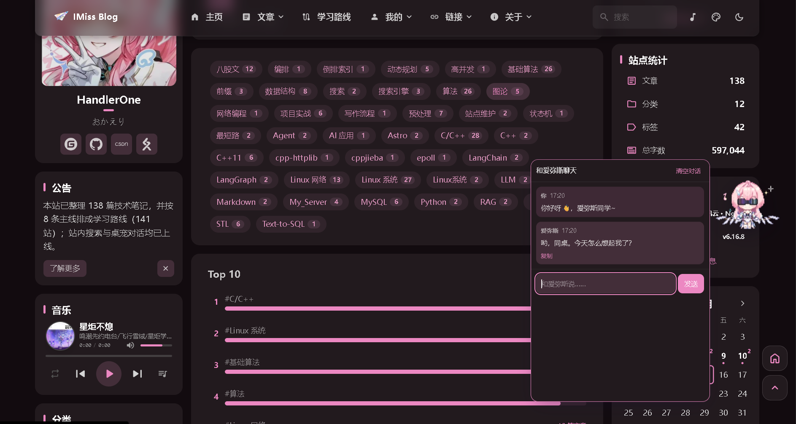

<div align="center">

<a href="https://imissblog.cn/">
  
</a>

<h1>IMiss Blog</h1>

<p><b>爱弥斯的小站 · 把学过的知识，写成可以再次出发的路。</b></p>

<p>以《鸣潮》角色爱弥斯为主题的个人技术博客，记录 C/C++、Linux、算法与 AI 应用。</p>

<p>
  <a href="https://astro.build/"></a>
  <a href="https://svelte.dev/"></a>
  <a href="https://www.typescriptlang.org/"></a>
  <a href="./LICENSE"></a>
</p>

<p>
  <a href="https://imissblog.cn/"><b>访问网站 ↗</b></a>
  &nbsp; · &nbsp;
  <a href="https://imissblog.cn/roadmap/">探索学习路线</a>
  &nbsp; · &nbsp;
  <a href="https://imissblog.cn/about-site/">关于本站</a>
</p>

</div>

---

<p align="center">
  <a href="#网站预览">网站预览</a> ·
  <a href="#功能亮点">功能亮点</a> ·
  <a href="#快速开始">快速开始</a> ·
  <a href="#项目结构">项目结构</a> ·
  <a href="#开发与维护">开发与维护</a>
</p>

## 网站预览

<a href="https://imissblog.cn/">
  
</a>

<p align="center"><sub>首页 · 动态壁纸、技术笔记与爱弥斯的日常陪伴</sub></p>

<table>
  <tr>
    <td width="50%">
      <a href="https://imissblog.cn/roadmap/">
        
      </a>
    </td>
    <td width="50%">
      <a href="https://imissblog.cn/tags/">
        
      </a>
    </td>
  </tr>
  <tr>
    <td align="center"><b>学习路线</b><br /><sub>从基础到实战，把零散的笔记连成路径。</sub></td>
    <td align="center"><b>AI 桌宠</b><br /><sub>页面里的爱弥斯，随时可以打开聊天面板。</sub></td>
  </tr>
</table>

> 以上为网站实景截图，分别展示首页、学习路线与 AI 桌宠；壁纸会随时段和轮播切换，实际画面以[线上站点](https://imissblog.cn/)为准。

## 功能亮点

| | 这里有什么 |
| --- | --- |
| 📚 **技术笔记** | C/C++、STL、Linux、网络、MySQL、算法与 AI 应用，支持分类、标签、归档和全文搜索。 |
| 🧭 **学习路线** | 按「主线 → 阶段 → 篇目」串联文章，方便从头学习，也方便回头查漏补缺。 |
| 💬 **AI 桌宠** | 爱弥斯像素桌宠支持拖动、互动和聊天，连接独立的 LangGraph 博客助手。 |
| 🌸 **动态壁纸** | 视频背景、手动切换与多种展示模式，配合主题色和明暗外观。 |
| 🎵 **个人空间** | 音乐盒、动态、项目展示、相册和书签导航，记录学习之外的日常。 |
| ✍️ **Markdown 写作** | 文件即内容，支持代码高亮、数学公式与图表；静态构建，交互按需加载。 |

<p align="center"><b>138 篇技术笔记</b> &nbsp; / &nbsp; <b>8 条学习主线</b> &nbsp; / &nbsp; <b>141 个停靠点</b></p>
<p align="center"><sub>内容概况截至 2026-10-15，后续更新以网站为准。</sub></p>

## 快速开始

需要 **Node.js ≥ 22.23** 和 **pnpm 11.x**。仓库声明的包管理器版本为 `pnpm@11.22.0`。

```bash
git clone https://github.com/HandlerOne01/imiss_-blog.git
cd imiss_-blog
pnpm install --frozen-lockfile
pnpm dev
```

打开 **<http://localhost:4321/>** 即可预览。依赖下载较慢时，可将安装命令替换为：

```bash
pnpm install --frozen-lockfile --registry=https://registry.npmmirror.com
```

<details>
<summary><b>构建、预览与搜索索引</b></summary>

```bash
pnpm build       # 生成静态站点和搜索索引
pnpm preview     # 预览生产构建
```

开发服务与生产预览默认使用同一端口，请先停止其中一个再启动另一个。开发模式需要真实搜索结果时，先完成构建，再运行 `pnpm index:dev`。

前端可独立运行；桌宠的真实对话依赖单独部署的 Agent 服务。未连接后端时会使用本地台词，接入方法见 [ARCH.md 第 8 章](./ARCH.md)。

</details>

## 项目结构

```text
imiss_-blog/
├── src/
│   ├── assets/                  # 图片、图标、字体等构建资源
│   ├── components/              # 页面组件、功能组件与桌宠
│   ├── config/                  # 站点配置入口
│   │   ├── siteConfig.ts        # 站点信息、主题与页面开关
│   │   ├── navBarConfig.ts      # 顶部导航
│   │   ├── roadmapConfig.ts     # 学习路线与篇目顺序
│   │   ├── backgroundWallpaper.ts # 壁纸与背景模式
│   │   ├── petConfig.ts         # 桌宠形象、动作与聊天面板
│   │   └── agentConfig.ts       # Agent 地址与连接配置
│   ├── content/
│   │   ├── posts/              # Markdown 技术文章
│   │   ├── projects/           # 项目展示
│   │   ├── dynamic/            # 短动态
│   │   └── spec/               # 关于等独立页面内容
│   ├── layouts/                # 页面布局
│   ├── pages/                  # 路由与页面
│   ├── styles/                 # 全局与模块样式
│   ├── types/                  # TypeScript 类型
│   └── utils/                  # 搜索、内容与 Agent 等工具
├── public/                     # 原样发布的图片、视频、音乐等
├── agent/                      # 爱弥斯人设与研究资料
├── server/                     # 桌宠 Agent 的同源网关
├── deploy/                     # Nginx、服务配置与发布脚本
├── scripts/                    # 内容处理、构建与验收工具
├── design/                     # 纸飞机标识、头像等设计源文件
├── docs/                       # 设计记录、参考文档与 README 截图
├── astro.config.mjs            # Astro 构建配置
├── ARCH.md                     # 架构、接口契约与技术约定
├── prd.md                      # 需求与验收标准
└── PROJECT_STATUS.md           # 项目进度与待办
```

### 常用配置

| 想做什么 | 从哪里开始 |
| --- | --- |
| 修改站点名称、描述、主题色 | [`src/config/siteConfig.ts`](./src/config/siteConfig.ts) |
| 调整导航和侧栏组件 | [`navBarConfig.ts`](./src/config/navBarConfig.ts) · [`sidebarConfig.ts`](./src/config/sidebarConfig.ts) |
| 更换壁纸、头像和个人资料 | [`backgroundWallpaper.ts`](./src/config/backgroundWallpaper.ts) · [`profileConfig.ts`](./src/config/profileConfig.ts) |
| 新增文章或维护学习路线 | [`src/content/posts/`](./src/content/posts/) · [`roadmapConfig.ts`](./src/config/roadmapConfig.ts) |
| 调整桌宠与 AI 连接 | [`petConfig.ts`](./src/config/petConfig.ts) · [`agentConfig.ts`](./src/config/agentConfig.ts) |
| 发布到服务器 | [`deploy/README.md`](./deploy/README.md) |

## 开发与维护

| 文档 | 内容 |
| --- | --- |
| [架构说明](./ARCH.md) | 模块设计、Agent 契约与配置约定 |
| [需求说明](./prd.md) | 功能边界与验收标准 |
| [项目状态](./PROJECT_STATUS.md) | 当前进度、已知问题与待办 |
| [部署指南](./deploy/README.md) | 构建发布、Nginx 与服务配置 |
| [站内维护手册](https://imissblog.cn/posts/project/boke-shiyong-yu-weihu-shouce/) | 文章、动态、项目和素材的日常维护 |

<details>
<summary><b>展开完整开发与维护说明</b> · 启动、写作、内容迁移、壁纸、桌宠与验收</summary>

以下保留原 README 中的操作说明。涉及环境、数量或历史版本的细节，请结合当前配置与 [项目状态](./PROJECT_STATUS.md) 阅读。

### 环境要求

| 工具 | 要求 | 当前开发机 |
| --- | --- | --- |
| Node.js | ≥ 22.23 | v24.16.0 ✅ |
| pnpm | 11.x（仓库声明 `pnpm@11.22.0`） | 11.24.0 ✅ |

> 包管理器由 `preinstall` 脚本强制为 pnpm；`pnpm-workspace.yaml` 里已允许 `esbuild` / `workerd` 的构建脚本。

### 我自己怎么把它跑起来（手把手）

#### 第 0 步：打开一个终端，进到本目录

在文件资源管理器里打开 `D:\HuaweiMoveData\Users\HUAWEI\Desktop\imiss_-blog`，
在地址栏输入 `powershell` 回车（或右键空白处 →「在终端中打开」）。
确认当前目录正确：

```powershell
pwd    # 应输出 D:\HuaweiMoveData\Users\HUAWEI\Desktop\imiss_-blog
```

#### 第 1 步：装依赖（**只需一次**，装过就跳过）

```powershell
pnpm install --frozen-lockfile --registry=https://registry.npmmirror.com
```

不加镜像会失败（本机直连 npmjs 只有 32–46 KiB/s，会超时）。

#### 第 2 步：起开发服务器（日常就用这个）

```powershell
pnpm dev
```

等它打印出 `Local http://localhost:4321/`（约 10 秒），然后：

- 浏览器打开 **http://localhost:4321/**
- 改动 `src/` 下任何文件都会**自动刷新**，不用重启
- 想用手机看（同一 WiFi）：`pnpm dev --host`，它会多打印一行 `Network http://192.168.x.x:4321/`，手机就访问这个地址
- **停止：在这个终端窗口按 `Ctrl + C`**

#### 第 3 步（可选）：看"上线后的样子"

`pnpm dev` 是开发模式，和最终产物不完全一样。想看真实产物：

```powershell
pnpm build      # 产出 dist/，约 1–2 分钟，全程不需要外网
pnpm preview    # 用 dist/ 起本地服务，同样是 http://localhost:4321/
```

`dev` 和 `preview` **占同一个端口，不要同时开**。端口冲突时：`pnpm dev --port 4322`。

#### 第 4 步（可选）：跑一遍验收脚本

它会自己开一个无头 Chrome，把需求逐条断言一遍，并截图到 `reports/screenshots/`：

```powershell
pnpm build        # 先构建（脚本要读 dist/ 与 sitemap）
pnpm preview      # 另开一个终端窗口跑这个并保持运行
pnpm verify:ui    # 再另开一个终端窗口跑这个
```

期望输出：`功能断言 343 项：✅ 通过 <N>，❌ 失败 0，⏭️ 跳过 <M>`。
> ⚠️ **只有总数「343」是稳定的**：`<N>` 与 `<M>` 会随环境摆动（历轮实测跳过数在 **0~5** 之间）。
> **总数与 Agent 后端在不在无关**（v1.62 起）：真机那 4 格后端没起时**照样注册**、只是记 ⏭️ 跳过，
> 所以 `verify:docs` 的「断言条数」门不会因为后端没起而变红。
> 要真后端往返的 `R-AGT-08`（`interrupt` 续跑）在后端自己的文章库不可用时会**合规跳过**，
> 并在下面单独打一行"本轮 N 项没有执行"——**跳过不等于通过**。
> **权威口径永远看 `reports/verify-ui.log` 的汇总行**（这里不写死那两个数，正是为了让文档不跟着漂）。
若输出 `检测到 astro dev 服务器` 的提示，说明你对 `pnpm dev` 跑了它——
那会把"关闭页面"等断言误判，请改成对 `pnpm preview` 跑。

再跑**内容校验**（不依赖浏览器，几秒钟出结果）：

```powershell
pnpm verify:posts   # 期望输出：`✅ verify:posts 通过：138 篇 0 错误、5 个警告`（有错误则退出码 1）
```

改了**文章正文里的图片引用**（尤其是又做了一次"外链图转存到站内"）时，另跑一次**图片外链自检**（v1.104 新增；三重核对：正文还剩哪些第三方图床引用 / 迁移进来的文件在 `dist/` 里在不在且字节一致 / 有没有本地路径成了没人引用的孤儿；**退出码就是结论**）：

```powershell
node scripts/verify-b13-images.mjs  # 期望输出：`AUDIT OK: every remaining hotlink is an explained download failure`（退出码 0）
node scripts/b13-census.mjs         # 想重算"改前 / 改后"两份外链数字时用它（写 reports/_b13-census.json）
```

> ⚠️ **它不把条数写死**：判据是"**剩下的每一处第三方图床引用，都必须在 `reports/_b13-mapping.json` 里有对应的下载失败记录**"——所以将来若又删掉几张源图，它不会假红，而是让你在映射表里补一条理由。
> **v1.104 的实测结果**：改前 10 篇共 **230 处**正文图片外链 / **226 个**去重 URL → 转存 **226 张正文图**到 `public/images/posts/<slug>/`（含 3 个徽章共 229 个文件），**剩 4 处**（`labuladong.gitee.io` / `segmentfault.com` / `s2.loli.net` 均 404、`upload-images.jianshu.io` TLS 证书不匹配 —— 源图在对方那里已经没了，按"不许为了好看而删引用"的口径原样保留）。

跑完界面验收后，再跑一次**文档自检**（它拿上面这次实测的数字当基准，核对三份文档有没有跟着更新）：

```powershell
pnpm verify:docs    # 期望输出：`文档检查 15 项：通过 15，失败 0`（有 FAIL 就是文档与仓库对不上了）
```

改了**桌宠 Agent 那一层**（`server/pet-gateway.mjs` / `deploy/nginx.conf`）时，另跑一次**网关自检**（它自己起网关实例 + 自带 stub 上游，不需要你先手工起什么；真后端没起时那 4 项会跳过且不影响退出码）：

```powershell
pnpm verify:gateway # 期望输出：`网关检查 51 项：通过 51 / 失败 0 / 跳过 0`（退出码 0）
```

> 它会拦下这类问题：改了导航/路由/数据，但 `prd.md`、`ARCH.md`、`PROJECT_STATUS.md` 里还写着旧数字或旧清单。
> 共 15 项检查（**原 17 项** —— v1.41 删掉排行模块时摘掉了两条排行专属检查）。
> 其中第 11 项「文件编码」查的是**受版本控制的文本文件不带 UTF-8 BOM**：**v1.56 起按内容判文本**（`git ls-files` 全量、逐个读前 8KB、含 NUL 字节即跳过二进制），所以 `.sh` / `.ps1` / `.conf` / `.service` 这类不常见扩展名与 `.gitignore` / `LICENSE` 这类**无扩展名**文件都在扫描面内；改之前它只认扩展名白名单，**漏掉了 18 个真文本文件**。

#### 常见问题

| 现象 | 原因 / 解决 |
| --- | --- |
| `pnpm: 无法将"pnpm"项识别为…` | 没装 pnpm：`npm i -g pnpm` |
| 安装依赖卡住/报 `ETIMEDOUT` | 忘了加 `--registry=https://registry.npmmirror.com` |
| 启动报端口被占用 | 上一台的窗口还开着；关掉它，或 `pnpm dev --port 4322` |
| `pnpm dev` **启动时**抛 `transport invoke timed out after 60000ms`（`{"name":"fetchModule"}`）后退出码 1 | **上游 Vite 的已知缺陷，不是本站代码的问题**（v1.110 查清，见 `ARCH.md` §14.3 **T93**）：这个 invoke 的超时是 `transport.timeout ?? 6e4` = **60 秒写死**（没有对外开关），而且**超时会被当成模块结果缓存住**（`cachedRequest` 保留被 reject 的 promise）→ 该进程再也恢复不了（vitejs/vite **#23131**，修复 PR **#23132 尚未合并**；withastro/astro **#15101** 已按 upstream 关闭）。本机空载实测：**热启动 5.2~5.8 秒 / 冷启动 37.0 秒**（删掉 `.astro` + `node_modules/.vite` 后；其中 `[content] Syncing content` 一项占 32 秒）—— 空载就用掉 60 秒额度的 **62%**，机器一忙（PyCharm 索引 / Defender 扫盘 / 旁边跑 `pnpm build`、`verify:ui`）就会翻过去。**v1.110 起 `pnpm dev` 自带自愈**：检测到这句话就自动清掉 `.astro` + `node_modules/.vite`（两份可再生缓存）**再起一次**，你不用手动重试。⚠️ 若要排查包装本身的问题，用原样入口 `pnpm dev:raw`；若日志里是 `Failed to run dependency scan`，那是另一码事（**T89**） |
| 换了 `pnpm dev --port 4322` 之后启动明显变慢（多等半分钟） | **`--port` 会改 Astro 配置摘要 → 清空内容缓存 → 多付一次 32 秒的全量内容同步**（v1.110 实测，见 **T93** 第 3 条）：`content-layer.js` 把"除 `vite`/`integrations`/`adapter` 之外的整个配置"做摘要存进内容库，端口一变摘要就变。**建议**：端口被占时优先**关掉占用它的那个窗口**；确实要用别的端口，就一次连着用完，别在两种启动方式之间来回切 |
| ~~现在**还没有**真实内容~~ **（v1.97 更正：这一行早就过期了）** | 站上现在真的有：**138 篇文章 / 8 条主线 141 站的学习路线 / 4 个项目 / 1 条动态 / 相册 9 张原图 / 书签 6 组 39 个 / 3 首音乐 / 会聊天的桌宠（连不上后端时走本地台词）**；评论区与留言**明确不做**（v1.89）。仍然空着的是**番剧 / 轻小说两页的开关**（要 MAL 的 `username`+`Client ID` 与 VNDB 的 `userId`，阻塞项 **B-05**），以及「按北京时间选首屏素材」（**R-BG-06**，等时段规则）—— 都在 `PROJECT_STATUS.md` §4 |

### 常用命令

| 命令 | 作用 |
| --- | --- |
| `pnpm dev` / `pnpm start` | 本地开发（默认 4321 端口）。**v1.110 起带自愈**：撞上 Vite 那句 `transport invoke timed out after 60000ms`（上游已知缺陷）会自动清掉 `.astro` + `node_modules/.vite` 两份可再生缓存再起一次；想跑原样的 `astro dev` 用 `pnpm dev:raw` |
| `pnpm check` | Astro 诊断（类型 / 内容 / 模板错误） |
| `pnpm type-check` | `tsc --noEmit`，覆盖 `src/` 与 `scripts/` |
| `pnpm build` | 生产构建：LQIP → VNDB 封面（未配置则跳过）→ Astro → 清理未用看板娘资源 → 字体子集 → 内联脚本压缩 → Pagefind 索引 |
| `pnpm index:dev` | 把**生产搜索索引**（`dist/pagefind/`）复制到 `.dev/pagefind/`，供 `pnpm dev` 下的站内搜索使用（dev 与 preview 同一份索引；改了文章要 `pnpm build` 后再跑一次） |
| `pnpm verify:search` | **搜索自检**（7 项）：索引可达 + 页面接线就绪 + 真机输入四组中英查询都出结果 + 不出现模板的英文假结果；`--base` 指 dev(4321) 或 preview(4323) |
| `pnpm preview` | 预览 `dist/` |
| `pnpm verify:ui` | 界面验收：343 项断言 + **上游身份零残留全产物扫描**（v1.47 起从"4 条路由抽样"升级为 `dist/**/*.html` 逐个扫；**v1.49 起扩到 `dist/**` 全部 799 个产物文件 + 文件名/路径**，二进制按"含 NUL 字节"跳过内容但照查文件名；**v1.51 起零例外** —— 关于页那个例外已删除，并新增"搜索索引里也搜不到上游字样"4 条；**v1.57 起再加 14 个隐私/排除项串的泄漏守卫**；**v1.58 起书签页图标换成各站官方图标 + 官方品牌色，11 张本地 favicon 走站内 `/booknav-icons/`，并断言深色下对比度 ≥ 3:1**；**v1.59 起桌宠默认档改成 `fixed`（完全静止），断言里默认档那三条走"清掉位置记忆后重载"、`float`/`ground` 走强制切档**；**v1.60 起新增"模板示例公告文案"守卫：负控扫模板示例串、正控要求公告卡内逐字含正式文案**；**v1.61 起「链接」下拉换成发起人的 6 条：断言按新清单钉「名字 + href + 顺序」，并另有一条配置层判据钉住「6 条地址都无查询串 / 裸 IP 那条按原样收录 / 注释里留了换 `https://<域名>/` 的建议」**；**v1.62 起「功能断言总数」与 Agent 后端在不在**无关**（修：R-AGT 端到端②段那 4 格原来被 `if (!probe)` 挡着、后端没起时**根本不注册** → 总数 294→290、`verify:docs` 的计数门假红；现在永远注册同样多的格数、后端没起只记 ⏭️ SKIP，另 2 格与后端无关永远真跑），并新增 1 条 `UNIT-AGT` 自检把该段的「格数 + 编号 + 顺序」钉成常量 → **总数 294 → 295**（`README`/`ARCH` §11/`PROJECT_STATUS` §1 四处同步）**；**v1.63 起恢复音乐播放器（导航 + 侧栏两个入口都开，歌单是发起人的《别难过》）：R-ID-06 那 3 条「播放器已关闭」的断言**就地翻成「已开启」**（拆成 6 格：两个入口各一格 + 产物里 localPlaylist 一格 + mp3/封面字节数与 HTTP 200 一格 + 浏览器里真拿到曲目一格 + 配置层 5 字段一格）→ **总数 295 → 298**（`README`/`ARCH` §11/`PROJECT_STATUS` §1 四处同步）**；**v1.64 起站点标识与头像换装**：发起人给的两张素材按分工落地 —— **小图标（导航栏 28px + 浏览器标签 32px）= 纸飞机**，**大图标（favicon 128/180/192）与侧栏资料卡头像 = 爱弥斯人物插画**；新增 5 条**真浏览器读像素**的判据（32px 透明带与 ≈1.35:1 包围盒 / 导航栏 logo 固有尺寸 256×190 / 180·192 满幅不透明方图 / 侧栏头像与大图标**同源**（8×8 指纹平均差 < 15）而与小图标**不同源**（负控 > 40））；另加 1 条**资料卡头像悬停**判据（v1.64 按发起人要求去掉悬停浮出的名片图标：头像链接内 0 个 svg、压暗层 0 子元素、真鼠标/强制 `:hover` 下底色确实变深、且**产物里也搜不到那个图标名**）→ **总数 298 → 301 → 303 → 304**（四处同步）**；**v1.67 起手机端也看得到桌宠**（`hideOnMobile: false`）且走**手机档缩放**（0.62 → 精灵 89px，桌面 0.86 → 124px；顺带修掉一个从 P3 起就没生效过的手机档样式 —— 内联 `--pet-scale` 压住了 `@media`，登记 T90），右键菜单按发起人要求改成「和爱弥斯聊天 / 落下去·飘起来 / 关闭」：**「关闭」= 缩成很小一只（124 → 62px，比待机还小）、双击恢复**，迷你期间不气泡不自动活动；新增 R-PET-12 三条（CSS 断点 = `mobileBreakpoint − 1` / 390 冷启动真实像素与 1440 对照 / 1440→390 resize 立刻切档）与 R-PET-13 五条（真机点「关闭」后 124→62px、脚底锚点不动、迷你时单击不说话、真双击恢复、菜单末项文案跟着状态走）→ **总数 308 → 317**（四处同步）**；**v1.68 起聊天框支持「点外面就关」**：点`面板与角色之外`的任意处即关框（面板里面、以及**点角色本體**都不关）—— 原先手机上**关不掉**（没有 Esc、面板里也没有关闭按钮）；顺带修掉"点角色会把面板 DOM 冲掉"的真缺陷（`say()` 加 `chatOpen` 闸门），并新增 3 条真机断言（点空地关 / 点面板里不关 / 点角色不关且面板完好）→ **总数 317 → 320**（四处同步）**；**v1.70 壁纸换成动态壁纸**：发起人给的 5 支原画（2944×1248 / 10 秒 / 合计 51.34 MB）**按字节原样**放 `public/assets/wallpaper/`，静态图与 LQIP 一并删除；断言在**产物里**核对 5 支的字节数 + sha256（"不可压缩"是他的硬要求）、验"在播 + loop + muted + 原生分辨率"、**在页面里真解码首尾帧**算接缝差（≤ 该素材 1 秒的正常运动量）、验三种降级（减少动态 / 省流量 `saveData` / 切后台 `visibilitychange`）；取景不再钉死 `object-position`，而是**按当前框反算**把人物锚点顶到窗口里（手机横幅横向只剩 30%，脸仍在窗口正轴）→ **总数 320 → 329**（四处同步）**；**v1.74 三种壁纸模式都能换壁纸**：全屏壁纸与透明覆盖下也支持双端左右滑动 + 电脑端点击切换（透明覆盖那条尤其关键 —— 壁纸层在 z-index:-1，指针到不了 wrapper，原来的拖动监听在那模式下等于没绑；原来拖动改 document 级、并新增"点空白换下一张"）→ **总数 329 → 331**（四处同步）**；**v1.83 顶层「留言」换成「关于」下拉 + 删除留言功能**：新增 1 条「关于两个子项」断言、R-CMT 两条就地换口径（条数不变）→ **总数 331 → 332**（四处同步）**；**v1.73 取景逐支可调**：`video.playlist` 每一项可加 `focusAnchorX`（水平落点）/ `focusAnchorY`（垂直落点）/ `zoom`（放大）——手机端高度是约束、垂直没有余量，所以"让人物下沉"要靠 zoom（会裁掉下缘）**；**v1.72 全屏壁纸改 cover（铺满整屏）**：v1.70 那版是 contain（画面缩在中间一条 + 上下模糊垫底），发起人指出「全屏不是这个意思，和 firefly 一样」→ 参照 firefly 的 `object-fit: cover` 改成铺满，取景仍按人物锚点反算（条数不变）**；**v1.71 修掉窄屏"横幅下面那块黑"**：窄屏壁纸框（65vh）与内容定位（`--banner-height-home` 80vh）**对不上**，横幅底边到内容顶边空出 77px 页面底色（+水波与渐变，暗色下连成黑板）→ 新增 `BANNER_HEIGHT_MOBILE` 单一事实来源，两处都读它（条数不变）**；**v1.69 菜单末项「关闭」改名「缩小」**（只改字面：跟随改 4 个 `same(…)` 数组、3 处 `label ===` 比对与 `realMenuClick` 的实参，**条数恒 320**；同轮明确**不做**「×」关闭按钮）**）+ 对比度 A/B + **90 张截图**（**要先 `pnpm build` 再 `pnpm preview`**） |
| `pnpm verify:chat-text` | **聊天文本清洗的纯函数守卫（11 项，不依赖浏览器、毫秒级）**：有序列表必须保留序号（后端「回序号就行」的前提）、无序列表仍换成 `·`、`1)` 归一成 `1.`、幂等、粗体/链接/标题/表格/围栏原兜底不退化；**另有 5 条站内链接切段**（`/posts/…` 要能被切成可点链接、完整域名不切出半截链接、拼回与原串逐字相同）。⚠️ 它存在的原因：`verify:ui` 的桌宠段用**假后端 + 固定台词**，判据里没有"有序列表 / 站内链接"这两种形态 —— 2026-10-12 序号被吃掉那个线上 bug 就是这么漏过去的 |
| `pnpm verify:posts` | 内容校验：frontmatter / slug / 图片存在性 / 站内链接 / 残留 Obsidian 语法（**改完文章或跑完迁移后跑一次**；有错退出码 1） |
| `pnpm verify:b13` | **图床守卫（v1.107 新增，`scripts/verify-b13-images.mjs`）**：扫**全部 138 篇正文**里还剩下多少第三方图片外链、逐条与 `reports/_b13-mapping.json` 的失败清单对账（**允许清单 = 4 处"试过、下载不到、按规矩原样保留引用"**；徽章/CI 装饰 `img.shields.io` / `travis-ci.org` 不计），再核 `dist/` 里 229 个已入库文件都在且字节一致、每个本地路径都真的被正文引用。**有未登记的外链或有文件对不上就退出码 1**。同一个口径另有一条断言落在 `pnpm verify:ui` 里（`B-13`，扫产物 HTML）—— 独立脚本没人跑就永远绿，所以两边都要有 |
| `pnpm verify:docs` | 文档自检：核对三份文档与仓库事实是否一致（版本号、断言/截图数、模块路由清单、导航子项、需求编号、阻塞项、阶段状态、**文件编码**），**共 15 项（原 17 项）**。**改完东西收工前跑一次** |
| `pnpm verify:gateway` | 网关自检（v1.45 / P5-5 新增，**51 项**）：自己起网关实例 + 自带 stub 上游，验路由白名单 / 来源 403 / 限流 429 / 长度与体积闸门 / **SSE 不缓冲** / 超时收口 / 日志不泄漏，最后对真后端跑一遍契约序列（**没起后端时那 4 项 ⏭ 跳过，退出码仍 0**） |
| `node server/pet-gateway.mjs` | 起桌宠 Agent 网关（**零依赖同源反代**，默认 `127.0.0.1:8787` → 上游 `127.0.0.1:2024`）；`--help` 看全部环境变量。生产配置见 `deploy/README.md` |
| `node scripts/import-posts.mjs --batch 1` | 迁移旧博客笔记（**默认 dry-run 只出报告**；加 `--write` 才落盘。详见下面「迁移旧笔记」一节） |
| `node scripts/convert-wallpaper.mjs` | 把 `dosc/photo` 的 4 张壁纸转成 webp（桌面 + 移动两套），改壁纸素材时用 |
| `pnpm make:logo` | 从 `design/` 下两张设计源出图：**纸飞机**（`imiss-logo.png`）→ 导航栏 Logo 与 32px 标签页图标；**人物插画**（`imiss-avatar.png`）→ 128/180/192 大图标 + 侧栏头像 |
| `node scripts/verify-b13-images.mjs` | **图片外链自检**（v1.104）：正文剩余第三方图床引用 / `dist/` 里的本地图片是否存在且字节一致 / 有无孤儿路径；**剩的每一处都必须在 `reports/_b13-mapping.json` 里有下载失败记录**，否则判红（退出码 1）。改完正文图片引用后跑一次 |
| `node scripts/b13-census.mjs` | 重算"改前（`git HEAD`）/ 改后（工作区）"两份外链图片数字（同一个函数算两遍），写 `reports/_b13-census.json` |
| `pnpm format` / `pnpm lint` | Biome 格式化 / 检查并安全修复（`biome … --write ./src ./scripts`）。⛔ **本项目不要跑这两条**：它会改写 `scripts/verify-ui.mjs` 里 CDP 模板字符串中的正则并顺带重排十几个无关文件（陷阱 T75，见 `ARCH.md` §14.3）。要保格式只对动过的文件跑 `npx biome check <files>` |
| `pnpm new-post` | 新建文章脚手架 |
| `pnpm lqips` | 重新生成 `src/constants/lqips.json`（图片占位色） |

**构建不依赖外网**：字体走本地文件（`src/assets/fonts/`，**不要**改回 `fontsource`/`npm` 等远端 provider，它们会在构建期访问 jsdelivr 并直接失败）；VNDB 封面下载保持关闭；番剧页（MyAnimeList）在未配置凭据时整段跳过；GitHub 卡片步骤失败会回落已提交的缓存。因此断网也能 `pnpm build`。

> ⚠️ **v1.104 补上了一个曾经的例外**：文章正文里的**外链图片**本身不参与构建，但 `/og/*` 那一层在本机到 `cdn.jsdelivr.net` 的 TLS 被重置时曾把整条 `pnpm build` 拖挂（v1.102 / v1.103 两轮只能**临时关掉 `generateOgImages`** 才跑完）。八股那批的 **226 张正文图已转存到站内** `public/images/posts/<slug>/`（正文改相对路径）之后，构建与访客访问都不再依赖别人的图床 —— 见上面「图片外链自检」与 `PROJECT_STATUS.md` §4 的 B-13 行。

### 目录说明

目录树与常用配置入口见上方[项目结构](#项目结构)。`agent/` 保存人设资料，独立 Agent 服务的接入见 `ARCH.md` 第 8 章；部署文件位于 `deploy/`。

### 写一篇文章

在 `src/content/posts/` 下新建 `.md`，frontmatter 至少要有：

```yaml
---
title: 文章标题
published: 2026-09-24
description: 一两句摘要，会出现在卡片与搜索结果里
category: Linux系统        # 对应归档/分类页
tags: [Linux, 进程]
---
```

文章内的图片放在 `public/images/posts/<slug>/`，正文里用绝对路径引用：

```md

```

> 为什么不放 `src/assets/`：文章图片数量大，进构建期图片优化管线会显著拖长构建时间；只有壁纸、封面、桌宠图集这些少量图才交给 Astro 优化。

### 迁移旧笔记（Obsidian → 本站）

旧笔记放在 `D:\HuaweiMoveData\Users\HUAWEI\Desktop\my_-blog\dosc\blog`（**全程只读，脚本绝不改源文件**）。迁移脚本会把每篇转成带 frontmatter 的文章、把配图复制进 `public/images/posts/<slug>/` 并把正文里的引用改写成站内路径。

```powershell
node scripts/import-posts.mjs --batch 1          # 先看报告（dry-run，不落盘）
node scripts/import-posts.mjs --batch 1 --write  # 确认没问题再落盘
node scripts/import-posts.mjs --cat Linux系统 --write   # 只迁某一个分类
node scripts/import-posts.mjs --only 缓冲区 --write     # 只迁文件名含「缓冲区」的
pnpm verify:posts                                # 落盘后校验
```

| 参数 | 作用 |
| --- | --- |
| （不加参数） | 全量 dry-run，只打印计划与警告 |
| `--write` | 真正写文件（**不加就一个字节都不写**） |
| `--batch 1..5` | 按批次迁（1 = 已定型的 18 篇；2 = C++11+C与C+++STL；3 = Linux系统+linux网络+MySQL；4 = 基础算法+AI应用；5 = 八股+项目） |
| `--cat` / `--only` / `--limit` | 按分类 / 路径子串 / 数量筛选 |
| `--src` | 换源目录（默认就是上面那个） |

**图片怎么对上号**：脚本**只按文件名精确匹配**（先在本篇文章的图片目录里找同名，再退化到"全库唯一同名"），**不会按顺序硬凑**——源笔记 258 条本地引用里 116 条能本目录同名命中、4 条全库同名命中、2 条确实没文件。匹配不到的引用会变成 `> [!WARNING] 原图缺失：xxx` 提示块并记进 `reports/import-report.json`；整篇一张图都找不到时该篇 `draft: true`（不上线）。每次落盘还会写 `reports/image-mapping-<slug>.json`（哪张原图 → 哪个 `NN.png`）。

**它会替你处理的 Obsidian 语法**：文首标签行 `#标签`（转成 frontmatter 的 `tags` 并从正文摘掉）、行内 `#标签`、`![[图片]]`、`![[]]` 之外的 `[[双链]]`（按标题索引改写成站内链接，解析不到的原样保留）、相邻两行图片之间补空行（否则会被解析进同一个段落并排显示）。`==高亮==` **不会**被改写——本语料里 `==` 全是 C++ 相等比较。


### 怎么换壁纸 / 加壁纸

壁纸配置在 `src/config/backgroundWallpaper.ts`：

| 想做什么 | 怎么做 |
| --- | --- |
| 换/加图片 | 图片放进 `src/assets/images/DesktopWallpaper/`（桌面）与 `MobileWallpaper/`（手机），然后往 `src.common.src.desktop` / `.mobile` 数组里加路径；**数组多于 1 张时**横幅两侧就会出现隐藏换图区 |
| 调整构图 | `banner.position`（现在是 `50% 35%`：水平居中、纵向略偏上保面部）与 `common.dimOpacity`（暗罩，现在是 `0.2`）——只改配置，不用碰代码 |
| 横幅高度 / 画面被裁 | `src/constants/constants.ts` 的 `BANNER_HEIGHT` + `BANNER_HEIGHT_EXTEND`（现在 45+35 = **80vh**）。框越矮，`object-fit: cover` 裁掉的画面越多：65vh 时只看得到 76% 的高度，80vh 时 95% |
| 画质 | **原图直出、不要自己重压**：素材原样放进 `src/assets`，压缩只交给构建管线；壁纸单独用 `WALLPAPER_QUALITY = 95`（在 `WallpaperSection.astro`）。自己先转一道 webp 再让 Astro 压一道 = 两代有损压缩，会明显发糊（踩过） |
| 关掉手动换图 | `banner.manualSwitch.enable = false`（完全回到模板原有行为） |
| 只关某一侧的行为 | `manualSwitch.zones`（桌面两侧交互区）/ `manualSwitch.drag`（拖动换图）/ `manualSwitch.dragThreshold`（拖动阈值，默认 60px） |
| 从原始素材重新转 webp | `node scripts/convert-wallpaper.mjs [--src <目录>]`（把 `dosc/photo` 那批转成桌面/移动两套 webp） |

**怎么用**：桌面端鼠标移到横幅**最左/最右边缘**会淡出一个箭头，点它换上一张/下一张（可循环）；也可以**按住横幅左右拖**。
手机端不显示箭头，**左右滑动**换图。键盘：Tab 能聚焦到两侧箭头，按 Enter / 空格换图。

#### 桌宠怎么调

右下角那只爱弥斯是常驻组件（`src/components/features/AemeathPet.astro` + `src/styles/pet.css`），配置在 **`src/config/petConfig.ts`**：

| 想改什么 | 改哪里 |
| --- | --- |
| 开 / 关桌宠 | `petConfig.enable` |
| 怎么换壁纸 | 三种壁纸模式（横幅 / 全屏 / 透明覆盖）都支持：**桌面端**鼠标移到横幅左右两侧会浮出箭头，点一下就换；也可以按住横向拖动，或在全屏 / 透明覆盖下**点空白处**换下一张。**手机端**左右滑动即可。张数 = `video.playlist` 的长度（当前 6 支），循环。**进站默认放哪一支按北京时间选**（23–03 星夜 / 03–07 起床 / 07–11 洗手台 / 11–15 湖畔 / 15–19 窗边 / 19–23 塔罗；区间左闭右开，口径是 UTC+8、不看访客本机时区 —— 见 `video.order`）。要关掉某一路：`backgroundWallpaper.banner.manualSwitch` 的 `zones` / `drag` / `click`。⚠️ 高视口页面（≥1600px，比如本仓库的侧栏整页截图）在视频壁纸下会把渲染进程卡死 —— 验收脚本对那类页面在导航前屏蔽 mp4（见 ARCH §6.5 ⑤） |
| 横幅文案在哪改 | `src/config/backgroundWallpaper.ts` 的 `common.homeText`：`title` 是主标题（IMiss Blog），`subtitle` 是打字机轮播的那 5 句（**发起人 2026-10-09 亲自给定**，见配置里的注释）；轮换快慢看同一个配置里的 `typewriter`（`pauseTime` = 每句停留时长，**v1.82 起 8000ms**，改完跑 `node reports/_subtitle-selfcheck.mjs`，采样窗口要覆盖“每句 ≈11 秒”的节奏）。改完跑 `node reports/_subtitle-selfcheck.mjs` 自检（判据：横向不溢出 + 打字机真在轮播；手机/桌面各出一图）。⚠️ 最长一句 20 字，手机上靠模板自带的窄屏字号（14px）才放得下 —— 再加更长的句子要先看自检结果 |
| 人脸没对准怎么办 | `node reports/_wp-griddraw-v1105.mjs` 出一组**带百分比刻度的首帧**（`reports/_wp-grid-v1105/*-grid.png`）＋ `node reports/_wp-facezoom-v1105.mjs` 出**头部区域的 5% 细网格放大图**（`*-facezoom.png`，标签是**原图坐标**），在图上读脸中心，把 `video.playlist` 里那一支的 `focus` 改成读到的值；然后 `node reports/_mobile-selfcheck.mjs` 自检（**6 支** × 横幅/全屏 = **12 组**，判据是"人脸落在可见窗口内、左右各留 ≥6% 余量"；要先 `pnpm build` + `pnpm preview`，默认打 `127.0.0.1:4323`）。⚠️ **一次只改点名的那一支** —— v1.75 我曾按实测把五支全改了，发起人要求"其他图片位置不动"，已回退四支（实测值备查在 ARCH §6.5）；v1.105 换掉星夜时也是**先量后决定不动**。⚠️ 全屏壁纸的可见窗口只有原画 **20%** 宽 —— 值差 5% 脸就跑偏，别估，要读。⚠️ 那几支配色下**肤色蒙版整幅命中**（v1.70 的也一样），机器量只能给"人物在哪半幅"，**定脸必须目视核对细网格图**。桌面 Chrome 的 `FaceDetector` 有 API 但**没实现**（抛 not implemented），别走那条路 |
| 人物在画面里的位置怎么调 | `src/config/backgroundWallpaper.ts` 的 `video.playlist`，每一项三个旋钮：`focus`（人物锚点在原画里的位置，**先决定裁到哪**）、`focusAnchorX` / `focusAnchorY`（锚点落在展示框里的相对位置，默认 0.5 / 0.45）、`zoom`（放大系数，默认 1）。⚠️ 手机端框是竖的、片源是横的 ⇒ 高度是约束 ⇒ **整幅高度全可见、垂直没有可平移的余量**，"让人物下沉"只能靠 `zoom` 放大（下缘会被裁掉）。改完拿 `node reports/_tune-focus-shots.mjs` 出图看 |
| 背景壁纸在哪配 | `src/config/backgroundWallpaper.ts` 的 `video.playlist`（**有序清单**：数组顺序就是展示顺序）。加壁纸 = 往数组里加一项 + 出一张首帧海报（`node reports/_wallpaper-posters.mjs`），视频本身**放进去就别动它**——不转码是发起人的硬要求，`verify:ui` 会在产物里核对 sha256。`video.order` 支持 `first/random/sequence/time`，`timeRange` 字段是给"以后按时间排序"留的（那套逻辑还没写，见 prd R-BG-06）。想把图片壁纸装回来：填 `src.desktop/mobile` 并把 `video.enable` 关掉 |
| 手机上要不要 | `petConfig.hideOnMobile`（**现在 `false` = 手机上显示**；"解析期就不启动脚本"的机制仍在，改回 `true` 立刻生效） |
| 手机上的大小 | `petConfig.mobileScale`（视口 ≤ `mobileBreakpoint` − 1 时生效，现在是 `0.62` ≈ 89×97px）；桌面档是 `petConfig.scale`（`0.86` ≈ 124×134px）。⚠️ 只有这两个值不够 —— 组件内联的是**两档的值**，由 `src/styles/pet.css` 的媒体查询选档（内联变量会压过媒体查询，见 ARCH §14.3 **T90**），改断点必须同时改 `mobileBreakpoint` 与 CSS 里的 `767` |
| 大小 | `petConfig.scale`（1 = 单格 144×156 原始像素） |
| 出场靠哪边 / 台词 / 待机多久睡 | `petConfig.startSide` / `lines` / `greeting` / `idleSecondsToSleep` |
| **运动模式**（悬浮+飞行 / 固定 / 贴地） | `petConfig.movement.mode`：`"fixed"`（**默认**，不悬浮不飞行、拖放也不落地）/ `"float"`（悬浮 + 每 30~90 秒朝随机方向轻轻挪 60~180px）/ `"fixed"`（不悬浮不飞行、拖放也不落地）/ `"ground"`（贴地行走、松手落地） |
| 悬浮与飞行的手感 | `petConfig.movement` 的 `hoverAmplitude`（浮动幅度 px）/ `hoverPeriodMs`（周期 ms）/ `flyIntervalRange`（飞行间隔 ms，30~90s）/ `flyDurationRange`（单次飞行时长 ms，4~6s）；**位移/弧线/倾角**在 `src/utils/pet-utils.ts` 的 `PET_TUNING`：`flyDistanceRange`（单次位移 px，60~180）/ `flyArc`（弧线拱高 px）/ `flyTilt`（倾角 deg） |
| 右键菜单的位置 | `AemeathPet.astro` 的 `placeMenu()`：按**宠物矩形**并排在**左边或右边**（哪边够放哪边、默认右侧；间隙 `PET_TUNING.menuGap`、边距 `menuMargin`），纵向顶部对齐宠物顶部并夹回视口；摆好后用 `elementFromPoint` 抽 5 个点（中心 + 四角）确认没被遮挡 —— 被挡就换另一侧、两侧都被挡就纵向让开遮挡带，结果写进 `data-pet-menu-side` / `data-pet-menu-occluded` / `data-pet-menu-nudged`。R-PET-07 起不再用鼠标坐标当锚点，菜单必须带 `z-index`（= 宠物 `zIndex` + 1 = 67，低于导航栏 80 / 浮动控件 1000） |
| 右键菜单里有哪些项 | **和爱弥斯聊天** / **落下去 · 飘起来**（按档位二选一：悬浮/固定档显示「落下去」把宠物放回地面并**真的带重力掉下去**，贴地档显示「飘起来」飘回悬浮）/ 和爱弥斯聊天。「跟过来」「睡一会儿」（R-PET-08）与「跳一下」（R-PET-09，左键单击宠物就能跳）都已按发起人要求删除 —— **能力都没删**：键盘 ←/→ 仍能指挥它走、Enter 仍等价于左键单击（`role="button"` 的无障碍激活路径）、45 秒无操作它仍会进「屏幕待机」、`say()` 仍被左键单击与切档应答调用（v1.67 删的只是「说句话」这个入口） |
| 聊天框怎么关 | **点面板与角色之外的任意处**（v1.68 / R-PET-14，手机上唯一顺手的关框路径）、按 `Esc`、或切页。**面板里没有关闭按钮** —— 发起人 2026-10-08 明确「不加叉键，那个功能不要了」）。面板里面（输入框 / 历史 / 「↓ 最新」/「清空对话」）与**点爱弥斯本體**都**不**关框 —— 点她只是逗她跳一下 |
| 菜单最后一项是什么 | 菜单文案是「**缩小**」（v1.69 前写作「关闭」）。它**不是真的关掉**（v1.67 / R-PET-13）：把 `petConfig.miniFactor`（现在是 `0.5`）乘到当前档位上 —— 桌面 124 → **62px**、手机 89 → 45px（**比待机还小**）；迷你期间她不气泡、不自动活动、不进待机画面、切页也不挥手；**双击她本體就变回来**，菜单末项文案会跟着变成「叫醒她」。真要彻底关掉用 `petConfig.enable: false` |
| 跳 / 走的观感 | 跳是**原地动画**（R-PET-09）：跳跃那 0.7 秒里不叠加悬浮浮动、也不位移；悬浮档平时在 `±hoverAmplitude` 内上下浮动、每 30~90 秒自己轻轻飘一段（`petConfig.movement`） |
| 行为（走、跳、拖、说话、对话） | `AemeathPet.astro` 里的脚本；状态表在 `src/utils/pet-utils.ts` |
| 和它聊天 | 右键 →「和爱弥斯聊天」→ 在**底部**的输入框里说一句（回车发送）。**接得上后端就走真实 Agent**（`agentConfig.enable: true`，默认指向本机 `127.0.0.1:2024` 的 `langgraph dev`）；**接不上就走本地 mock 台词**（`petConfig.mockReplies`），不报错、不提任何内部信息 |
| 聊天框长什么样（R-PET-11） | 尺寸 / 思考中短句 / 折叠阈值都在 `petConfig.chat`：`width`·`height`（默认 **340×460**，窄屏按可用空间收窄、塞不下才改走宠物上下方）、`minWidth`·`minHeight`（收窄下限与上下兜底的高度下限）、`thinkingLines`（**至少 3 条**，默认 4 条，每 `thinkingRotateMs` 轮换）、`historyLimit`（历史条数上限）、`collapseChars`（超过多少字才折叠给「展开全文」） |
| 聊天框摆在哪 | `AemeathPet.astro` 的 `placeChat()` → **复用右键菜单那份 `placePanel()`**（同一份选边 + 5 点遮挡抽样 + 让位 + 四边夹回视口）：默认贴宠物左边或右边，右侧还要避开右下角浮动按钮列；摆位结果写进 `data-pet-chat-side`（`left`/`right`/`above`/`below`）/ `data-pet-chat-occluded` / `data-pet-chat-w` / `data-pet-chat-h` |
| 聊天框的文本口径 | 流式增量**不上屏**（只记字数），答复完成后由 `src/utils/pet-chat-text.ts` 的 `cleanMarkdown()` 整段清洗再上屏：`**粗**`/`# 标题`/表格 `\|`/`> 引用` 这些裸符号一个都不会漏给访客；用户自己那句话只压空白与长度 |

> **怎么改运动模式（R-PET-06）**：打开 `src/config/petConfig.ts`，把 `movement.mode` 改成 `"float"`（默认：悬浮 + 偶尔到处飞）/ `"fixed"`（固定：不悬浮不飞行、拖放也不落地）/ `"ground"`（贴地走、松手落地）三者之一，**不用改任何代码**；
> 飞行间隔 / 单次时长 / 浮动幅度与周期都在同一段 `movement` 里（默认 20~60 秒飞一次、单次 2.6 秒、上下浮动 ±6px）；`pnpm dev` 下改完自动生效，生产要重新 `pnpm build`。
> 浏览器里存的旧位置记忆（`localStorage["imiss.pet.pos"]`）**不会**盖掉配置里的模式——只有"同一模式存下的坐标"才会被复用。

> 素材是 Codex 自定义宠物图集（8 列 × 9 行、单格 144×156，MIT）。第 2 行与第 1 行逐像素相同，
> 所以左走用第 1 行 + `scaleX(-1)`。**不要同时开模板自带的 Live2D / Spine 看板娘**（R-PET-04）。

### 怎么维护学习路线（`/roadmap/`）

导航第 3 格「学习路线」→ `/roadmap/` 是**一个纯静态单页**：8 条主线 → 阶段 → 篇目；页顶一行站点数字 —— **`138 篇 · 8 条主线 · 141 个停靠点（3 处跨线复用）· 约 70 小时`**（四个数**构建期实算、不许硬编码**，其中"总时长 = 各线表头小时数之和"）；篇目行显示的是**分类显示名**（文章 frontmatter 的 `category`，与面包屑 / `/categories/` 一致），不是 `src/content/posts/` 下的目录名；页内 **0 张图**、0 个 Svelte 岛、关掉 JS 也全可读。内容**只在一个文件里**：`src/config/roadmapConfig.ts`。

| 想做什么 | 怎么做 |
| --- | --- |
| 加 / 删 / 挪一篇 | 改对应主线里的 `stops` 数组 —— **数组顺序就是页面顺序**（不写"第 N 步"数字，挪位置不用改编号） |
| 改一条主线的名字 / 一句话说明 / 难度档 | 同一文件里那条线的 `name` / `summary` / `level`（`"入门" \| "进阶" \| "实战"`） |
| 改某一篇在路线页上的显示名 | 那个停靠点加 `name`（**只覆盖本页显示名，不改文章标题、不影响 URL**） |
| 加一个阶段 | 往 `stages` 里加一项 `{ title, stops: [...] }` |
| 让同一篇同时出现在两条线上 | 在第二条线里再写一个停靠点并标 `crossLine: true`（全站限定 2~3 处） |

**三条硬规矩**（第 1 条写错 → **构建期直接抛错**；第 2 条漏篇/多篇 → 构建日志 warning，并由 `pnpm verify:ui` 对账站点报红）：

1. **`slug` + `category` 必须成对、且都真实存在**：站内 `cpp/` 与 `stl/` 下都有 `vector` / `list` / `string`，只写 `slug` 会指到错的那一篇。改文章路径或分类之前先来这里同步。**写错一个 `slug` 就是构建期直接抛错**（页面根本盖不出来），不用等验收脚本。
2. **不许漏篇、不许凭空多篇**：8 条线的篇目**并集必须等于站内总篇数**（现在是 138 篇）。两层把关：**构建期**——解析不到文章就抛错（上一条），并集 ≠ 站内篇数则在构建日志里 warning；**验收期**——`pnpm verify:ui` 的 R-PATH 段拿站点自己生成的篇目清单 `dist/api/allPostMeta.json` 跟路线页去重后的链接数**对账**（不是跟写死的字面量比），并按 `href` 给同名两行逐个配对显示名。停靠点数 **141** 大于篇数 **138**，差的正是那几处跨线引用。
3. **页顶数字不做假**：**篇数 / 主线数 / 停靠点数（含跨线复用）/ 总时长**这四个数都是构建期从文章实算的（渲染出来就是 `138 篇 · 8 条主线 · 141 个停靠点（3 处跨线复用）· 约 70 小时`）。**总时长 = 各线表头小时数之和**（同一个取整口径，`src/utils/roadmap-utils.ts` 的 `lineHours` / `roadmapHours`），所以页顶与 8 条线的小时数天然自洽。数字对不上先看数据文件；**"小时数"这类取整口径的问题才轮到模板**——别把口径问题当数据错误查。

改完跑收工三连：`pnpm verify:posts`（文章没问题）→ `pnpm build`（解析不到会直接抛错）→ `pnpm verify:ui`（路线页全项断言）。**不需要碰任何组件或样式**；真要改版式才动 `src/pages/roadmap.astro` 与 `src/styles/pages/roadmap.css`。

### 桌宠与 Agent

桌宠是页面右下角的爱弥斯像素角色，配置在 `src/config/petConfig.ts`（开关、缩放、台词、Agent 地址）。
它连接的博客专用 Agent 是独立的 Python 服务（LangGraph + DeepSeek），**没有后端时桌宠走本地 mock，不会报错**。接入方式见 [`ARCH.md`](./ARCH.md) 第 8 章。

**后端重启之后，之前的对话不会丢**（v1.99）：后端线程存在内存里，服务一重启旧线程就失效（404）；
前端会**新建线程并把最近 3 轮对话重放过去**（`src/config/agentConfig.ts` 的 `contextReplay`：
`enable` / `rounds` / `maxCharsPerMessage`）。⚠️ 只在"失效重建"这条路径上重放 ——
正常轮次线程自己就带着上下文，每轮重放等于把同一段历史反复塞进去（上下文翻倍、白烧 token）。

### 部署

本站目标是**自建服务器 + Nginx 静态托管**：

```powershell
pnpm build                       # → dist/
# 将 dist/ 上传到服务器站点目录，Nginx 指向它
```

要点（完整配置见 `ARCH.md` 第 12 章，实现文件 `deploy/nginx.conf`）：

- 路由使用 `trailingSlash: always`，产物是 `<route>/index.html`，不需要 SPA 回退；
- `/_astro/`（带内容哈希）长缓存，`/assets/` 中等缓存，HTML 不缓存；
- Agent 网关通过 `/api/` 反向代理，流式响应需 `proxy_buffering off`。

首次部署后需要回填站点信息组件与 `siteConfig.site_url`（真实域名），否则 sitemap / RSS / OG 仍是占位值。

### 与上游模板的关系

- 本站 = 上游基线 v6.16.8 + 本站改动。改动集中在 `src/config/*` 与**新增文件**，核心组件只做最小编辑（便于将来跟随上游升级）。
- 上游升级步骤：拉取上游新版 → 用 `git diff` 核对 `src/components`、`src/utils`、`scripts` 的冲突 → 保留本站的 `src/config/*`、`src/content/*`、`public/*` 与新增组件。
- 首页横幅文字、导航、页面开关等差异都在配置层，升级时不需要改代码。

</details>

## 许可与致谢

IMiss 取自「爱弥斯」（Ai Mi Si）的谐音。这个小站基于开源 Astro 博客模板二次开发，保留原作者的版权与许可声明。

- **代码许可**：[MIT](./LICENSE)。上游主题说明见 [中文文档](./README.upstream.zh.md) 与 [English](./README.en.md)，主题基于 [Fuwari](https://github.com/saicaca/fuwari)。
- **桌宠素材**：[aemeath-mini-codex-pet](https://github.com/cuNuo/aemeath-mini-codex-pet)，像素小人来源于 [lzy-buaa-jdi/ameath](https://gitee.com/lzy-buaa-jdi/ameath)，遵循各自的 MIT 许可。
- **角色与素材**：本站为非官方粉丝项目；爱弥斯、《鸣潮》及相关官方视觉设定归其权利方（库洛游戏）所有。

---

<p align="center"><sub>おかえり。欢迎来到 <a href="https://imissblog.cn/">IMiss Blog</a>。</sub></p>
