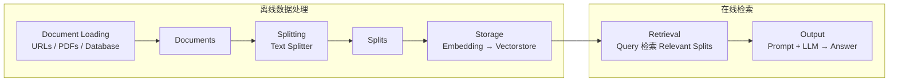
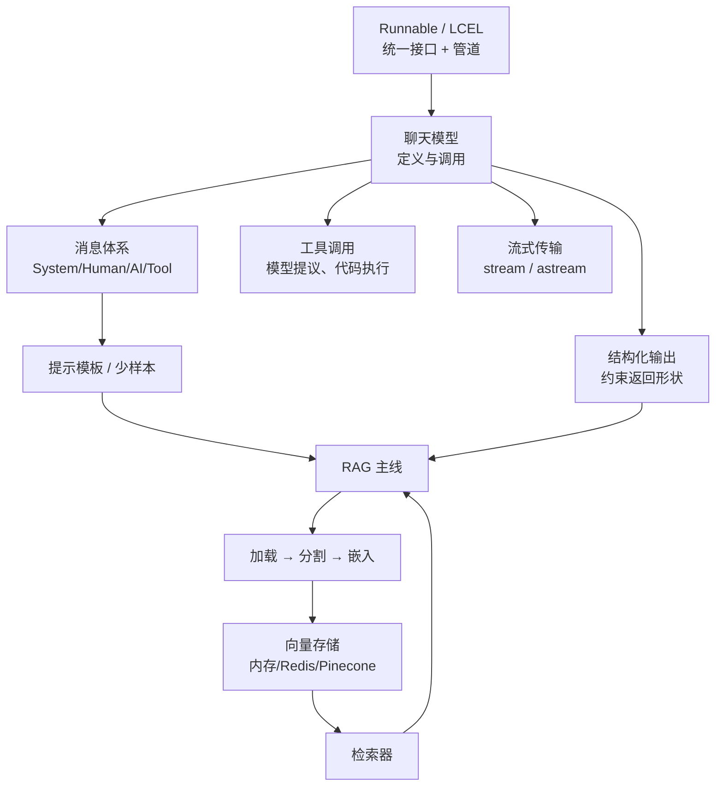
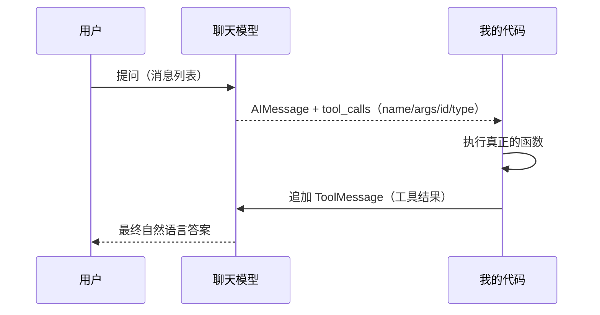
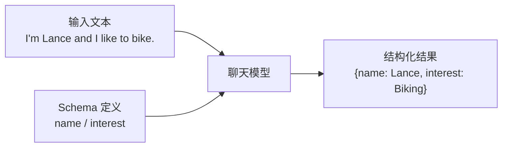
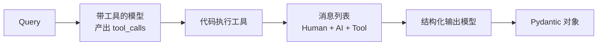
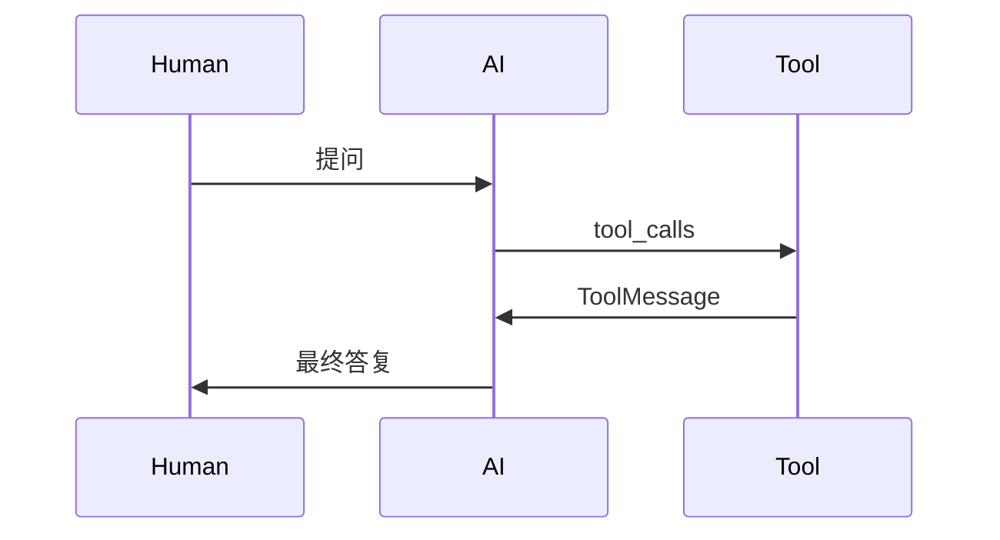
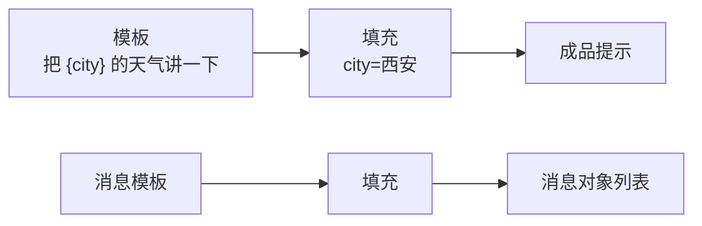
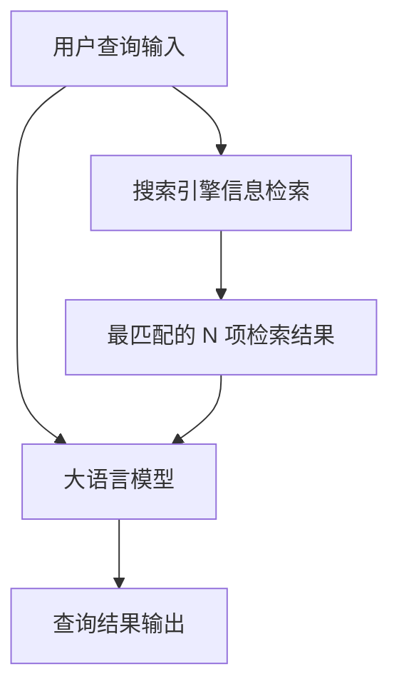
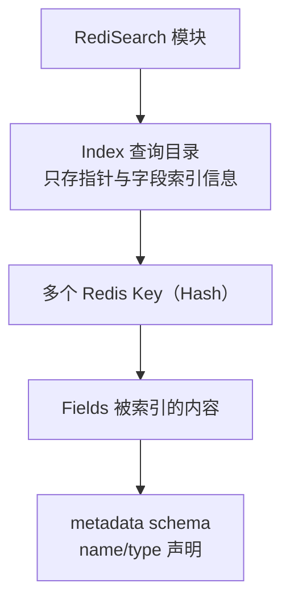
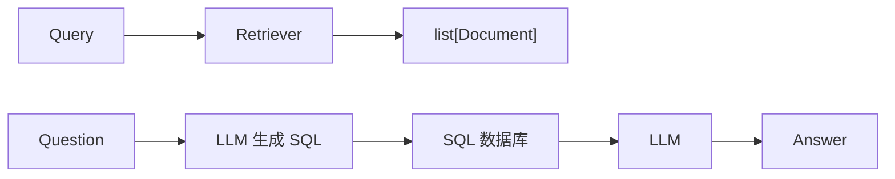

一句话心智模型：**LangChain 把「调模型」从一次函数调用，变成一条可拆装的数据流水线**。

- 模型、提示模板、解析器、检索器、工具 → 全是同一种东西：`Runnable`（能收输入、能出输出）。
- 用 `|` 把它们串起来 → 得到 `RunnableSequence`（也就是「链」）。
- 链本身还是 `Runnable` → 可以继续套娃。

**我的结论**：它不是「AI 库」，是**编排层**。它不负责让模型变聪明，只负责把「提示词、切模型、解析输出、接工具、查资料、多轮记忆」这些脏活标准化。

## 〇、知识地图与踩坑清单

### 0.1 裸调模型的痛点（为什么要这层抽象）

| 痛点 | 裸调用的后果 | 对应组件 |
| --- | --- | --- |
| 提示词散落各处 | 改一个措辞要翻遍工程 | `PromptTemplate` / `ChatPromptTemplate` |
| 换一家厂商 | 请求体、返回体字段全不一样 | `BaseChatModel` / `init_chat_model` |
| 返回一段自然语言 | 程序吃不下，只能正则硬抠 | `with_structured_output` / 输出解析器 |
| 模型只会编，不会查 | 知识停在训练截止日 | 工具（`TavilySearch`）、RAG |
| 多轮对话 | 历史要自己裁剪拼接 | 消息类、`trim_messages` |
| 生成慢、要边出边显示 | 只能干等 | `stream` / `astream` |
| 出问题无法复盘 | 不知道哪一步错 | `LangSmith` 跟踪 |

- 幻觉、上下文窗口有限、输出不定型、无法算数、无法访问库表与实时数据 → 都属于「模型是封闭知识系统」的连带后果。
- 工具调用解决的正是最后两条；RAG 解决的是知识陈旧与私有数据。

### 0.2 RAG 知识地图（后面所有组件都挂在这张图上）



- 六个环节：**加载 → 分割 → 嵌入 → 存储 → 检索 → 生成**。
- 离线那三步是一次性的（建库）；在线那两步是每次提问都跑的（查询）。
- 我不把它当流程图背，而是当**排错顺序**用：答案不对，先看切分粒度，再看检索命中，最后才怪模型。

### 0.3 组件速查

| 环节 | 组件 | 关键类/函数 |
| --- | --- | --- |
| 加载 | 文档加载器 | `PyPDFLoader`、`UnstructuredMarkdownLoader` |
| 分割 | 文本分割器 | `CharacterTextSplitter`、`RecursiveCharacterTextSplitter`、`TokenTextSplitter` |
| 嵌入 | 嵌入模型 | `OpenAIEmbeddings`、`Embeddings` |
| 存储 | 向量存储 | `InMemoryVectorStore`、`RedisVectorStore`、`PineconeVectorStore` |
| 检索 | 检索器 | `as_retriever()`、`Retriever` |
| 生成 | 聊天模型 + 提示模板 | `ChatOpenAI`、`ChatPromptTemplate` |
| 记忆 | 消息与历史 | `BaseChatMessageHistory`、`RunnableWithMessageHistory` |
| 可观测 | 跟踪 | `LangSmith` |

### 0.4 环境与依赖

**运行环境**：Python 3.13 + 一套 `requirements.txt`（`pip install -r requirements.txt` 批量装）。

**第一批（前面章节够用）**

| 包 | 版本 | 用途 |
| --- | --- | --- |
| `langchain` | 0.3.27 | 主包 |
| `langchain-openai` | 0.3.33 | OpenAI 聊天模型与嵌入 |
| `langchain-deepseek` | 0.1.4 | DeepSeek 聊天模型 |
| `langchain-ollama` | 0.3.6 | 本地部署模型 |
| `langchain-tavily` | 0.2.12 | Tavily 搜索工具 |
| `langchain-chroma` | 0.2.5 | Chroma 向量库 |
| `langchain-community` | 0.3.22 | 社区加载器（PDF/Markdown 等） |
| `langchain-redis` | 0.2.4 | Redis 向量存储 |
| `nltk` | 3.9.2 | 分词相关 |
| `unstructured` | 0.18.15 | Markdown 结构化加载 |
| `markdown` | 3.9 | Markdown 处理 |
| `redisvl` | 0.10.0 | 查看 Redis 索引（`rvl` 命令） |

**第二批（学到向量存储后半段才需要）**：`pinecone==7.3.0`、`langchain-pinecone==0.2.12`。

> **坑（很重要，我踩过）**：`langchain-pinecone` 会连带装上 `simsimd`，装上之后 **Redis 向量存储的 MMR 搜索会失效**，官方还没修。所以顺序上先把 Redis 部分跑完再装 Pinecone；两条路线别在同一环境里混着验收。

> **坑**：早期 `0.2.3` 版对 Python 3.13 支持可能失败，因为它的 `numpy` 版本区间（`>=1.26.4,<2.0.0`）与 3.13 不兼容。

**密钥类环境变量**

| 变量 | 归属 |
| --- | --- |
| `OPENAI_API_KEY` | OpenAI |
| `OPENAI_ORG_ID` | OpenAI 组织（`organization` 参数缺省读它） |
| `ANTHROPIC_API_KEY` | Anthropic |
| `DEEPSEEK_API_KEY` | DeepSeek |
| `GOOGLE_API_KEY` | Google |
| `TAVILY_API_KEY` | Tavily 搜索 |
| `PINECONE_API_KEY` | Pinecone |
| `LANGSMITH_API_KEY` / `LANGSMITH_TRACING` | LangSmith 跟踪 |

### 0.5 全篇路线图



## 一、快速上手

### 内容与目标

- LangChain 是**围绕大模型构建应用的框架**：把一条 AI 应用流程拆成标准化组件，让你自由组合。
- 目标：跑通「定义模型 → 组织消息 → 调用 → 解析」这条最短链路，并理解 `|` 的含义。

### 详细过程

六步走完一次完整调用，顺序别乱。

### 步骤1：申请 API key 并配置环境变量

- 先申请密钥，再落到系统环境变量，**不要硬编码进代码**（避免泄露 + 方便换号）。
- 变量名用 `OPENAI_API_KEY`。
- 创建密钥的界面操作：填 Name（示例里写 `LC`）→ Project 保持默认 → 点 `Create secret key` → 立刻复制保存。
- 注意：密钥只在创建时完整显示一次；丢了只能重新生成。

### 步骤2：定义大模型

```bash
pip install -U langchain-openai
```

```python
from langchain_openai import ChatOpenAI

model = ChatOpenAI(model="gpt-5-mini")
```

- 装好对应包，传个模型名，就拿到模型实例。

### 步骤3：定义消息列表

```python
from langchain_core.messages import HumanMessage, SystemMessage

messages = [
    SystemMessage(content="把下面这句英文翻译成中文"),
    HumanMessage(content="hi!"),
]
```

- `SystemMessage` 管行为设定，放**列表首位**；`HumanMessage` 装用户输入。
- 合起来是一个消息列表 —— 聊天接口吃的是列表，不是单串文字（这点后面回灌工具结果时会再撞上）。

### 步骤4：调用大模型

```python
result = model.invoke(messages)
```

- 模型是 `Runnable` 实例，`invoke` 就完事。
- 返回 `AIMessage`，不是字符串。

**参数说明：`AIMessage` 的四个字段**

| 字段 | 装什么 | 我用它干什么 |
| --- | --- | --- |
| `content` | 正文文本 | 直接展示 |
| `additional_kwargs` | 附加数据，例如工具调用 | 取 `tool_calls` |
| `response_metadata` | 响应本身的信息（`id`、`model_name`、`finish_reason`、原始响应头） | 调试与日志 |
| `usage_metadata` | 资源消耗（`input_tokens` / `output_tokens` / `total_tokens`） | 计费、监控、预算 |

- 示例结果：`content='你好!'`，`finish_reason` 为 `stop`，合计 22 token（入 20、出 2）。

### 步骤5：输出解析

```python
from langchain_core.output_parsers import StrOutputParser

parser = StrOutputParser()
print(parser.invoke(result))   # 你好!
```

- `StrOutputParser` 干的事：把消息对象**降级成纯字符串**。
- 注意它属于 `langchain_core.output_parsers`。

### 步骤6：链式执行

```python
chain = model | parser
print(chain.invoke(messages))
```

- 先定义组件，再链接，一次 `invoke` 走完全程。
- 结果与「先 `model.invoke` 再 `parser.invoke`」完全一致。

### 引出 LangChain 相关概念

**Runnable 接口**

`Runnable` 是所有组件的基础接口，规定一个节点至少能做到五件事：

| 能力 | 方法 | 我的理解 |
| --- | --- | --- |
| 调用 | `invoke` / `ainvoke` | 一进一出，最常用 |
| 批处理 | `batch` / `abatch` | 一次喂多条输入 |
| 流式 | `stream` / `astream` | 边生成边吐 |
| 检查/内省 | `inspect`、`get_graph` 之类 | 打印内部结构，排错用 |
| 组合 | `compose`、`pipe`、`\|` | 拼成更长的链 |

- 聊天模型是 `Runnable`，输出解析器也是 `Runnable`，所以两者都能 `invoke`。
- **关键点**：组合出来的链**本身还是 `Runnable`**，所以能无限套下去。

**LangChain Expression Language**

- LCEL 是**声明式**的写法：用已有 `Runnable` 拼出一个新的 `Runnable`。
- `model | parser`、`RunnableSequence(first=model, last=parser)`、`model.pipe(parser)` 三种写法等价。

```python
from langchain_core.runnables import RunnableSequence

chain = model | parser                                  # ① 重载 |
chain = RunnableSequence(first=model, last=parser)      # ② 显式构造
chain = model.pipe(parser)                              # ③ 方法调用
```

- 规则只有一条：**上一个节点的输出 = 下一个节点的输入**。
- 拼出来的对象类型叫 `RunnableSequence`，也就是「链」；它自己仍是 `Runnable`。
- 这套手感迁移自 Unix 管道：小工具各做一件事，靠管道拼出复杂行为。

> **结论**：理解了「输出即输入」，后面所有组合方式（`RunnablePassthrough` 让输入原样穿过、字典字面量把同一输入并行分发给多分支）都是这句话的推论。

**概念说明**：`Runnable` 不是某个具体类，而是一份**契约** —— 谁实现了它，谁就能进管道。聊天模型、提示模板、输出解析器、检索器、工具包装，都是在履行这份契约。

> **我踩过的坑**：`|` 两侧必须都是 `Runnable`。普通函数直接塞进去会报错，得先包成 `RunnableLambda` 或者用 `@chain` 装饰。

## 二、聊天模型核心能力

聊天模型能做的事，可以拆成五块能力来看，前面四块分别对应四个小节。

### 1. 定义聊天模型

先分清两个概念，不然看文档会飘：

| 概念 | 输入 | 输出 | 说明 |
| --- | --- | --- | --- |
| LLM（纯文本补全模型） | 字符串 | 字符串 | 旧式补全接口，也可含多模态 |
| 聊天模型（ChatModel） | 消息列表 | 消息对象 | 为对话调优，底层仍由 LLM 支撑 |

- 现在绝大多数模型都走**聊天接口**：进消息列表、出消息对象，而不是裸文本。

### 1.1 通过 API 定义聊天模型

### 方式1：ChatOpenAI

```python
from langchain_openai import ChatOpenAI

model = ChatOpenAI(
    model="gpt-5-mini",
    temperature=0,
    max_tokens=None,
    timeout=None,
    max_retries=2,
    # api_key=..., base_url=..., organization=...
)
```

`ChatOpenAI` 是 OpenAI 聊天模型的具体实现，父类是 `BaseChatOpenAI`。

**ChatOpenAI 常用初始化参数说明**

| 参数 | 含义 | 备注 |
| --- | --- | --- |
| `model` | 模型名 | 示例用 `gpt-5-mini` |
| `temperature` | 随机性 | 高→发散，低→保守 |
| `max_tokens` | 生成上限 | `None` 表示不额外限制 |
| `timeout` | 请求超时 | `None` 用默认 |
| `max_retries` | 重试次数 | 示例 `2` |
| `api_key` / `openai_api_key` | 密钥 | 缺省读环境变量 `OPENAI_API_KEY` |
| `base_url` | 请求根地址 | 换第三方端点用 |
| `organization` | 组织 | 缺省读 `OPENAI_ORG_ID` |

- 想用国产模型：只要对方兼容 OpenAI 协议，改 `base_url` + 换密钥即可，`ChatOpenAI` 不用换。

```python
import os
from langchain_openai import ChatOpenAI

model = ChatOpenAI(
    model="deepseek-chat",
    base_url="https://api.deepseek.com/v1",
    openai_api_key=os.getenv("DEEPSEEK_API_KEY"),
)
```

> **坑**：`base_url` 里的 `/v1` 是**接口版本**路径，与模型版本无关；写错前缀直接 404。另外 DeepSeek 的密钥要单独申请、单独配变量。

### 1.1.2 `invoke()` 调用

```python
abstractmethod invoke(input: Input, config: RunnableConfig | None = None, **kwargs) -> Output
```

**请求参数**

| 参数 | 说明 |
| --- | --- |
| `input` | 输入，可以是字符串、消息列表、提示对象等 |
| `config` | 可选的 `RunnableConfig`，默认 `None` |

`RunnableConfig` 里值得记的字段：

- `configurable`：运行时可改的属性（键值对），**动态换模型就靠它**。
- `run_id`：本次运行标识，缺省自动生成 UUID。
- `run_name`：默认取类名，日志里用它区分。
- `metadata`：字符串键、JSON 值的字典，附加到这次运行上。

**返回值**：`AIMessage`（或其它 `BaseMessage` 子类）。

### 方式2：init_chat_model

```python
from langchain.chat_models import init_chat_model

gpt = init_chat_model("gpt-5-mini", model_provider="openai", temperature=0)
ds = init_chat_model("deepseek-chat", model_provider="deepseek", temperature=0)

print(gpt.invoke("what's your name").content)     # ChatGPT
print(ds.invoke("what's your name").content)      # DeepSeek Chat
```

**init_chat_model() 常用参数说明**

| 参数 | 说明 |
| --- | --- |
| `model` | 模型名 |
| `model_provider` | 提供方；不写则尝试从模型名推断 |
| `configurable_fields` | `None`=全不可配；`'any'`=全可配；也可传字段名列表 |
| `config_prefix` | 非空时运行时读 `{prefix}_{param}`；空串则直接读 `{param}` |
| `**kwargs` | 其他参数透传给具体模型类 |

- 支持的 `model_provider` 常见取值：`openai`、`anthropic`、`google_genai`、`ollama`、`deepseek`（`openai` 对应 `langchain-openai` 包）。
- 因为所有集成实现的都是同一套 ChatModel 接口，所以**换厂商只是换字符串**。

**init_chat_model() 返回值说明**

- 返回对应 provider 的 `BaseChatModel` 子类实例：
  - `model_provider="openai"` → `langchain_openai.ChatOpenAI`
  - `model_provider="deepseek"` → `langchain_deepseek.ChatDeepSeek`
  - 其它厂商同理（如 `ChatAnthropic`）。
- 开了 `configurable_fields` 时，先拿到的是一个「可配置模型模拟器」，**传入配置后才真正建模型**。

**示例1：基本用法**

```python
gpt_model = init_chat_model("gpt-5-mini", model_provider="openai", temperature=0)
deepseek_model = init_chat_model("deepseek-chat", model_provider="deepseek", temperature=0)
```

问它是谁：一个答 ChatGPT，一个答 DeepSeek Chat。

**示例2：创建可配置模型**

```python
configurable_model_1 = init_chat_model(temperature=0)

configurable_model_1.invoke(
    "what's your name",
    config={"configurable": {"model": "gpt-5-mini"}},
)
```

- 初始化时只给 `temperature`，模型名留到运行时用 `configurable.model` 指定。

**示例3：具有默认值的可配置模型**

```python
configurable_model_2 = init_chat_model(
    model="gpt-5-mini",
    temperature=0,
    configurable_fields=("model", "model_provider", "temperature", "max_tokens"),
    config_prefix="first",
)

configurable_model_2.invoke(
    "what's your name?",
    config={"configurable": {
        "first_model": "deepseek-chat",
        "first_temperature": 0.5,
        "first_max_tokens": 100,
    }},
)
```

- 有了 `config_prefix="first"`，运行时键名就变成 `first_model` / `first_temperature` / `first_max_tokens`。
- **实用价值**：一套代码里放多个可切换的模型位（快模型/强模型），不必改代码。

### 1.2 通过本地部署的 LLM 定义聊天模型

### 1.2.1 ChatOllama

```python
from langchain_ollama import ChatOllama

ollama_model = ChatOllama(
    model="deepseek-r1:70b",
    base_url="http://192.168.100.220:11434",
)
print(ollama_model.invoke("what's your name?"))
```

**ChatOllama 常用初始化参数说明**

| 参数 | 含义 | 备注 |
| --- | --- | --- |
| `model` | 本地模型名 | 需先在 Ollama 侧拉好 |
| `base_url` | Ollama 服务地址 | 可指向内网机器 |
| `num_ctx` | 上下文窗口 | 默认 `2048` |
| `num_gpu` | 使用几块 GPU | macOS 上默认 `1`，开启 Metal 加速 |

- 示例输出里 `content` 是空的（思考内容走独立字段）、`usage_metadata` 显示 8/44/52。
- **场景**：内网、离线、数据不外出的环境，用它顶替 `ChatOpenAI`；它同样实现 `Runnable` 接口，所以链的写法一字不改。

### 2. 聊天模型—调用工具

为什么需要工具：

- 模型是**封闭知识系统**：训练数据有截止日、参数不能改，让它「算 9×6」或「查昨天的天气」都不可靠。
- 收益四条：**扩能力边界、保实时性、拆解复杂任务、接入既有系统**。

机制一句话：**模型不执行任何东西，它只产出「要调用哪个工具、参数是什么」；执行由你的代码完成。**



- 天气例子：模型不直接答，而是给出 `tool_calls`，其中 `name` 为 `get_weather`、`args` 含 `location` 为 `Hawaii`、`id` 为 `call_abc123`、`type` 为 `tool_call`。
- 查库例子四步：建工具 → 绑工具 → 模型给出调用参数（`min_price=10.0`、`max_price=50.0`、`category="electronics"`）→ 代码执行取结果。

### 2.1 创建工具

三种造法，从最省事的开始。

### 2.1.1 使用 @tool 装饰器创建工具

```python
from langchain_core.tools import tool

@tool
def multiply(a: int, b: int) -> int:
    """Multiply two integers.

    Args:
        a: First integer
        b: Second integer
    """
    return a * b

multiply.invoke({"a": 2, "b": 3})   # 6
multiply.name          # 'multiply'
multiply.description   # 取自文档字符串
multiply.args          # {'a': {'title': 'A', 'type': 'integer'}, ...}
```

- `@tool` 是最省事的做法：**函数名即工具名，文档字符串即描述**。
- 进 schema 的三样东西：**函数名 + 类型提示 + 文档字符串**，缺一不可；描述写得含糊，模型选错工具的概率立刻上升。
- 参数必须**需要指定变量名和变量类型**（类型提示），否则 schema 推断不出来。
- 简单工具靠解析 **Google 风格文档字符串**取参数描述，关键字是 `Args:` 与 `Returns:`。
- 实际打印出来的 `args` 是 JSON Schema 片段，形如 `{'a': {'title': 'A', 'type': 'integer'}}`。
- 天气类的工具示例里，返回字段可以细到「天气 / 最高气温 / 最低气温」这一级。

**什么是 Schema？**

- Schema = **描述其它数据结构的声明格式**。同一份人物数据可以有两种组织方式（扁平 vs 分组），差异就是 schema 差异。
- 更正式的例子：把「姓名」拆成姓与名，「地址」再拆成省/市/区/国，日期统一成 ISO 格式 —— 这些都是 schema 层面的约定。
- `JSON Schema` 的能力边界：能描述**表面结构**并自动校验（`type` / `properties` / `format`），但**表达不了元素之间的约束关系**。
- 所以复杂格式的校验常分两阶段：**结构级**（schema 干）+ **语义级**（通用编程语言干）。

#### 2.1.1.1 模式1：依赖 Pydantic 类

- 不写文档字符串、又没给 `description` → 直接报 `ValueError: Function must have a docstring...`。
- 解法：用一个 Pydantic 类做运行时校验，字段描述交给 `Field(..., description=...)`。

```python
from pydantic import BaseModel, Field
from langchain_core.tools import tool

class MultiplyInput(BaseModel):
    """Multiply two integers."""
    a: int = Field(..., description="First integer")
    b: int = Field(..., description="Second integer")

@tool(args_schema=MultiplyInput)
def multiply(a: int, b: int) -> int:
    return a * b
```

- `args_schema` 默认 `None`（自动推断）。
- Pydantic 里**字段没有默认值就是必填**。

#### 2.1.1.2 模式2：依赖 Annotated

```python
from typing_extensions import Annotated
from langchain_core.tools import tool

@tool
def add(
    a: Annotated[int, ..., "First integer"],
    b: Annotated[int, ..., "Second integer"],
) -> int:
    """Add two integers."""
    return a + b
```

- 把说明文字塞进 `Annotated` 的第三项，与函数注解一起进工具 schema。
- 写法上函数体不写文档串也能跑通，描述改由注解承担。

### 2.1.2 使用 StructuredTool 类提供的函数创建工具

```python
from langchain_core.tools import StructuredTool

calculator_tool = StructuredTool.from_function(func=multiply)
calculator_tool.invoke({"a": 2, "b": 3})   # 6
```

- `StructuredTool.from_function` 是**类方法**：吃一个普通函数，吐一个工具对象。
- 关键参数说明：

| 参数 | 说明 | 默认 |
| --- | --- | --- |
| `func` | 目标函数 | 必填 |
| `coroutine` | 异步版本的函数 | 无 |
| `name` | 工具名 | 取函数名 |
| `description` | 工具说明 | 取文档字符串 |
| `args_schema` | 入参结构 | 自动推断 |
| `response_format` | `'content'` / `'content_and_artifact'` | `'content'` |
| `return_direct` | 直接把工具结果返回给用户 | `False` |
| `infer_schema` | 是否自动推断入参 schema | `True` |
| `parse_docstring` | 是否解析文档字符串 | `False` |
| `error_on_invalid_docstring` | 文档串非法时报错 | `False` |

- `**kwargs` 继续向后透传。

**示例1：常规用法**

- 最小示例：函数直接交给 `func`，工具名与描述从函数自动继承；`invoke` 收字典入参，两数同乘打印 `6`。

**示例2：加入配置，依赖 Pydantic 类**

```python
class CalculatorInput(BaseModel):
    a: int = Field(description="first number")
    b: int = Field(description="second number")

calculator_tool = StructuredTool.from_function(
    func=multiply,
    name="Calculator",
    description="两数相乘",
    args_schema=CalculatorInput,
)
```

- 函数没有说明时，用 `name`、`description`、`args_schema` 三项补齐元信息。
- `tool.args` 返回的是 JSON Schema 片段，含 `description`、`title`、`type` 键。

**示例3：加入 response_format 配置**

```python
from typing import List, Tuple

def multiply(a: int, b: int) -> Tuple[str, List[int]]:
    nums = [a, b]
    return f"{nums}相乘的结果是{a * b}", nums

calculator_tool = StructuredTool.from_function(
    func=multiply, name="Calculator", response_format="content_and_artifact",
)
```

- 默认 `'content'`：工具结果只落在 `ToolMessage.content`。
- 配成 `'content_and_artifact'`：函数必须返回**二元组**，分别对应 content 与 artifact。
- 两者的分工：

| 字段 | 面向谁 | 例子里装什么 |
| --- | --- | --- |
| `content` | **模型** | 一句人话结论 |
| `artifact` | **链中后续组件** | 完整原始响应（含 `results` 数组、来源链接） |

- 只留 content 的代价：丢掉来源链接、原始返回和排查线索，也不方便留档分析。
- 想拿到元组，得把请求伪装成模型的调用形态（`name` / `args` / `id` / `type` 四项，`id` 与 `type` 不可省）；返回体形如 `content`、`name`、`tool_call_id`、`artifact` 四字段并列。
- `@tool` 装饰器同样认 `response_format` 这个开关。

### 2.2 绑定工具

```python
from langchain_openai import ChatOpenAI

model = ChatOpenAI(model="gpt-4o-mini")
model_with_tools = model.bind_tools([multiply, add])
```

- `bind_tools` 的 `tools` 可以是字典、Pydantic 类、普通函数或 `BaseTool` 实例。
- 返回值是一个 `Runnable`：可以接 `PromptValue`、字符串或消息列表；输出是 `AIMessage`（其中可能夹带工具调用）。
- 关键参数：

| 参数 | 取值 | 说明 |
| --- | --- | --- |
| `tool_choice` | `"auto"` | 允许不用工具（默认行为） |
| | `"none"` | 禁用工具 |
| | `"any"` / `"required"` / `True` | 至少挑一个工具 |
| | 字符串工具名 | 点名调用指定工具 |
| | `False` / `None` | 不表态，走服务端默认 |
| `strict` | `True` | 输入与输出都按声明的 JSON Schema 校验 |
| | `False` | 两边都不校验 |
| | `None`（默认） | 不把这个参数下发给服务端 |
| `parallel_tool_calls` | `None`（默认）/ `False` | 是否允许并行调用 |

### 2.3 工具调用

```python
result = model_with_tools.invoke("9乘6等于多少？")
result.tool_calls
# [{'name': 'multiply', 'args': {'a': 9, 'b': 6}, 'id': 'call_...', 'type': 'tool_call'}]
```

- 典型回包：`content` 为空，调用信息藏在 `additional_kwargs` 与 `tool_calls` 里。
- `finish_reason` 为 `tool_calls`（表示「我要调工具」）；`response_metadata` 里带 prompt/completion/total 三个 token 数。
- 换一句无关的话（`hello world!`）：模型正常闲聊，`finish_reason` 变成 `stop` —— 说明**调不调工具由相关性决定**，不是绑了就必调。

### 2.4 强制模型调用工具

```python
model_with_tools = model.bind_tools([add, multiply], tool_choice="any")
```

- 同一句问候在强制模式下也产出了 `add` 调用，参数被模型自拟为 `1` 与 `2`。
- 用途：做「必须走工具」的确定性流程，或者调试工具 schema 是否可用。

### 2.5 工具属性

- 只要发生调用，返回对象上就有 `tool_calls`，里面是名字、入参、调用编号（`name` / `args` / `id` / `type`）。
- 它是**纯 Python 数据**（列表套字典），可以直接循环取用，**不需要解析文本** —— 这就是结构化工具调用相对「让模型输出 JSON 再正则抠」的最大好处。

### 2.6 将工具输出传递给聊天模型

拿到调用请求只是半程；答案要把工具产物**回灌**给模型才生成。

```python
from langchain_core.messages import HumanMessage

messages = [HumanMessage("9乘6等于多少？5加3等于多少？")]
ai_msg = model_with_tools.invoke(messages)
messages.append(ai_msg)

for tool_call in ai_msg.tool_calls:
    selected_tool = {"add": add, "multiply": multiply}[tool_call["name"].lower()]
    messages.append(selected_tool.invoke(tool_call))   # @tool 工具可直接吃整个 tool_call 字典

result = model.invoke(messages)     # 54 与 8
```

要点：

1. 聊天接口吃**消息列表**，所以工具产物必须先包成 `ToolMessage`。
2. 一轮对话里需要凑齐三类消息：用户提问（`HumanMessage`）、带调用的 AI 回复（`AIMessage`）、工具结果（`ToolMessage`）。
3. 按名字挑函数时做小写化比较 → 对大小写不敏感。
4. `@tool` 造出的工具支持把整个 `tool_call` 字典丢进 `invoke`，直接得到 `ToolMessage`（内部自动补 `tool_call_id`）。
5. 示例里 `ai_msg` 携带两条调用（9×6 与 5+3），于是产生两条 `ToolMessage`。
6. 两趟的 token 统计可对照：第二趟输入明显变长，输出很短。

**关键字段对照**

| 字段 | 说明 |
| --- | --- |
| `ToolMessage.content` | 给模型看的文本 |
| `ToolMessage.artifact` | 原始结构化数据，**不给模型** |
| `tool_call_id` / `id` | 关联「请求」与「结果」的标识，缺了模型会对不上号 |
| `type: "tool_call"` | 手工构造调用时的必填类型 |

### 2.7 LangChain 提供的工具

- 官方既备了单件工具，也备了成套工具包（Toolkit）；搜索、数据库、浏览器等方向都有。
- 所有工具都落在 `BaseTool` 与 `BaseToolkit` 两个基类之下，找类名可以按这两个基类全局检索。
- 分类覆盖：Code Interpreter、Productivity、Web Browsing、Database、Finance 等。
- 同是搜索类的返回字段粒度不同：多数给 URL / Snippet / Title，`SerpApi` 只给 `Answer`，`Jina` 还带正文；免费与收费并存（例如 `DuckDuckGoSearch` 免费）。
- 集成包命名有规律：单个集成常落在 `langchain_community.tools` 下（如 `tavily_crawl.py`、`azure_ai_services.py` 这类模块名），也有独立包（如 `langchain-tavily`）。

### 2.7.1 TavilySearch

- 定位：面向**智能体检索**场景的搜索工具，返回结构化结果，便于直接进入推理与生成环节。
- 申请：官网注册后拿密钥，免费额度按积分计（每月 1000），key 常以 `tvly-dev` 开头；控制台带 Playground 可试搜，也有预置案例（Research Assistant / Chat / Crawl2RAG 等）。

```python
from langchain_tavily import TavilySearch

tool = TavilySearch(max_results=4)      # 最多取回 4 条
model_with_tools = model.bind_tools([tool])

ai_msg = model_with_tools.invoke("西安今天天气怎么样")
tool_msg = tool.invoke(ai_msg.tool_calls[0])
result = model_with_tools.invoke([*messages, ai_msg, tool_msg])
```

**参数说明**

| 参数 | 说明 |
| --- | --- |
| `max_results` | 结果条数上限 |
| `search_depth` | 检索深度（`default` / `none` 等档位） |
| 返回字段 | `query`、`title`、`score`、`raw_content`、`answers`、`images`、`results` |

- 接入三步：装包（`langchain-tavily`）→ 配环境变量 `TAVILY_API_KEY`（Windows 下写进系统变量）→ 代码里实例化并 `bind_tools`。
- 示例结果：问西安天气，工具跑完后模型用中文汇总，并附上气象局链接。
- 注意：回灌之后仍用**带工具的实例**发第二次请求；这与 2.6 里用裸模型发第二趟略有差别（带工具时理论上还能继续发起新调用）。
- 也可以用官方客户端 `tavily.TavilyClient` 直接调 `tavily_client.search(query)` —— 适合不需要模型决策、写死流程的场景。

### 3. 聊天模型—结构化输出

要解决的问题：**从「字符串」到「对象」的范式转换**。

- 没有它时：`AIMessage.content` 是一段人读着舒服的文本，程序读着难受；想抠出「公司名」和「股价变化」，只能上正则，脆弱又费事。
- 有它之后：**先声明期望结构，再要求模型必须按这个结构返回**。
- 典型动机：输出要落库，就得对齐库表结构。



### 3.1 with_structured_output()

三步走：

```python
# 1. 定义输出结构
class Person(BaseModel):
    name: str
    age: int

# 2. 绑定 schema，其实是生成一个支持结构化返回的 Runnable
structured_model = model.with_structured_output(Person)

# 3. 执行
result = structured_model.invoke("张小红今年 18 岁")
# Person(name='张小红', age=18)
```

- 这是获得结构化输出**最简单、最可靠**的方法。
- 输出结构可以是 `TypedDict`、JSON Schema 或 Pydantic 类：
  - `TypedDict` / JSON Schema → 返回**字典**
  - Pydantic 类 → 返回 **Pydantic 对象**

**请求参数：**

| 参数 | 说明 |
| --- | --- |
| `schema` | 输出结构：JSON、`TypedDict`、Pydantic、OpenAI 函数/工具 |
| `method` | 生成方式，见下表 |
| `include_raw` | `False`（默认）只返回解析结果；`True` 连原始响应一起返回，解析报错也被捕获 |
| `strict` | `True` 保证严格符合 schema 且校验输入 schema；`False` 两边都不校验；`None`（默认）不下发该参数 |
| `tools` | 要绑定的工具列表；要求 `method='json_schema'` + `strict=True` + `include_raw=True`，生成的 `AIMessage` 会在 `'raw'` 里含工具调用 |
| `**kwargs` | 直接透传给 `bind()` |

**`method` 三选一**

| 取值 | 含义 | 注意 |
| --- | --- | --- |
| `json_schema` | 默认，走 OpenAI 的结构化输出 API | 最可靠 |
| `function_calling` | 走工具调用（旧称函数调用） | 兼容面广 |
| `json_mode` | 走 OpenAI 的 JSON mode | **必须自己在提示里说明要输出成什么格式**，否则只有「是 JSON」而没有「是这个 JSON」 |

**返回值：** 返回一个 `Runnable` 实例。执行时：

- `include_raw=False`：Pydantic schema → Pydantic 对象；其它 schema → 字典。解析失败直接抛错。
- `include_raw=True`：返回带三个键的字典 ——

| 键 | 类型 | 说明 |
| --- | --- | --- |
| `'raw'` | `BaseMessage` | 原始模型响应 |
| `'parsed'` | 视 schema 而定 | 解析失败时为 `None` |
| `'parsing_error'` | `Optional[BaseException]` | 解析错误对象 |

### 3.1.1 返回 Pydantic 对象

```python
from pydantic import BaseModel, Field

class Movie(BaseModel):
    """一部电影的信息。"""
    title: str = Field(description="电影标题")
    year: int = Field(description="上映年份")
    director: "Director" = Field(description="导演")

class Director(BaseModel):
    name: str
    country: str

structured_model = model.with_structured_output(Movie)
```

- 内部流程：抽出代表 Pydantic 参数的 JSON → 用 Pydantic 模型解析与校验 → 转成可用的对象实例返回。
- 支持**嵌套输出**（上面的 `Movie` 里套 `Director`），也支持列表、联合类型。

### 3.1.2 返回 TypedDict

```python
from typing_extensions import TypedDict

class Person(TypedDict):
    name: str
    age: int

structured_model = model.with_structured_output(Person)
structured_model.invoke("张小红 18 岁")    # {'name': '张小红', 'age': 18}
```

- `TypedDict` 的价值：给字典补上**精确的类型提示** —— 键名拼错、类型写错，类型检查器当场就报，不必等到运行时。
- 想同时看原始响应，就加 `include_raw=True`，拿到的就是 `raw` / `parsed` / `parsing_error` 三键字典。

### 3.1.3 返回 JSON

```python
json_schema = {
    "title": "Person",
    "type": "object",
    "properties": {"name": {"type": "string"}, "age": {"type": "integer"}},
    "required": ["name", "age"],
}

structured_model = model.with_structured_output(json_schema)
```

- 直接给 JSON Schema 也能跑，适合 schema 由外部配置下发的场景。

### 3.1.4 选择输出格式

- 做法：建一个**带联合类型属性**的父模式，让模型自己选其中一种。

```python
from typing import Literal, Union

class Action(BaseModel):
    action: Literal["respond", "search"]
    response: Union[Response, SearchQuery]

structured_model = model.with_structured_output(Action)
```

- 价值：把「要不要检索」「回不回答」这类分支交给模型判，后面接链时按 `action` 路由即可。

### 3.2 实用场景

结构化输出真正落地的地方就这三处，逐个过一遍。

### 3.2.1 场景1：作为信息提取器

```python
class Person(BaseModel):
    name: str
    age: int

structured_model = model.with_structured_output(Person)
structured_model.invoke("张小红今年 18 岁，在杭州读大学")
```

- 最常用的一类：把非结构化文本（简历、工单、聊天记录）洗成字段。
- 和 RAG 结合时，它常常是「抽元数据」的那一环。

### 3.2.2 场景2：使用"少样本提示"来增强信息提取能力

- 光给 schema，模型对**边界情况**（多值、缺值、「无」怎么写）理解会飘。
- 加几个「输入 → 期望输出」的示例对之后，抽取稳定很多。
- 具体写法见 [少样本提示](#3-少样本提示few-shotting) 一节的案例二。

### 3.2.3 场景3：与工具结合使用

> **注意**：把聊天模型的原生工具和结构化输出凑一块用，体验很差；这里只看能力边界。

### 方式1：使用 with_structured_output() 的 tools 参数

```python
structured_model = model.with_structured_output(
    SearchResult, method="json_schema", strict=True, include_raw=True, tools=[search_tool],
)
out = structured_model.invoke("搜索 LangChain 的最新进展")
```

- 结果：**它不会直接给你想要的结构化结果**，而是只返回一个带工具调用信息的 `AIMessage`。
- 原因：它只负责把「有哪些工具可用」告诉模型，执行与否它一概不管。
- 要拿到「工具执行结果 + 最终结构化输出」，只能手动处理工具调用，再把结果回灌给模型 —— 也就是下一种做法。

### 方式2：拆解能力，单独依次执行

顺序**不能弄反**：① 先绑定工具 → ② 再添加结构化输出。

```python
model_with_tools = model.bind_tools([search_tool])           # ① 先工具
structured_model = model.with_structured_output(SearchResult) # ② 再结构化输出

messages = [HumanMessage("搜索并总结 LangChain 的最新进展")]
ai_msg = model_with_tools.invoke(messages)     # 第一趟：回来的是调用请求
messages.append(ai_msg)
for call in ai_msg.tool_calls:
    messages.append(search_tool.invoke(call))  # 执行工具，手动把结果加入消息列表
result = structured_model.invoke(messages)     # 第二趟：拿结构化结果
```

- 若不回灌工具结果，模型只会凭自己直接给答案（示例里它真这么干了）。
- 这么写**实际调用了两次模型**：第一次产工具调用，第二次带工具结果产结构化输出。
- 想「一次调用拿到结构化结果 + 工具执行」→ 那是 Agent 的活（LangGraph 部分）。



### 4. 聊天模型—流式传输

- `invoke` 是**非流式**：模型想得越久，用户干等越久（示例里一个笑话等了约 20 秒）。
- 流式 = 结果没写完就先往外吐，等待感立刻下降。

### 4.1 stream() 同步传输

```python
from langchain_openai import ChatOpenAI

model = ChatOpenAI(model="gpt-4o-mini")
chunks = []
for chunk in model.stream("讲一个 50 字的笑话"):
    chunks.append(chunk)
    print(chunk.content, end="|", flush=True)
```

- `.stream()` 返回**迭代器**，可以 `for` 遍历；`flush=True` 保证即时输出。
- 块对象叫 `AIMessageChunk`（完整消息的一个片段）。
- 分隔符会暴露切块粒度：有时一个字一块，有时几个字一块。
- 返回结构与 `AIMessage` 一致：`content` 是文本，`additional_kwargs` 与 `response_metadata` 默认空字典；`id` 形如 `run--…`。
- 块可以相加：`chunks[0] + chunks[1] + …` 能合并成一条消息。

> **坑**：末块常常是空字符串，拼接时会多出一个分隔符。

### 4.2 astream() 异步传输

流式场景优先用异步：主流程别被 I/O 堵住。

### 4.2.1 异步相关概念

| 概念 | 资源与切换 | 特点 |
| --- | --- | --- |
| 进程 | 吃多核，内存各自独立 | 隔离好，但跨进程通信麻烦 |
| 线程 | 共享同一 CPU，需锁同步 | 有数据竞争风险 |
| 协程 | 单线程内的「流水线」 | 用户态轻量并发，切换开销低于线程 |

**什么是协程？**

- 用 `async def` 定义，在需要停顿的地方 `await`，稍后从原地恢复。
- 切换由程序与语言掌控，属于用户态协作式调度。

**什么是事件循环？**

- `asyncio` 的核心，相当于一个维护待办清单的调度员。
- 机制：任务等 I/O 时先挂起 → 转去跑就绪任务 → 条件满足再恢复。

**如何运行？**

```python
import asyncio, time

def boil_water():              time.sleep(5)          # 同步：烧水 5 秒
def send_message():            time.sleep(2)          # 同步：发消息 2 秒
async def boil_water_async():  await asyncio.sleep(5)
async def send_message_async(): await asyncio.sleep(2)

async def main():
    task1 = asyncio.create_task(boil_water_async())
    task2 = asyncio.create_task(send_message_async())
    await task1
    await task2

asyncio.run(main())     # 总耗时 5 秒，而不是 7 秒
```

- 同步版：烧水 + 发消息串行 = 7 秒，等待期间 CPU 完全空闲。
- 异步版：两段等待重叠 = 5 秒。
- `create_task` 把协程包成任务交给循环，再逐个 `await` 收尾；`asyncio.run(main())` 负责建循环并把主协程投进去。
- 这段示例放在脚本里跑（比如 `xxx.py`）时，才能看出同步与异步的耗时差别。

> **坑**：`await` 只是**让出控制权**，不是开线程。CPU 密集任务照样会卡住整个循环。

### 4.2.2 使用

```python
import asyncio
from langchain_openai import ChatOpenAI

model = ChatOpenAI(model="gpt-4o-mini")

async def async_stream():
    async for chunk in model.astream("讲一个 50 字的笑话"):
        print(chunk.content, end="|", flush=True)

asyncio.run(async_stream())
```

- 行为与同步流式一致，只是消费方式变成 `async for`，且必须写在 `async` 函数里。
- **坑**：异步迭代器不能直接用普通 `for`；漏写 `async` 关键字会直接报错。

### 4.3 使用 StrOutputParser 解析模型的输出

- 流式不是聊天模型专属：任何 `Runnable` 都支持。
- 但**部分组件不做流式**，例如检索器就是同步阻塞型的。
- 块的类型随被流式的组件而变：聊天模型吐的是消息块，其它组件可能是别的。
- `StrOutputParser` 从消息块里抽出 `content`，于是链上流动的就是纯字符串令牌。

```python
from langchain_core.output_parsers import StrOutputParser

parser = StrOutputParser()
chain = model | parser
for token in chain.stream("写一段关于爱情的歌词，需要 5 句话"):
    print(token, end="|", flush=True)
```

- 链本身还是 `Runnable`，所以能直接 `.stream()`。

### 4.4 自定义流式输出解析器

目标：把「逐字」输出改成「逐句」输出，同时保留流式。

```python
from typing import Iterator, List

def split_into_list(input: Iterator[str]) -> Iterator[List[str]]:
    buffer = ""
    for chunk in input:
        buffer += chunk
        while "。" in buffer:
            stop_index = buffer.index("。")
            yield [buffer[:stop_index].strip()]
            buffer = buffer[stop_index + 1:]
    yield [buffer.strip()]        # 收尾：别漏

chain = model | parser | split_into_list
```

| 要点 | 说明 |
| --- | --- |
| 签名约定 | 同步：迭代器 → 迭代器；异步：异步迭代器 → 异步迭代器 |
| 机制 | 缓冲区累积文本，遇到句号就切出前段并 `yield` |
| 返回结构 | 产出字符串列表，如 `['…句子']` |

> **坑**：循环结束后残留缓冲必须再 `yield` 一次，否则最后一句丢失。
> **坑**：缓冲末尾会多出一个空字符串块；模型不按句号断句时，切分规则直接失效。

### 4.5 深度探索流式传输

### 4.5.1 SSE 协议介绍

- HTTP 是无状态「请求—响应」模式，服务端本来没法主动推消息。
- SSE 让服务端先声明「后面发的是流消息」，客户端保持连接等新数据。
- 浏览器用内置 `EventSource` 接收，逐条触发 `onmessage`。

**核心特点**

| 特点 | 说明 |
| --- | --- |
| 复用 HTTP/HTTPS | 不用新端口、新协议，部署友好 |
| 单向推送 | 只能服务端 → 客户端，同一连接不能反向发数据 |
| 自动重连 | 断线后浏览器自动重连，间隔由 `retry` 指定 |
| 长连接 | 响应头声明事件流类型，服务端持续推自定义事件 |

**数据格式**

```text
Content-Type: text/event-stream
Connection: keep-alive

data: 第一段
event: message
id: 1
retry: 3000

data: 第二段

```

| 字段 | 必需性 | 说明 |
| --- | --- | --- |
| `data` | 必需 | 承载数据 |
| `event` | 可选 | 事件类型，默认 `message` |
| `id` | 可选 | 数据编号 |
| `retry` | 可选 | 重连间隔 |

- 报文由若干 message 组成，message 之间用**空行**分隔，每行写一个 `[field]: value`。
- 以冒号开头的行按注释处理。

> **坑**：字段名与值之间是「冒号 + 空格」，漏换行或多写空行都会让解析失败。

### 4.5.2 LangChain 流式传输流程分析

- LangChain 不定义底层传输协议；协议来自模型供应商与所用 Web 框架，LangChain 只负责接收并整理成消息块。

#### 4.5.2.1 通过源码分析流程

`BaseChatOpenAI._stream()` 是同步流式的入口，返回逐块产出的生成块迭代器：

```python
def _stream(self, messages, stop=None, run_manager=None, *,
            stream_usage=None, **kwargs) -> Iterator[ChatGenerationChunk]:
    kwargs["stream"] = True                      # ① 强制开流式
    stream_usage = self._should_stream_usage(stream_usage, **kwargs)
    payload = self._get_request_payload(messages, stop=stop, **kwargs)   # ② 组装请求体
    default_chunk_class = AIMessageChunk
    response_stream = self.root_client.beta.chat.completions.stream(**payload)  # ③a 结构化分支
    response = self.client.create(**payload)                                    # ③b 普通分支
    generation_chunk = self._convert_chunk_to_generation_chunk(                  # ④ 转生成块
        chunk, default_chunk_class, base_generation_info)
    run_manager.on_llm_new_token(generation_chunk.text, chunk=generation_chunk, logprobs=logprobs)
    yield generation_chunk
```

| 参数 | 含义 |
| --- | --- |
| `messages` | 输入消息列表 |
| `stop` | 停止词，默认 `None` |
| `run_manager` | 回调管理器，默认 `None` |
| `stream_usage` | 是否把用量统计随流回传，默认 `None` |
| `**kwargs` | 透传其它请求参数 |

- 转换结果为 `None` 时跳过该块；捕获 `openai.BadRequestError` 后交给专门的异常处理函数。
- `is_first_chunk`（是不是首块）与 `logprobs`（对数概率）在这里被用到 —— 首块带基础生成信息，回调时把对数概率一起传下去。
- 首块携带 `base_generation_info`；`ChatGenerationChunk(message=…, generation_info=…)` 是产出结构。

#### 4.5.2.2 LangChain 请求 OpenAI 使用什么协议？

- 客户端包装类继承官方 SDK 的默认 HTTP 客户端（`openai.DefaultHttpxClient`，即 `openai._base_client` 那条线）。
- 地址取值顺序：显式传参 → 环境变量 `OPENAI_BASE_URL` → 兜底 `https://api.openai.com/v1`。
- **结论**：LangChain 借官方 Python SDK 接入，底层发的仍然是 HTTP 请求。

#### 4.5.2.3 LangChain 如何支持流式传输？

- 开启方式就是请求里带上 `stream=True`，含义是「请边生成边回数据」。
- 原始返回形如 `chat.completion.chunk`，每条 `data` 行是一个 JSON 增量块。
- 结构要点：`choices` 数组里的 `delta` 携带增量，`finish_reason` 为 `null` 表示还没结束。

#### 4.5.2.4 块是什么格式？怎么变成 AIMessageChunk？

```python
def _convert_chunk_to_generation_chunk(self, chunk, default_chunk_class, base_generation_info):
    choices = chunk.get("choices", []) or chunk.get("chunk", {}).get("choices", [])
    message_chunk = _convert_delta_to_message_chunk(choice["delta"], default_chunk_class)
    return ChatGenerationChunk(message=message_chunk, generation_info=None)
```

| 处理规则 | 说明 |
| --- | --- |
| 取选择项 | 兼容两条路径：顶层 `choices`、或 beta 接口下的嵌套 `choices` |
| `delta` 为 `None` | 直接返回空，调用侧 `continue` 跳过这块 |
| 分派依据 | 按 `role` 分派到具体块类：`HumanMessageChunk` / `SystemMessageChunk` / `FunctionMessageChunk` / `ToolMessageChunk` / `ChatMessageChunk` |
| 工具调用增量 | `tool_call_chunk(name=, args=, id=, index=)`；**缺 `index` 会整体跳过转换** |
| 角色标记 | `developer` 角色会附加 `__openai_role__` 标记键，`system` 不带 |
| 容错 | 函数调用名称为 `None` 时改写为空字符串，避免下游报错 |

- 四步总结：**集成官方 SDK → 发出 HTTP 调用 → 加 `stream=True` 走事件流 → 归一成统一消息块**。

### 5. 使用 LangSmith 跟踪 LLM 应用

- 定位：为生产级 LLM 应用提供**监控与评估**的平台；与框架无关，能配 langchain / langgraph，也能独立用。
- 触发场景：链、代理、模型调用一多，就必须能看每一步的输入输出与耗时。

**申请 API Key（界面步骤）**

| 步骤 | 说明 |
| --- | --- |
| 点击 + 新建 | 进入创建流程 |
| 填写描述 | 例如 `Description...` 这样的说明文本 |
| 选择个人版 | 个人使用选个人套餐 |
| 选择 API Key 过期时间 | `Never` / `30d` / `1 year` / `Custom` |
| 创建 | 生成密钥并立刻保存 |
| Key 类型 | 个人访问令牌（Personal Access Token）；服务密钥（Service Key）面向自动化与 CI |

**打开跟踪**

```bash
LANGSMITH_TRACING="true"
LANGSMITH_API_KEY="<申请到的 Key>"
```

- Windows 下写进系统变量。
- **坑**：环境变量改完要**重启终端或 IDE**，旧进程读不到新值。

**能看到什么**

| 位置 | 内容 |
| --- | --- |
| Tracing Projects / Runs / Threads / Evaluators / Automations | 项目、单次运行、会话线程、评估器、自动化 |
| 列表页 | 名称、输入、输出、错误列 |
| 统计面板 | 运行次数、令牌消耗、错误率、流式占比、首 token 延迟分位 |
| 详情页 | `Waterfall` 瀑布流视图，逐层列出步骤 |
| 指标栏 | `TIME TO FIRST TOKEN`、`TOTAL TOKENS`、`LATENCY`、`TYPE` |

- 常见步骤类型：`RunnableSequence`（就是链）、`ChatOpenAI`（模型调用）、`RunnableLambda`（函数包装）。
- **坑**：顶层步骤不一定叫「序列」，名称随实际调用结构变化。

> **结论**：业务代码一行不改，只配环境变量，就能拿到全链路监控。

## 三、核心组件（Components）

- 组件都是围绕「调用大模型」衍生出来的扩展，目的是让交互更规范、更高效。
- 学的时候抓**用途与适用场合**，接口参数不必死背 —— 会查文档就行。

### 1. 消息（Messages）

### 1.1 LLM消息结构

每条消息大致由三部分组成：**角色 + 内容 + 附加元数据**；元数据字段各家厂商不一样。

| role | 作用 | 备注 |
| --- | --- | --- |
| `system` | 设定行为与背景 | 并非每家厂商都支持 |
| `user` | 人类输入 | —— |
| `assistant` | 模型回应 | 可能包含工具调用请求 |
| `tool` | 回传外部检索/工具执行结果 | 需要模型支持工具调用 |

- `content` 可以是纯文本，也可以是图像/音频/视频等**字典列表**（多模态支持仍有限）。
- 元数据四项：`ID`、`Name`、`Metadata`、`Tool Calls`。
  - `Name` 用于区分同角色的不同实体，仅部分模型支持。
- 输入可以直接用 OpenAI 风格的 dict 列表，`invoke` 同样吃：

```python
model.invoke([{"role": "user", "content": "Hello, how are you?"}])
```

### 1.2 LangChain消息

- 提供**跨厂商统一的消息格式**：换模型不用改消息写法。
- 用 `init_chat_model` + `model_provider` 就能切厂商：

```python
from langchain.chat_models import init_chat_model

init_chat_model("gpt-4o-mini", model_provider="openai")
init_chat_model("claude-3-5-sonnet-latest", model_provider="anthropic")
init_chat_model("deepseek-chat", model_provider="deepseek")
init_chat_model("gemini-2.5-flash", model_provider="google_genai")
```

**五类消息**

| 类 | 对应角色 | 用途 |
| --- | --- | --- |
| `SystemMessage` | system | 行为设定 |
| `HumanMessage` | user | 用户输入 |
| `AIMessage` | assistant | 模型回复 |
| `AIMessageChunk` | assistant 分片 | 专用于流式 |
| `ToolMessage` | tool | 工具结果 |

- 五类都是 `BaseMessage`（`langchain_core.messages.base`）的子类，同时充当模型的入参与出参。

### 1.2.1 BaseMessage抽象消息类

| 字段 | 说明 |
| --- | --- |
| `content` | 消息的字符串正文（或多模态块列表） |
| `additional_kwargs` | 附加负载；AI 消息里可能藏厂商编码的工具调用 |
| `response_metadata` | 响应头、logprobs、token 计数、模型名等 |
| `type` | 唯一类型字符串，反序列化时用来识别消息种类 |
| `name` | 可选可读名，用不用取决于模型实现 |
| `id` | 可选唯一标识，理想情况由提供方给出 |

| 方法 | 签名 | 说明 |
| --- | --- | --- |
| `pretty_print()` | `-> None` | 直接打印可读形式 |
| `pretty_repr(html: bool = False)` | `-> str` | 返回字符串；`html=True` 输出 HTML 标记 |
| `text()` | `-> str` | 只取文本内容 |

### 1.2.2 对话模式

- 常规序列：`System` 打头，之后 `Human → AI` 成对循环。
- 带工具的一轮：`Human → AI`（发起调用）→ `Tool`（回结果）→ `AI`（最终答复）。



> **坑**：顺序非法会让模型理解偏差 —— `ToolMessage` 必须紧跟在发起该调用的 AI 消息之后。

### 1.3 缓存历史消息

### 1.3.1 多轮对话

```python
from langchain_core.messages import HumanMessage, AIMessage

model.invoke([HumanMessage("Hi! I'm Bob")])
model.invoke([
    HumanMessage("Hi! I'm Bob"),
    AIMessage("Hello Bob! How can I assist you today?"),
    HumanMessage("What's my name?"),
])
```

- 只发一条 `HumanMessage`，再问名字时模型答不上来。
- 把先前的 AI 回复和新问题一起送过去，就有多轮效果。
- **结论**：模型不保存状态，历史列表必须由调用方自己维护。

### 1.3.2 内存缓存

`RunnableWithMessageHistory` 把某个 `Runnable` 包起来，自动跟踪输入输出并落到某个存储里。

```python
from langchain_core.chat_history import BaseChatMessageHistory, InMemoryChatMessageHistory
from langchain_core.runnables.history import RunnableWithMessageHistory

store = {}

def get_session_history(session_id: str) -> BaseChatMessageHistory:
    if session_id not in store:
        store[session_id] = InMemoryChatMessageHistory()
    return store[session_id]

with_message_history = RunnableWithMessageHistory(model, get_session_history)
config = {"configurable": {"session_id": "1"}}
with_message_history.invoke([HumanMessage("Hi! I'm Bob")], config=config)
```

| 要点 | 说明 |
| --- | --- |
| `runnable` | 被包装的实例 |
| `get_session_history` | 按 `session_id` 取历史的回调 |
| 返回值 | 必须是 `BaseChatMessageHistory` 实例 |
| 常见写法 | 模块级 `store` 字典 + 不存在就新建内存历史 |
| `config` | 必须形如 `{"configurable": {"session_id": ...}}`，否则读不到会话 |
| 会话隔离 | 同 id 共享历史；换 id 就是另起一段 |

#### 1.3.2.1 说明

- v0.3 起官方**不再推荐**这个包装器，改为使用 LangGraph 的持久化能力。
- 弃用理由：这类内存抽象缺少多用户、多会话的原生支持，能力受限；多数同类实现在 0.3.x 已正式标记弃用。
- 生产环境曾用 `RedisChatMessageHistory` 替代内存版，新应用如今也不建议再用。

### 1.4 管理历史消息

所谓「管理」，本质是对消息做增删改查。

### 1.4.1 前置概念

#### 1.4.1.1 上下文窗口

- 定义：一次请求里模型能查看处理的最大 token 量，类似短期工作记忆。
- 占用项：用户输入、模型输出，有时还有系统指令与历史对话。
- 数值因模型而异：GPT-5 为 `400000`，GPT-4.1 为 `1047576`。
- 窗口被占满 → 没有生成空间 → 必须精简输入。

#### 1.4.1.2 Token

- token 是比字词更细的文本基本单位：文本先经 tokenization 拆成碎片，再转成数字向量。

| 语言 | 换算 | 备注 |
| --- | --- | --- |
| 英文 | 约 1 token ≈ 4 字符 ≈ 0.75 词；1000 token ≈ 750 词 | 可以是整词、词根或标点 |
| 中文 | 约 1 汉字 ≈ 1.5–2 token；1000 token ≈ 500–700 汉字 | 生僻词容易被拆碎 |

- 工作台比喻：输入与输出的积木总和，不能超出台面容量。

### 1.4.2 消息裁剪

- 多轮输入 = 系统消息 + 历史 + 最新提问；模型没有记忆，每轮都把整段上下文重新送进去。
- `trim_messages` 能把历史压到指定 token 数或指定条数。

```python
from langchain_core.messages import trim_messages

trimmer = trim_messages(
    max_tokens=65, strategy="last", token_counter=model,
    include_system=True, allow_partial=False, start_on="human",
)
trimmer.invoke(messages)
(trimmer | model).invoke(messages)
```

**参数说明**

| 参数 | 说明 |
| --- | --- |
| `max_tokens` | 上限；示例取 65，裁剪后 `prompt_tokens` 从 88 降到 60 |
| `strategy` | `"last"`（默认，保尾部）/ `"first"`（保头部） |
| `token_counter` | 可传函数，也可直接传语言模型（模型自带计数方法） |
| `include_system` | `True` 时系统消息必定保留（它本就在列表首位） |
| `allow_partial` | 单条内容能否被切开，示例取 `False` |
| `start_on` | 起始类型约束，如 `"human"` |
| `ends_on` | 结尾类型约束，如 `("human", "tool")` |

**裁剪合法性四条**（不满足会报错）：

1. 必须以 `Human` / `System` 起头；
2. 必须以 `Human` / `Tool` 收尾；
3. `Tool` 必须跟在那条发起调用的 AI 消息之后；
4. 历史里有 `System`，就必须保留它。

> **坑**：早期历史被裁掉后信息就丢了 —— 示例里模型又答不出名字了。

#### 1.4.2.1 基于输入Token数的修剪

- 未裁剪时 `prompt_tokens=88`（`completion_tokens=5`、`total=93`），模型还记得名字。
- 设 `max_tokens=65` 后 `prompt_tokens` 降到 60（`completion=16`、`total=76`），代价是丢历史。
- `trimmer` 可以单独 `invoke` 观察结果，也可以 `trimmer | model` 组成链。

#### 1.4.2.2 基于消息数的修剪

```python
trim_messages(max_tokens=11, strategy="last", token_counter=len,
              include_system=True, allow_partial=False, start_on="human")
```

- `token_counter=len` 把计数口径从 token 换成**条数**，此时 `max_tokens` 表示最大条数。
- 示例输出 10 条：1 条系统消息 + 9 条对话，起点被对齐到 Human。

### 1.4.3 消息过滤

适用场景：只想把整段历史里的某一部分交给模型。

```python
from langchain_core.messages import filter_messages

filter_messages(messages, include_types="human")
filter_messages(messages, include_types=[HumanMessage, AIMessage], exclude_ids=["3"])
filter_messages(include_types="human").invoke(messages)     # 与直接调用等价
```

| 参数 | 说明 |
| --- | --- |
| `include_types` | 单个字符串（如 `"human"`）或消息类列表 |
| `exclude_ids` | id 列表，用于剔除指定消息 |
| `exclude_types` / 按名称过滤 | 存在此能力 |

### 1.4.4 消息合并

起因：有些厂商拒绝同角色消息连续出现。

```python
from langchain_core.messages import merge_message_runs

merged = merge_message_runs(messages)     # 方式一：直接调用
merger = merge_message_runs()             # 方式二：先建 merger
(merger | model).invoke(messages)
```

- 把相邻同类消息并成一条；合并后内容以换行符拼接，元数据保留在合并结果上。

> **坑**：方式一取回 `merged` 之后，别再把原始 `messages` 传给模型 —— 那等于合并白做了。

### 2. 提示词模板（Prompt Template）

### 2.1 概念

- 定义：**可复用的提示蓝图**，用占位符在运行时产出最终提示。
- 机制：固定文本 + 输入变量名清单，引擎逐个替换占位符。



**四条价值**

| 价值 | 说明 |
| --- | --- |
| 一次定义、多次复用 | 城市名做成变量，省去重复抄写 |
| 结构与数据分离 | 模板管骨架，变量管数据 |
| 输出格式稳定 | 骨架不变，措辞不易漂移 |
| 修改集中一处 | 改提示只改模板 |

- 两条路径：**字符串模板**填空得文本；**消息模板**填空得消息对象列表。

### 2.2 用法

### 2.2.1 字符串模板

```python
from langchain_core.prompts import PromptTemplate

prompt_template = PromptTemplate.from_template("Translate the following into {language}")
prompt_template.invoke({"language": "Chinese"})     # -> PromptValue(text='...')

# 等价写法
PromptTemplate(input_variables=["language"], template="Translate the following into {language}")
```

- `PromptTemplate` 实现了标准 `Runnable` 接口，可直接调用。
- `from_template` 会自动识别占位符名并返回实例。
- `template` 是模板串，`input_variables` 是变量名列表。
- 返回值是 `PromptValue`，打印形如 `text='…'`。

### 2.2.2 聊天消息模板

```python
from langchain_core.prompts import ChatPromptTemplate
from langchain_openai import ChatOpenAI
from langchain_core.output_parsers import StrOutputParser

prompt_template = ChatPromptTemplate([
    ("system", "把下面内容翻译成{language}。"),
    ("user", "{text}"),
])
messages = prompt_template.invoke({"language": "Chinese", "text": "..."}).to_messages()

chain = prompt_template | ChatOpenAI(model="gpt-4o-mini") | StrOutputParser()
for token in chain.stream({"language": "English", "text": "..."}):
    print(token, end="|")
```

- 用「角色 + 内容」元组声明各条消息：`system` / `user` / `human` / `ai`。
- **版本差异**：0.2.24 起可以直接 `ChatPromptTemplate(...)`；更早版本只能用 `ChatPromptTemplate.from_messages()`。
- `invoke` 返回 `PromptValue`，`to_messages()` 得到消息对象列表。
- 每条消息带 `content`、`additional_kwargs`、`response_metadata` 三部分。

### 2.2.3 消息占位符

```python
from langchain_core.prompts import ChatPromptTemplate, MessagesPlaceholder

prompt_template = ChatPromptTemplate([
    ("system", "..."),
    MessagesPlaceholder("msgs"),
])
prompt_template.invoke({"msgs": [HumanMessage("..."), AIMessage("..."), HumanMessage("...")]})

# 等价写法，省掉 MessagesPlaceholder
ChatPromptTemplate([("system", "..."), ("placeholder", "{msgs}")])
```

- `MessagesPlaceholder` 在指定位置展开**一整段历史消息**。
- 变量必须是消息对象列表，展开后**严格保持原有顺序**。

### 2.3 使用 LangChain Hub 的提示词模板

- Hub 用于上传、浏览、拉取、管理提示；早期含 Prompt / Chain / Agent，现在只剩 Prompt。
- 使用前需要配 `LANGSMITH_API_KEY`。

```python
from langsmith import Client
from langchain_openai import ChatOpenAI

client = Client()
prompt = client.pull_prompt("hardkothari/prompt-maker", include_model=True)
chain = prompt | ChatOpenAI(model="gpt-4o-mini")
chain.invoke({"lazy_prompt": lazy_prompt, "task": task}).pretty_print()
```

| 要点 | 说明 |
| --- | --- |
| `pull_prompt` | 按 id 拉模板 |
| `include_model=True` | 连模型配置一起取回 |
| 输入键名 | 由模板自带的占位符决定（示例是 `lazy_prompt` 与 `task`） |
| 常见 id | `hardkothari/prompt-maker`、`rlm/rag-prompt`、`hwchase17/react` |
| `pretty_print()` | 美化打印消息 |

> **坑**：直接硬编码 id（不带版本 tag）时，上游一改，你的输出会**静默变化**。
> **坑**：键名与模板占位符不一致，调用时会报缺少输入变量。

### 3. 少样本提示（few-shotting）

### 3.1 概念

- **零样本**：只给考题不给样例，模型凭已有知识作答，容易答偏。
- **少样本**：先给几组「输入 + 期望输出」例题，让它归纳规则再回答。
- 机制：示例把格式、风格、推理链路**显式化**，从而约束输出范围。

**三类适用场景**

| 场景 | 说明 |
| --- | --- |
| 强制固定格式 | 输出必须长成某个样子 |
| 难以描述的风格 | 用文字说不清，给例子最快 |
| 多步推理 | 把推理链路示范出来 |

- 经典对照：问模型 `2 🦜 9` 等于几。
  - 不给样例 → 它说这符号没有数学意义。
  - 给几个 `2 🦜 2`、`2 🦜 3` 的样例 → 它推断 🦜 是加号，答 11。

### 3.2 实现少样本提示

消息版的写法最常用，先看骨架。

```python
from langchain_core.prompts import ChatPromptTemplate, FewShotChatMessagePromptTemplate

example_prompt = ChatPromptTemplate([("human", "{input}"), ("ai", "{output}")])
few_shot_prompt = FewShotChatMessagePromptTemplate(
    example_prompt=example_prompt,     # 单条示例怎么渲染
    examples=examples,                 # 样本集
)
final_prompt = ChatPromptTemplate([("system", "..."), few_shot_prompt, ("human", "{input}")])
chain = final_prompt | ChatOpenAI(model="gpt-4o-mini")
chain.invoke({"input": "What is 2 🦜 9?"}).pretty_print()
```

- 完整路径：`langchain_core.prompts.few_shot.FewShotChatMessagePromptTemplate`。
- 示例集就是普通字典列表，**字段名必须与格式化模板的占位符对齐**。
- `invoke({})` 返回 `PromptValue`：`to_string()` 转文本，`to_messages()` 转消息。
- 该模板可以直接嵌进消息模板列表，与 system、human 消息拼接。

> **坑**：字段与占位符不匹配会报缺少输入变量 —— 命名要一致。

### 3.3 使用案例

### 3.3.1 案例一：推理引导

目标：让模型**先亮出分析过程，再给结论**。

- 固定四段式：是否需要后续问题 → 后续问题 → 中间答案 → 最终答案。
- 示例覆盖四类题：寿命对比、创始人出生日期、亲属追溯、导演国籍。

```python
from langchain_core.prompts import PromptTemplate, FewShotPromptTemplate

example_prompt = PromptTemplate.from_template("Question: {question}\n{answer}")
prompt = FewShotPromptTemplate(
    examples=examples,                  # 四段式样例集
    example_prompt=example_prompt,
    prefix="...",                       # 示例之前
    suffix="Question: {input}",         # 示例之后，接真实提问
    input_variables=["input"],
)
prompt_messages = prompt.invoke({"input": "..."}).to_messages()
ChatOpenAI(model="gpt-4o-mini").invoke(prompt_messages).pretty_print()
```

| 参数 | 说明 |
| --- | --- |
| `examples` | 样例集 |
| `example_prompt` | 单条示例的格式化模板 |
| `prefix` | 放在示例之前，可省略 |
| `suffix` | 放在示例之后，用 `Question: {input}` 接真实提问 |
| `input_variables` | 外部变量名列表 |

- 完整路径：`langchain_core.prompts.few_shot.FewShotPromptTemplate`。
- 效果：模型沿用四段式，逐条追问后给出结论。
- 注意：示例答案文本的**缩进会原样进入提示词**。

### 3.3.2 案例二：使用示例数据增强 LangChain 信息提取能力

目标：从一段叙事文本里抽出人物结构化数据。

```python
from typing import List, Optional
from pydantic import BaseModel, Field
from langchain_core.prompts import ChatPromptTemplate, MessagesPlaceholder
from langchain_core.messages import SystemMessage
from langchain_core.utils.function_calling import tool_example_to_messages

class Person(BaseModel):
    name: Optional[str] = Field(default=None, description="姓名")
    hair_color: Optional[str] = Field(default=None, description="发色")
    skin_color: Optional[str] = Field(default=None, description="肤色")
    height_in_meters: Optional[str] = Field(default=None, description="身高（米）")

class Data(BaseModel):
    people: List[Person]

prompt_template = ChatPromptTemplate([
    SystemMessage(content="只抽取相关信息，未知属性一律回 null"),
    MessagesPlaceholder("example_messages"),
    ("user", "{new_message}"),
])
example_messages.extend(
    tool_example_to_messages(txt, [tool_call], ai_response=ai_response)
)
structured_model = ChatOpenAI(model="gpt-4o-mini").with_structured_output(schema=Data)
chain = prompt_template | structured_model
```

分步说明：

| 步骤 | 要点 |
| --- | --- |
| ① 定义结构 | `Person` 各字段都是 `Optional` 且默认 `None`；`Field` 的 `description` 就是写给模型的字段提示 |
| ② 挑示例 | 两类：文中没有人 → 返回空列表；只有人名 → 其余字段缺失 |
| ③ 拼模板 | `SystemMessage` + `MessagesPlaceholder` + user 三段 |
| ④ 造示例消息 | `tool_example_to_messages(input, tool_calls, ai_response)` 返回消息列表 |
| ⑤ 绑结构化 | `with_structured_output(schema=Data)`，直接拿 Pydantic 对象 |

- 按示例是否含人，把 `ai_response` 设为「检测到人」或「未检测到人」。
- 一条示例会展开成**四条消息**：人类 → 带工具调用的 AI → 工具 → AI；工具消息内容是固定致谢语，表示调用被系统接受。
- `tool_calls` 接收 Pydantic 模型列表；该工具仍在测试期，API 可能变动。

> **坑**：身高字段被定义成字符串类型，模型可能返回 `2.0` 这种带小数写法。
> **关键设定**：第二个人物只补名字、其余留空 —— 这是在教模型「允许缺失」。
> **总结**：模式定义 + 示例引导 + 模板拼上下文 + 链式调用，四者配合才成立。

### 3.4 示例选择器（Example selectors）

### 3.4.1 概念

- 示例给得多通常更准，但抬高成本与延迟；**过量反而干扰模型**。
- 合适的数量取决于模型、任务、示例质量与预算 —— 只能实验确定。
- 示例选择器的职责：按某种策略，从示例总集里取出一个子集塞进提示。

| 策略 | 依据 |
| --- | --- |
| Length（长度） | 按提示容量取舍 |
| Similarity（语义相似） | 嵌入向量相似度 |
| MMR（最大边际相关） | 相似 + 彼此差异 |
| Ngram（ngram 重叠） | 字面片段重叠 |

### 3.4.2 按长度选择示例（Length）

- 担心提示溢出上下文窗口时用它：**输入越长入选越少，输入越短入选越多**。

```python
from langchain_core.example_selectors import LengthBasedExampleSelector
from langchain_core.prompts import FewShotPromptTemplate, PromptTemplate

example_prompt = PromptTemplate(
    input_variables=["input", "output"],
    template="Input: {input}\nOutput: {output}",
)
example_selector = LengthBasedExampleSelector(
    examples=examples, example_prompt=example_prompt, max_length=25,
)
dynamic_prompt = FewShotPromptTemplate(
    example_selector=example_selector, example_prompt=example_prompt,
    prefix="...", suffix="...", input_variables=["adjective"],
)
dynamic_prompt.invoke({"adjective": "big"}).to_messages()[0].content
```

| 参数/方法 | 说明 |
| --- | --- |
| `examples` | 候选示例列表 |
| `example_prompt` | 单条示例的格式化模板 |
| `max_length` | 长度上限，超出就裁掉示例 |
| `get_text_length` | 测长函数，默认按空白切词计数 |
| `add_example(example)` | 追加一条示例 |
| `select_examples(input_variables)` | 依输入返回选中的示例 |

- 模块路径：`langchain_core.example_selectors.length_based`。
- 与 `FewShotPromptTemplate` 配合时，用 `example_selector` 取代 `examples`。

> **坑**：示例总量没到上限时会**全选**，它不会主动帮你精简提示。

### 3.4.3 按语义相似性选择示例（Similarity）

#### 3.4.3.1 概念

- 语义相似度看的是**含义贴近程度**，能处理同义与一词多义。
- 字面重合少但语义同类 → 仍判相似；同一个词但语义不同 → 判不似。

#### 3.4.3.2 实现

```python
from langchain_chroma import Chroma
from langchain_core.example_selectors import SemanticSimilarityExampleSelector
from langchain_openai import OpenAIEmbeddings

example_selector = SemanticSimilarityExampleSelector.from_examples(
    examples, OpenAIEmbeddings(), Chroma, k=1,
)
```

- 实现方式：把示例做成嵌入向量，取**余弦相似度**最大者。
- `from_examples` 入参：`examples`、`embeddings`、`vectorstore_cls`、`k`。
- `k` 决定取几条，**默认 4**；示例里显式传 1。
- 模块路径：`langchain_core.example_selectors.semantic_similarity`；依赖 `langchain-chroma`。

### 3.4.4 按最大边际相关性选择示例（MMR）

它和语义相似最大的差别在于「不只看像不像」。

#### 3.4.4.1 概念

- MMR 是**重排**算法：以相似度为底，同时兼顾代表性与彼此差异。
- 流程：先取最相关的那条，之后每一步都选「相关且与已选互补」的，迭代成组。
- 适用：推荐防同质、摘要防重复、RAG 检索后去冗并降幻觉。

#### 3.4.4.2 实现

```python
from langchain_core.example_selectors import MaxMarginalRelevanceExampleSelector

example_selector = MaxMarginalRelevanceExampleSelector.from_examples(
    examples, OpenAIEmbeddings(), Chroma, k=2,
)
```

- 用法与语义选择器基本一致，`from_examples` 参数同为 `examples`、`embeddings`、`vectorstore_cls`、`k`（默认 4）。

### 3.4.5 通过ngram重叠选择示例（Ngram）

#### 3.4.5.1 概念

- ngram = 文本里连续 n 个词或字符构成的片段。
- ngram 重叠统计两边**共有的片段数量**，属字面匹配，同义词无效。
- 若改成比较词向量、相似度达阈值即算重叠，就变成语义版重叠。

#### 3.4.5.2 实现

```python
from langchain_community.example_selectors import NGramOverlapExampleSelector

example_selector = NGramOverlapExampleSelector(
    examples=examples, example_prompt=example_prompt, threshold=-1.0,
)
dynamic_prompt.invoke({"sentence": "Spot can run fast."}).to_messages()[0].content
```

| `threshold` | 行为 |
| --- | --- |
| 负值（默认 `-1.0`） | 只按分数排序，不剔除 |
| `0.0` | 剔除零重叠的示例 |
| 大于 `1.0` | 全剔除，返回空 |

- `select_examples` 返回的是**按重叠分数降序**排列的示例。
- 模块路径：`langchain_community.example_selectors.ngram_overlap`；依赖 `nltk` 与 `langchain_community`。

### 4. 输出解析器（Output parsers）

### 4.1 概念

- 解析器把模型的**自由文本**转成机器可读结构，供下游使用。
- 常见目标：JSON、字典或列表、Pydantic 实例、布尔或字符串枚举。

### 4.1.1 与 with_structured_output() 的区别

| 维度 | 输出解析器 | `with_structured_output()` |
| --- | --- | --- |
| 身份 | 一个组件 | 聊天模型的方法 |
| 用法 | 直接进 LCEL 管道：`prompt \| llm \| parser` | 手动调用，返回一个新的 `Runnable` |
| 关系 | 二者功能有重合 | 更「原生」，更可靠 |

### 4.2 解析文本输出

```python
from langchain_core.output_parsers import StrOutputParser

chain = ChatOpenAI(model="gpt-4o-mini") | StrOutputParser()
for chunk in chain.stream("写一首夏天的诗词，50 字以内。"):
    print(chunk, end="|")
```

- `StrOutputParser` 实现 `Runnable` 接口，直接取出消息的 `content`。
- 不用它也行 —— 那就得自己从 `AIMessage.content` 里取文本。

### 4.3 解析结构化对象输出

```python
from langchain_core.output_parsers import PydanticOutputParser
from langchain_core.prompts import PromptTemplate

parser = PydanticOutputParser(pydantic_object=Joke)
prompt = PromptTemplate(
    template="Answer the user query.\n{format_instructions}\n{query}\n",
    input_variables=["query"],
    partial_variables={"format_instructions": parser.get_format_instructions()},
)
chain = prompt | model | parser
chain.stream({"query": "给我讲一个关于唱歌的笑话"})
```

| 要点 | 说明 |
| --- | --- |
| `pydantic_object` | 唯一的参数：目标 Pydantic 模型类 |
| `get_format_instructions()` | 产出格式说明串，拼进提示末尾约束模型 |
| `partial_variables` | 预填 `format_instructions`，调用时只传 `query` |
| 模块 | `langchain_core.output_parsers.pydantic` |

> **坑**：流式下对象是**逐步补全**的，前若干片段里字段可能为空或缺省。

### 4.4 解析 JSON 输出

```python
from langchain_core.output_parsers import JsonOutputParser

parser = JsonOutputParser()                        # 空手：不校验
parser = JsonOutputParser(pydantic_object=Joke)    # 带模型：约束字段与类型
chain = prompt | model | parser
chain.invoke({"query": "给我讲一个关于唱歌的笑话"})
```

- `JsonOutputParser` 产出字典；`pydantic_object` 留空则不校验。
- 传入 Pydantic 后能约束字段与类型，但**模型没给的字段仍是 `None`**。

**其它内置解析器**

| 解析器 | 目标格式 |
| --- | --- |
| `XMLOutputParser` | XML |
| `YamlOutputParser` | YAML |
| `CommaSeparatedListOutputParser` | 逗号分隔列表 |
| `EnumOutputParser` | 枚举 |
| `DatetimeOutputParser` | 日期时间 |

- 也可以照这些的写法自行扩展。

### 5. 文档加载器（Document loaders）

### 5.1 RAG介绍

### 5.1.1 RAG概念

- 大模型：强在语义理解与总结，弱在获取实时信息（训练数据有截止日）。
- 搜索引擎：强在实时，弱在信息分散、要人自己归纳。
- 两者结合 = 给 AI 配一本活字典。



- 但公网搜索也够不着**本地或企业内部**的私有数据 —— 这时就该上 RAG。
- 与 AI 搜索类比：变的只是知识库，从线上搜索换成本地/私有库检索。

### 5.1.2 RAG流程

整体分两大过程：**离线数据处理**与**在线检索**。

| 过程 | 环节 | 干什么 |
| --- | --- | --- |
| 离线 | Document Loading | 把 URLs / PDFs / Database 等来源统一加载成 Documents |
| 离线 | Splitting | 文本分割器把 Documents 切成分块 Splits |
| 离线 | Storage | 先嵌入（Embedding）成向量，再存进向量存储（Vectorstore） |
| 在线 | Retrieval | 用问题匹配出 Relevant Splits |
| 在线 | Output | 把 Prompt + 检索结果一起交给 LLM，产出 Answer |

- 加载器有 100 多种：非结构化文件（含 PDF）、结构化数据（含 SQL）、Python / Java 之类代码都能接。
- 私有数据不能直接被检索访问，所以必须先**构建成可检索的知识库** —— 这就是离线处理存在的理由。

### 5.1.3 RAG示例

- 知识库：《租房项目 Q&A》文档。
- 目标：聊天式提问，得到答案。
- 要求：**最多三句话**，简明扼要。

```python
from langchain_openai import OpenAIEmbeddings, ChatOpenAI
from langchain_redis import RedisConfig, RedisVectorStore
from langchain_core.prompts import ChatPromptTemplate
from langchain_core.runnables import RunnablePassthrough
from langchain_core.output_parsers import StrOutputParser

model = ChatOpenAI(model="gpt-4o-mini")
embeddings = OpenAIEmbeddings(model="text-embedding-3-large")
config = RedisConfig(
    index_name="qa",
    redis_url="redis://192.168.100.238:6379",
    metadata_schema=[{"name": "category", "type": "tag"}, {"name": "num", "type": "numeric"}],
)
vector_store = RedisVectorStore(embeddings, config=config)
retriever = vector_store.as_retriever()

prompt = ChatPromptTemplate.from_messages([
    ("human", "请根据上下文回答，最多三句话。\nQuestion: {question}\nContext: {context}\nAnswer:"),
])

def format_docs(docs):
    return "\n\n".join(doc.page_content for doc in docs)

rag_chain = (
    {"context": retriever | format_docs, "question": RunnablePassthrough()}
    | prompt | model | StrOutputParser()
)
for chunk in rag_chain.stream("项目的数据库表怎么设计的？"):
    print(chunk, end="")
```

- 链首用**字典映射**：`context` 走「检索 + 拼串」，`question` 走透传。
- 文档越细，回答越贴合预期；输出是流式逐字打印的。

### 5.2 Document文档类

`class langchain_core.documents.base.Document`：装一段文本 + 相关元数据。

```python
from langchain_core.documents import Document

Document(page_content="...", metadata={"source": "mammal-pets-doc"})
```

| 参数 | 类型 | 说明 |
| --- | --- | --- |
| `id` | 可选 | 文档标识，理想上全集合唯一且为 UUID，但**不强制** |
| `page_content` | `str` | 文本正文 |
| `metadata` | `dict`（可选） | 与内容关联的任意元数据 |

- 单个 `Document` 通常对应大文档中的**一块或一页**。

### 5.3 加载PDF文档

```python
from langchain_community.document_loaders import PyPDFLoader

docs = PyPDFLoader(file_path).load()      # list[Document]
len(docs); docs[0].page_content[:200]; docs[0].metadata
```

- 类路径：`langchain_community.document_loaders.pdf.PyPDFLoader`。
- `init()` 入参 `file_path`；`load() -> list[Document]`。
- **每一页独立成一个 `Document`**，所以列表长度 = 页数。
- 元数据含 `source`、`page`、`page_label`、`total_pages`、`producer` 等。
- 复杂版式、图表或扫描件：可以跳过解析，直接把页面转成图像喂多模态模型，往往更准。

### 5.4 加载Markdown文件

```python
from langchain_community.document_loaders import UnstructuredMarkdownLoader

loader = UnstructuredMarkdownLoader(markdown_path)                   # mode="single"（默认）
loader = UnstructuredMarkdownLoader(markdown_path, mode="elements")
data = loader.load()
set(d.metadata["category"] for d in data)
```

- 类路径：`langchain_community.document_loaders.markdown.UnstructuredMarkdownLoader`。
- 依赖：`unstructured[md]` 与 `nltk`。

| `mode` | 行为 |
| --- | --- |
| `single`（默认） | 整篇合并成**一个** Document |
| `elements` | 按元素类型拆分（示例文档被切成 441 个） |

**elements 模式下的元素类型**

| category | 含义 |
| --- | --- |
| `Title` | 标题（一级、二级、三级都算） |
| `NarrativeText` | 叙述性文本，一个或多个连续段落 |
| `ListItem` | 列表项（`-` / `*` / `+` 或 `1.` 开头） |
| `Table` | 表格 |
| `Image` | 图片（Markdown 图片语法插入） |
| `UncategorizedText` | 未分类文本：脚注、图注、极短词块、页眉页脚里的日期页码等 |

- 层级怎么还原：每个文档对象的元数据里有 `element_id`（唯一标识）与 `parent_id`（归属哪个父元素），后者能表达层级；另有 `category_depth` 可判标题深度。
- 想再往上接：LangChain 还能加载网页、云厂商文件、社交媒体文档等。

> **坑**：各级标题都记成 `Title` —— 只看 `category` 分不出是几级标题。

### 6. 文本分割器（Text splitters）

### 6.1 概念

- 把大文本拆成**更小、更易管理**的块，便于索引与投喂模型。
- 两个动机：块太大**难检索**；块太大**超出模型上下文窗口**。
- 收益：提升检索粒度，让「查询」和「文档片段」匹配得更准。
- 这是离线处理里的 `Splitting` 环节，产物是 Splits，接着进 Storage。

### 6.2 根据文档长度与文档语义拆分

按长度切是最省事也最有效的口径，保证每块不超过某个大小。口径有两种：**字符**与 **Token**。

### 6.2.1 基于字符长度拆分

```python
from langchain_community.document_loaders import UnstructuredMarkdownLoader
from langchain_text_splitters import CharacterTextSplitter

data = UnstructuredMarkdownLoader(markdown_path).load()
text_splitter = CharacterTextSplitter(
    separator="\n\n", chunk_size=100, chunk_overlap=20,
    length_function=len, is_separator_regex=False,
)
texts = text_splitter.split_documents(data)
```

**参数说明**

| 参数 | 示例值 | 说明 |
| --- | --- | --- |
| `separator` | `"\n\n"` | 分隔符；默认有一份优先级列表 `["\n\n", "\n", " ", ""]`，按顺序尝试 |
| `chunk_size` | `100` | 目标块大小 |
| `chunk_overlap` | `20` | 相邻块的重叠量 |
| `length_function` | `len` | 测量长度的函数 |
| `is_separator_regex` | `False` | 分隔符是否按正则解释 |

- `split_documents` 返回切分后的 `Document` 列表，原有元数据随块保留。

**关于超长块提示**

- 日志 `Created a chunk of size xxx, which is longer than the specified 100` 是**常见现象，不是错误**。
- 原因：所有分隔符都切不动时，它选择**保留完整的一块**，而不是硬截断成无意义的碎片 —— 为的是保住语义完整性。
- 分割逻辑：先用 `\n\n`（段落）切；某段还是超长 → 继续下探；若单个字符串本身超过 `chunk_size`，就在两个选项里选：
  - 选项A：任意位置硬切（会把 `Christopher` 切成 `Christop` + `her`，破坏 URL、单词、数据完整性）；
  - 选项B：整块保留 + 打一条提示日志。
- 它选 B。

**如何应对和处理？** 大面积超长说明 `chunk_size` 设小了；案例里把它从 100 调到 200 后，提示大幅减少。

### 6.2.2 基于Token长度拆分

- 大模型实际吃的是 token，不是字符串，所以按 token 计长更贴合。

```python
import tiktoken

enc = tiktoken.get_encoding("cl100k_base")
enc.encode("my name is LiHua!")            # [2465, 836, 374, 14851, 39, 4381, 0]
enc.decode_single_token_bytes(token)
```

- `cl100k_base` 是 tiktoken 的一种编码方式，`gpt-4`、`gpt-3.5-turbo` 都用它。
- 上面那句会被切成 `["my", "name", "is", "Li", "H", "ua", "!"]` —— 注意人名被拆开了。

```python
text_splitter = CharacterTextSplitter.from_tiktoken_encoder(
    encoding_name="cl100k_base", chunk_size=200, chunk_overlap=50,
)
texts = text_splitter.split_documents(data)
```

- 对 OpenAI 模型来说，这种口径更准确。
- 它**仍会保留超长块**并打同样的日志；同一份文档下，块数比字符口径更少。

### 6.2.3 硬性约束长度拆分

要「任何块都不许越界」，就得换成 `RecursiveCharacterTextSplitter`（或其 `from_tiktoken_encoder`）。

```python
from langchain_text_splitters import RecursiveCharacterTextSplitter

text_splitter = RecursiveCharacterTextSplitter.from_tiktoken_encoder(
    encoding_name="cl100k_base", chunk_size=100, chunk_overlap=0,
)
text_splitter = RecursiveCharacterTextSplitter(separators=["\n\n", "\n", " ", "。", "，", ""])
```

- 递归机制：先用 `\n\n`（段落）→ 不行换 `\n`（行）→ 再换空格（词）→ 一路下探直到满足上限。
- 代价：**丢掉了一部分语义完整性保护**，含义相近的内容会被强制切开。
- 中文场景的坑：默认分隔符列表容易把词组拆成单字，导致语义失效；把 `。`、`，` 等中文标点补进 `separators` 就能缓解。

> **坑**：传 `separators` 时别忘了一并给 `chunk_size`、`chunk_overlap` 等参数。

### 6.3 特殊文档结构拆分

代码等特殊文本，用专门的分割器效果更好 —— 它懂语法结构。

| 文档类型 | 拆分原则 |
| --- | --- |
| Markdown | 按标头层级（`#`、`##`、`###`） |
| HTML | 按标签 |
| JSON | 按对象或数组元素 |
| Code | 按函数、类或逻辑块 |

```python
from langchain_text_splitters import PythonCodeTextSplitter

python_splitter = PythonCodeTextSplitter(chunk_size=50, chunk_overlap=0)
python_docs = python_splitter.create_documents([PYTHON_CODE])
```

- 示例参数取得小，切出来的块**正好是完整的函数**。
- 同类还有 `HTMLHeaderTextSplitter`（按标签结构拆）。

### 7. 文本向量

### 7.1 嵌入与嵌入模型（Embedding and Embedding Models）

先把「向量」这件事讲透，后面才好接向量库。

- 嵌入（Embedding）：把人类符号（词、句、商品、用户、图片）转换成计算机能理解的**数值形式**，并要求转换后保留语义与关系。


| 模型类型 | 目标 | 例子 |
| --- | --- | --- |
| 生成式模型（LLM） | 理解输入并**创造**新文本 | 各种聊天模型 |
| 表示型模型（嵌入模型） | 只输出**语义向量** | `text-embedding-3-large`、`gemini-embedding-001`、`Qwen3-Embedding-8B` |

### 7.1.1 什么是向量？

嵌入结果是一个**一维数字列表**，例如 `[0.023, 0.487, -0.129, ..., 0.325]`。

**向量维度**

- 列表长度固定，这个长度就叫维度。
- `text-embedding-ada-002` → 1536 维；`text-embedding-3-large` → 3072 维。
- 维度越高，能捕捉的语义越细微，但计算与存储开销同步上升。

**向量空间**

- 每个点（从原点指向它的那个向量）代表一个概念：一个词、一句话、一张图、一个用户、一部电影。
- 三维里点是 `(x, y, z)`；高维空间里点是几百上千个数字的坐标。

**两种度量**

| 度量 | 看什么 | 结论 |
| --- | --- | --- |
| 欧氏距离（Euclidean Distance） | 就是几何意义上的直线距离 | 越短越像 |
| 余弦相似度（Cosine Similarity） | 只看向量方向，忽略长度 | 方向 = 含义，长度 ≈ 文本长短 |

- 捕捉语义时，**余弦相似度更常用**。
- 价值所在：解决传统数据库（如 MySQL）不擅长的**相似性检索** —— 按内容找相近的，而不是按条件做精确匹配。

### 7.1.2 嵌入模型应用场景

| 场景 | 做法 |
| --- | --- |
| 语义搜索 | 查询与文档各自成向量 → 比相似度 → 返回最相似文档；文档里没有「红色」「水果」也能命中「苹果」 |
| 检索增强生成（RAG） | 先在知识库做语义检索取最相关内容，再连同问题交给 LLM |
| 推荐系统 | 用户与物品同处一个向量空间，向量靠近即偏好或属性接近 |
| 异常检测 | 正常数据聚成一团；新数据远离聚集区即可疑（垃圾邮件、欺诈交易） |

- 语义搜索三步：① 为多篇文档生成向量 → ② 为查询生成向量 → ③ 度量相似度取最高。
- 顺带回顾：示例选择器的语义相似策略，用的就是这套东西。

### 7.2 Embeddings 嵌入模型类

- 换提供方要装各自的包：`langchain-openai`、`langchain-ollama`、`langchain-google-genai`。

### 7.2.1 定义嵌入模型

```python
from langchain_openai import OpenAIEmbeddings

embeddings = OpenAIEmbeddings(model="text-embedding-3-large")
```

- 类路径：`langchain_openai.embeddings.base.OpenAIEmbeddings`，它继承基础类 `Embeddings`。

**两个核心方法**

| 方法 | 输入 | 输出 | 语义 | 时机 |
| --- | --- | --- | --- | --- |
| `embed_documents()` | 多个文本 | 二维列表 `List[List[float]]` | 索引 | 离线、批量 |
| `embed_query()` | 单个字符串 | 一维列表 `List[float]` | 搜索 | 在线、实时、按需 |

- 为什么要分成两个方法：有些厂商（OpenAI、Cohere 等）会区别对待两类输入 —— 文档侧与查询侧可能走不同优化、甚至加不同前缀（`Documents` 与 `Query`），哪怕底层是同一个模型。

### 7.2.2 嵌入文档列表

```python
documents_vector = embeddings.embed_documents([doc.page_content for doc in documents])
```

- **注意**：得先把 `page_content` 抽成字符串列表，才能传给嵌入模型。
- 实测：96 个文档 → 96 个向量，每个 3072 维。

### 7.2.3 嵌入单个查询

```python
query_vector = embeddings.embed_query("项目中遇到了哪些挑战？如何解决？")
```

- 这是**在线**环节：用户一提问，就要实时把问题转成向量，去已索引的文档向量里检索。

### 7.3 向量存储（Vector Stores）

### 7.3.1 向量数据库介绍

- 在 LangChain 里不需要你手动调嵌入模型生成向量、再手动比向量 —— 这部分归 Vector Stores。
- 核心任务：解决传统库不擅长的**相似性搜索**。
- 规模感：一篇文档 1536 维浮点 ≈ 6KB 不到；一百万篇 ≈ 1.5GB 纯向量数据，而真实数据集常有千万到亿级。

**三大核心机制**

| 机制 | 说明 |
| --- | --- |
| 专门的索引 | 灵魂所在。不做暴力搜索，而是预建特殊索引结构。典型是 **ANN 近似最近邻**：甘愿让出一点精度换速度，不保证绝对最近邻，但极大概率找到非常相似的。技术流派：`IVF`（倒排文件）、`K-MEANS`（聚类）、`HNSW`（分层导航小世界） |
| 相似度计算优化 | 底层用高度优化的库，如 FAISS（出自 Facebook AI 研究院），靠 **SIMD** 指令集与 GPU 并行把向量运算做快。SIMD = 单指令多数据流，一条指令能同时处理一批数据 |
| 数据管理 | 增删改查、元数据过滤、可扩展与持久化、友好接口（gRPC / RESTful） |

- 图书馆比喻：不从头到尾遍历书架，先按分类找到大概区域，再在区域内细找。
- 元数据过滤很关键：先用「某年以后的、科技类别的」缩小范围，再算相似度，准确率与效率同时改善。
- 常见产品：Chroma、Weaviate、Pinecone、Qdrant、Milvus。
- LangChain 的定位：通过与这些库集成，让你不必手动处理向量生成/存储/比较。

### 7.3.2 内存存储

用 `InMemoryVectorStore` 做最小可跑的验证。

#### 7.3.2.1 基本操作

```python
from langchain_core.vectorstores import InMemoryVectorStore

vector_store = InMemoryVectorStore(embedding=embeddings)
ids = vector_store.add_documents(documents=documents)   # 返回 id 列表（UUID）
vector_store.get_by_ids(ids[:3])
vector_store.delete(ids=ids[:3])                        # 不传 ids 即全量删除
```

| 操作 | 说明 |
| --- | --- |
| 初始化 | 大多数向量存储初始化时接受**嵌入模型**作为参数 |
| `add_documents` | 添加文档并**自动编排索引**，索引列表随返回值给出 |
| `get_by_ids` | 按 id 列表取回 `Document` 列表 |
| `delete` | 按 id 删除；不传 ids 视为清空全部 |

- 数据检索的两步终于在这里闭环：**编制索引**（从源摄取数据并建索引）→ **检索和生成**（接受查询、取相关数据、交给模型）。

#### 7.3.2.2 向量搜索

传一个查询进去，向量存储会嵌入该查询、在所有已嵌入文档里做相似性搜索、返回最相似的文档。

- 这依赖两件事：**怎么衡量相似度** + **怎么高效地搜**。

#### 7.3.2.2.1 相似性搜索

```python
vector_store.similarity_search(query="数据库表怎么设计的？", k=2)
```

| 参数 | 说明 |
| --- | --- |
| `query` | 查询字符串 |
| `k` | 返回条数，**默认 4** |

> **说明**：`InMemoryVectorStore` 是按**余弦相似度**捕捉语义的。

- 检索出来的只是**相似片段**，不是答案 —— 把「找到的最相关内容」和「提出的问题」一起交给 LLM，才叫 RAG。

#### 7.3.2.2.2 元数据过滤

```python
from langchain_core.documents import Document

def _filter_function(doc: Document) -> bool:
    return doc.metadata.get("source") == "hahaha"

vector_store.similarity_search(query="数据库表怎么设计的？", k=2, filter=_filter_function)
```

- 搜索方法可加 `filter`，传一个返回**布尔值**的函数：按元数据先筛，再搜。
- 用途：从特定来源或日期范围里检索。

> **坑**：示例里 `source=="hahaha"` 是无效值，结果会把文档全滤掉、返回空列表 —— 换成正确的来源才有结果。

### 7.3.3 Redis向量存储

- Redis 是键值型 NoSQL，除传统用途外还能建**二级索引**结构，因此能以缓存级速度充当向量数据库。
- 优势：速度快、客户端库生态庞大、被大量企业长期采用。

#### 7.3.3.1 基本概念

**理解 RediSearch**

- Redis 官方提供的高性能**搜索 + 全文索引**模块，能在 Redis 内部直接做复杂搜索与分词查询，不用再引入外部搜索引擎。
- 自带分词，既避开 `LIKE` 的局限（数据是 `Apple iPhone 17 Pro Max 256GB 星宇橙色`，搜「苹果17橙色」匹配不上），又不必部署 ES 那种大型组件。
- 适合轻量级、响应要求高、中等规模的全文检索。

**理解 Index**

- Index（索引）是 RediSearch 里的**查询目录**：建在多个 Hash 型 Redis Key 之上，为极速文本搜索、过滤、聚合而设计。
- 它**本身不存数据**，只存指向其它 Key 的指针，以及这些 Key 里特定字段的索引信息。

**理解 Index Fields**

- 建索引时点名要索引的那些字段，定义了索引的「结构蓝图」。
- 类比书后索引页：不把每个字都收进去，只挑重要关键词（字段），记录它们出现的页码（文档 ID）。

| 类型 | 用途 |
| --- | --- |
| `TAG` | 标签类，做等值分组与过滤 |
| `NUMERIC` | 整数或浮点，做范围查询、排序、统计 |
| `TEXT` | 全文检索用，分词、词干化、模糊匹配都支持 |
| `GEO` | 经纬度，做地理查询与距离计算 |

**理解 metadata schema**

- schema 是描述数据结构的声明格式，metadata schema 顾名思义就是**对元数据的结构声明**。
- 文档元数据存进去后就变成了索引字段，所以要逐字段声明：`name` 是字段名，`type` 是字段类型。

```python
metadata_schema=[{"name": "category", "type": "tag"}, {"name": "num", "type": "numeric"}]
```

**四者关系**



#### 7.3.3.2 环境设置

| 步骤 | 内容 |
| --- | --- |
| ① 启动服务端 | Docker 起 Redis 实例。版本 ≥ 8.0 用官方镜像；< 8.0 要换 `redis-stack` 镜像才含 RediSearch |
| ② 装客户端 | Python 侧用 `redis-py`（`pip install redis`） |
| ③ 装集成包 | LangChain 用 Redis 向量库需装 `langchain-redis` |
| ④ 定义连接 URL | 结构：`[protocol]://[auth]@[host]:[port]/[database]`，例如 `redis://localhost:6379` |
| ⑤ 测试连接 | `ping()` 返回 `True` 即连通 |

```python
import redis

redis_client = redis.from_url("redis://localhost:6379")
print(redis_client.ping())        # True
```

- 用 `docker ps` 看容器是否起来。
- 想看索引结构，装 `redisvl`（`pip install -U redisvl`），用 `rvl` 命令行工具：

```bash
rvl index info -i qa --host 192.168.100.238 --port 6379
```

#### 7.3.3.3 基本操作

**初始化**

```python
from langchain_redis import RedisConfig, RedisVectorStore

config = RedisConfig(
    index_name="qa",
    redis_url="redis://localhost:6379",
    metadata_schema=[{"name": "category", "type": "tag"}, {"name": "num", "type": "numeric"}],
)
vector_store = RedisVectorStore(embeddings, config=config)
```

| 类 | 初始化参数 | 说明 |
| --- | --- | --- |
| `RedisVectorStore`（`langchain_redis.vectorstores`） | `embeddings` | 用于此存储的嵌入模型实例 |
| | `config` | 可选的 `RedisConfig` 对象 |
| `RedisConfig`（`langchain_redis.config`） | `index_name` | 索引名，默认生成 ULID 唯一标识符 |
| | `key_prefix` | Key 前缀，未设则默认等于 `index_name` |
| | `redis_url` | 实例 URL，默认 `redis://localhost:6379` |
| | `metadata_schema` | 元数据字段 schema，**设置了才能做元数据过滤** |

- 索引字段包括：`text`（文档文本）、`embedding`（向量，数组型）、`_index_name`（索引名），以及 metadata schema 里的每个属性（各自算独立字段）。

**添加文档**

```python
ids = vector_store.add_documents(documents=documents)
```

- 这次可以给被切分的文档**补元数据**（如 `category`、`num`），将来就能按它过滤。
- Redis 里 `embedding` 被转成二进制存储，直接看是乱码；除此之外还存着设置的元数据。
- 生成的 id 形如 `qa::ULID`。

**获取文档**

```python
vector_store.get_by_ids(ids)
```

**删除文档**

```python
vector_store.delete(["<id>"])                        # 按 id 列表删
vector_store.index.drop_keys(["qa::<id>"])           # 按 Redis key 删
vector_store.index.delete(drop=True)                 # 全量删除：删索引（drop=True 连数据一起）
```

#### 7.3.3.4 向量搜索

#### 7.3.3.4.1 相似性搜索

```python
search_docs = vector_store.similarity_search(query="...", k=2)
scored = vector_store.similarity_search_with_score(query="...", k=4)   # [(Document, score)]
```

| 方法 | 输入 | 输出 |
| --- | --- | --- |
| `similarity_search` | 查询字符串 | 文档列表 |
| `similarity_search_by_vector` | 向量 | 文档列表 |
| `similarity_search_with_score` | 查询字符串 | 带相似分值的文档列表 |
| `similarity_search_with_score_by_vector` | 向量 | 带相似分值的文档列表 |

- `query`：查询串；`k`：返回条数，默认 4。
- 带分值版每条给出 `(doc, score)`，含正文与元数据。

> 结果打印如下：每条命中文档都会把 `page_content` 与 `metadata` 一并带出，可以逐条核对命中是否合理。

> **注意**：**分数越小 = 越像** —— Redis 返回的是距离，不是相似度。

#### 7.3.3.4.2 元数据过滤

- Redis 侧要用 **Redis 过滤表达式**：由 `redisvl.query.filter` 的过滤类构造，再传给 `filter` 参数。

```python
from redisvl.query.filter import Tag, Num

cond = (Tag("category") == "qa") & (Num("num") < 50)
vector_store.similarity_search_with_score(query="...", k=2, filter=cond)
```

| 类 | 管什么 |
| --- | --- |
| `Tag` | 标签等值判断（TAG 型字段） |
| `Num` | 数值大小比较（NUMERIC 型字段） |

- 多个条件可用 `&`（与）、`|`（或）拼成复合表达式。

> **坑**：条件值写错**不会报错**，只会把所有文档筛掉、结果为空（示例里 `source=="hahahaha"` 就是这样）。

#### 7.3.3.4.3 最大边际相关性搜索

- MMR 是一种**重排算法**：拿语义相似度当基础工具，从候选集里选出一组结果 —— 既贴题，又互相不重复。
- 比喻：语义相似性像面试官给每个应聘者打匹配分；MMR 像团队经理组建团队 —— 要的是一组精华，不是单个最优。

**MMR 使用场景**

| 场景 | 目的 |
| --- | --- |
| 推荐系统 | 推荐相关但品类不同的东西，防止信息茧房 |
| 摘要类任务 | 选出能代表主旨又互不重复的句子 |
| RAG | 检索完一堆文档后去重与多样化筛选，再交给 LLM，提升质量、减少幻觉 |

```python
vector_store.max_marginal_relevance_search(query="...", k=2, fetch_k=10, filter=cond)
```

**两阶段过程**

1. **初步获取**：按纯向量相似度，从库中找出最相似的 `fetch_k` 个文档 —— 先「广撒网」，拿到足够大的候选池。
2. **重新排序与筛选**：在这个候选池里同时考虑「与查询的相似度」和「候选之间的多样性」，挑出最终的 `k` 个。


- 记住：`fetch_k` 只决定候选池大小，`k` 才是最终输出条数。

### 7.3.4 Pinecone向量存储

#### 7.3.4.1 Pinecone介绍

- 面向机器学习场景的生产级向量数据库**托管服务**：负责高维向量的存储、索引与查询。
- 全托管：后端维护、扩展、更新、监控都由它负责，你只管应用开发。
- 能力：无缝扩展、实时数据写入、安全保障；适合相似度搜索、推荐系统等场景。
- 个人免费版限制：单项目、单索引；写入量（Write 0/2M）与存储（0GB/2GB）都有额度。

#### 7.3.4.2 环境设置

| 步骤 | 说明 |
| --- | --- |
| ① 注册 | 选「个人免费版」那一项，继续注册 |
| ② 建账户 | 填名、姓；Purpose of use 选 Personal；Preferred coding language 选 Python；也可直接 Skip |
| ③ 保存密钥 | 注册完生成 default API Key，弹窗里立刻复制 —— 关掉后不再显示 |
| ④ 另建密钥 | 控制台 API keys 页可 `Create API key`，权限默认 All |
| ⑤ 配环境变量 | 写入系统变量 `PINECONE_API_KEY` |
| ⑥ 装包 | `pip install -qU pinecone langchain-pinecone` |

#### 7.3.4.3 基本操作

```python
from pinecone import Pinecone, ServerlessSpec
from langchain_openai import OpenAIEmbeddings
from langchain_pinecone import PineconeVectorStore

pc = Pinecone()
if not pc.has_index("qa"):
    pc.create_index(
        name="qa", dimension=3072, metric="cosine",
        spec=ServerlessSpec(cloud="aws", region="us-east-1"),
    )
index = pc.Index("qa")
vector_store = PineconeVectorStore(
    embedding=OpenAIEmbeddings(model="text-embedding-3-large"), index=index,
)
```

| 要点 | 说明 |
| --- | --- |
| 顺序 | 先用客户端**建索引**，再用该索引构造向量存储 |
| `has_index` / `create_index` | 先判存在再建 |
| `dimension` | **必须与嵌入模型的输出维度一致**，示例取 3072 |
| `metric` | 度量方式，示例为 `cosine` |
| `spec` | 部署规格，指定云厂商（`aws`）与区域（`us-east-1`） |
| `PineconeVectorStore` 参数 | `embedding` + `index`，就这两个 |

**增删查**

```python
ids = vector_store.add_documents(documents=docs)    # -> list[str]
vector_store.delete(delete_all=True)                # 清空
vector_store.delete(ids=[...])                      # 定点删
```

- 常规做法：先加载 → 再切分 → 然后逐条补 `category`、`num` 元数据。
- 控制台记录页能核对写入的 ID、元数据与打分。

#### 7.3.4.4 向量搜索

```python
vector_store.similarity_search(query="...", k=2, filter={"category": "QA"})
```

- 用法与 Redis 版一致，仍返回文档列表。
- 区别：Pinecone 的过滤条件传**字典**。

> **坑**：数值元数据回读会变成浮点，例如 `23` 显示成 `23.0`。

### 8. 检索器（Retrievers）

### 8.1 相关概念

先把「检索系统」和「检索器」这两个词分清。

### 8.1.1 检索系统

- 检索系统（IR System）：面对海量非结构化数据，能自动完成查找、排序、返回的一套系统。
- 核心任务一句话：在正确的时间，用正确的方式，把正确的信息给到正确的人。
- 最常见例子：搜索引擎。
- 随着大模型流行，检索系统已成 AI 应用（例如 RAG）的重要组成部分。

| 类型 | 机制 | 特点 |
| --- | --- | --- |
| 关系数据库 | 数据存在行（记录）与列（属性）里，用 SQL 查询 | 擅长数据完整性、复杂查询、实体关系 |
| 词法搜索索引 | 把查询里的词与文档里的词做匹配（词法检索），常用**倒排索引** | 词频繁同时出现 → 可能很匹配 |
| 向量数据库 | 不用词频，用**嵌入模型**把文档转成高维向量，再用余弦相似度等做相似性搜索 | 语义层面检索 |

### 8.1.2 检索器

- 检索器是检索系统里的**核心组件**：拿到查询后，找出可能含有相关关键词的那批候选文档。
- 用上面任何一种检索系统都能造检索器。

**LangChain 的统一接口**

1. 进：一个查询串
2. 出：一批 `Document` 对象（标准化的文档对象）



- 关系数据库那条路：问题 → LLM 转成 SQL → 执行查询 → 结果再交给第二个 LLM → 输出 Answer（可选配 SQL Agent；该示例在 LangGraph 部分展开）。

**检索系统与检索器的对比**

这两个词经常被混着用，摆在一起看差别更清楚。

| 维度 | 检索系统（IR System） | 检索器（Retriever） |
| --- | --- | --- |
| 定位 | 一整套信息查找系统 | 检索系统中的一个**组件** |
| 核心作用 | 把正确的信息给到正确的人 | 按查询捞出候选文档 |
| 典型产品 | 搜索引擎 | 关系库版、向量库版等 |
| 类型 | 上面三类都算（关系库、词法索引、向量库） | —— |
| 接口 | —— | 进：查询串；出：`Document` 列表 |

### 8.2 使用向量数据库作为检索器

最省事的方式：让向量存储自己变身。

### 8.2.1 基本使用

```python
retriever = vector_store.as_retriever()
retriever.invoke("数据库表怎么设计的？")             # -> list[Document]

retriever = vector_store.as_retriever(search_kwargs={"k": 2})
retriever = vector_store.as_retriever(
    search_type="mmr", search_kwargs={"k": 2, "fetch_k": 10},
)
retriever.stream("...")      # 没有流式，等同于一次返回
```

- 调 `as_retriever` 就能把向量存储当检索器用（示例用 Redis 向量存储）。
- 检索器是 `Runnable`，用 `invoke` 交互；**默认走相似性搜索**。

> 输出结果如下：一个 `Document` 列表，每条都带 `page_content` 和 `metadata`，可以直接塞进提示模板的 `context`。

| 参数 | 取值/说明 |
| --- | --- |
| `search_type` | `"similarity"`（默认）、`"mmr"`、`"similarity_score_threshold"`（相似性分数阈值） |
| `search_kwargs` → `k` | 限制返回文档数 |
| `search_kwargs` → `fetch_k` | 传给 MMR 算法的候选文档量 |

> **坑**：检索器虽然是 `Runnable`，但**不提供流式** —— 它本身是同步阻塞操作，`stream` 与 `invoke` 表现一样，一次返回。

### 8.2.2 使用 @chain 创建“检索器”

```python
from langchain_core.runnables import chain
from langchain_core.documents import Document
from typing import List

@chain
def retriever(query: str) -> List[Document]:
    return vector_store.similarity_search(query, k=2)
```

- 检索器特点就两条：是 `Runnable`；输入查询串、输出文档列表。满足即可。
- 自己写的好处：**灵活性更高**，想做元数据筛选也更方便。

> **注意**：严格说它**不算真检索器** —— 真检索器是 `Runnable` 对象，这里只是一个具备同样输入输出约定的函数。

### 8.3 RAG 案例

- RAG 是当前大模型应用的核心模式：提问 → 用嵌入模型在知识库里做语义搜索 → 把最相关的内容和问题一起交给 LLM 生成答案。
- 因为检索器是 `Runnable`，所以用「链」就能把整条流程串起来。

**要完成的四件事**

1. 按 Query 检索最相关的 4 篇文档；
2. 把文档拼成字符串，便于发给聊天模型；
3. 把 Query 与文档字符串一起发送；
4. 由输出解析器格式化输出。

```python
from langchain_openai import ChatOpenAI, OpenAIEmbeddings
from langchain_redis import RedisConfig, RedisVectorStore
from langchain_core.prompts import ChatPromptTemplate
from langchain_core.runnables import RunnablePassthrough
from langchain_core.output_parsers import StrOutputParser

model = ChatOpenAI(model="gpt-4o-mini")
embeddings = OpenAIEmbeddings(model="text-embedding-3-large")
config = RedisConfig(index_name="qa", redis_url="redis://localhost:6379")
vector_store = RedisVectorStore(embeddings, config=config)
retriever = vector_store.as_retriever()

prompt = ChatPromptTemplate.from_messages([
    ("human", "根据上下文回答问题。\nQuestion: {question}\nContext: {context}\nAnswer:"),
])
format_docs = lambda docs: "\n\n".join(d.page_content for d in docs)

rag_chain = (
    {"context": retriever | format_docs, "question": RunnablePassthrough()}
    | prompt | model | StrOutputParser()
)
for chunk in rag_chain.stream("项目中遇到了哪些挑战？"):
    print(chunk, end="")
```

**`RunnablePassthrough` 是什么**

- 它是一个「伪」`Runnable`：在链里**透明地传递输入数据**，不做任何修改。
- 什么时候需要它：下一步同时要「原始输入」和「上一环节的结果」。案例里就是把 `Query` 与「检索结果拼成的字符串」一起送进提示模板。

**为什么检索器不能流式，这里却能流式？**

把这类链的执行拆成两段看：

| 阶段 | 性质 | 做什么 |
| --- | --- | --- |
| 阶段一：准备 | 阻塞 | 接输入、查文档、拼提示 |
| 阶段二：生成 | 可流式 | 调用 LLM |

- 流出来的是**最终答案**，不是中间过程。

> 最终打印结果如下：模型给出的是一段连贯的自然语言回答，检索到的片段本身不会出现在用户可见的输出里。
