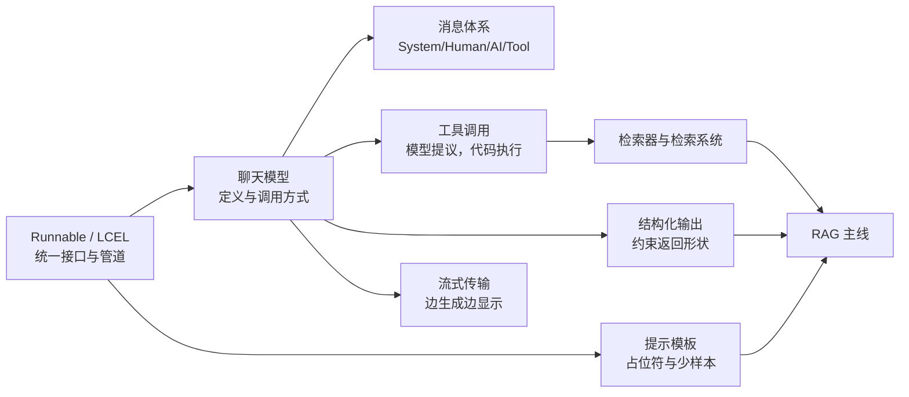
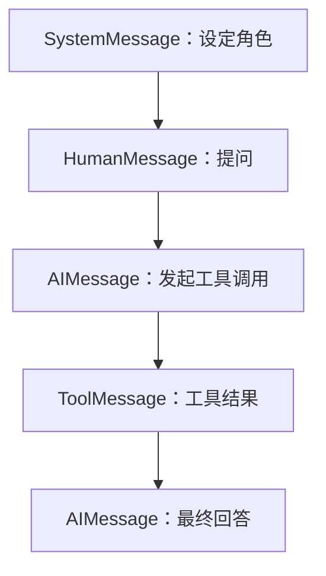
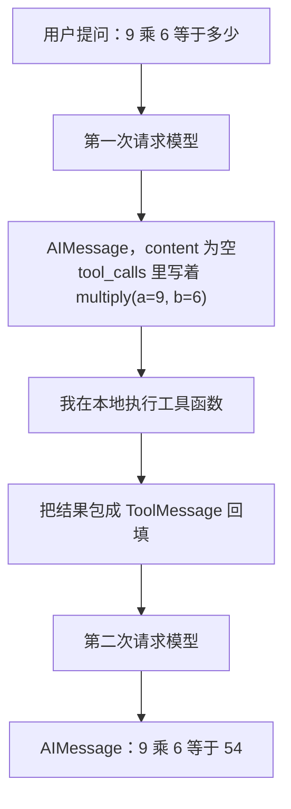
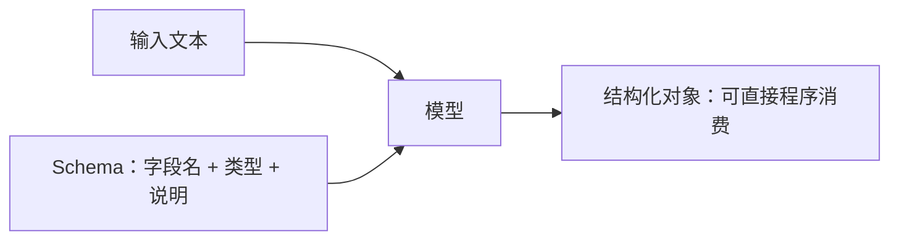
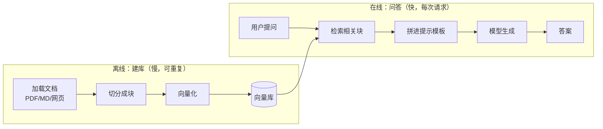

用 C++ 写惯了以后，第一次看 LangChain 我最大的困惑是：它到底封装了什么？把整份资料读完、又自己敲了一遍之后，我的结论是——**它把"调模型"这件事从一次函数调用，变成了一条可拆装的数据流水线**。模型、提示模板、解析器、检索器、工具，全都是同一种东西：能接收输入、产出输出的节点，然后你用 `|` 把它们串起来。

这篇笔记按我自己的理解顺序重排了一遍：先讲清最小心智模型，再往上叠能力，最后落到 RAG 这条主线。重点放在"为什么这么设计"和"哪一步容易翻车"。

## 路线图



## 一、快速上手：五分钟跑通一次调用

### 1.1 它到底想解决什么

不借助框架，直接写 HTTP 请求去问模型，很快会遇到一串具体麻烦：

| 我遇到的问题 | 裸调用的后果 |
| --- | --- |
| 提示词散落在各处 | 想改一个措辞要翻遍工程 |
| 换一家模型厂商 | 请求体、返回体的字段全不一样 |
| 模型返回的是一段自然语言 | 程序没法直接吃，只能正则硬抠 |
| 想让模型查实时数据 | 它只会编，而且编得很自信 |
| 多轮对话 | 历史消息得自己裁剪、自己拼接 |

LangChain 的思路不是去解决"模型不够聪明"，而是把上面这些环节都抽象成**标准组件**，再给一个统一接口把它们连起来。所以我更愿意把它看成一个"编排层"，而不是"AI 库"。

### 1.2 一次最小调用

```python
from langchain_openai import ChatOpenAI
from langchain_core.messages import HumanMessage, SystemMessage
from langchain_core.output_parsers import StrOutputParser

model = ChatOpenAI(model="gpt-4o-mini")

messages = [
    SystemMessage(content="把用户的话翻译成中文"),
    HumanMessage(content="hi!"),
]

parser = StrOutputParser()
chain = model | parser          # 组链
print(chain.invoke(messages))   # 一次执行到底
```

`model.invoke(messages)` 单独调用返回的是 `AIMessage`，想拿纯文本还得再点一次 `.content`。`StrOutputParser` 干的就是这件事：把消息对象拆成字符串。而 `model | parser` 把两步合成一步，这就是 LangChain 最核心的手感。

### 1.3 Runnable 是什么

几乎所有组件都实现了 `Runnable` 接口，它规定了一个节点至少能做什么：

| 能力 | 方法 | 我的理解 |
| --- | --- | --- |
| 调用 | `invoke` / `ainvoke` | 一进一出，最常用 |
| 批处理 | `batch` / `abatch` | 一次喂多条输入 |
| 流式 | `stream` / `astream` | 输出边生成边吐 |
| 内省 | `get_graph` 等 | 打印内部结构，调试用 |
| 组合 | `pipe` / `\|` | 拼成更长的管道 |

**关键点：组合出来的链，本身还是一个 Runnable。** 所以 `chain | parser2 | ...` 可以无限套下去，这跟 Unix 管道是同一个味道——小工具各自只做一件事，靠管道拼出复杂行为。

### 1.4 `|` 运算符背后的东西

`model | parser`、`RunnableSequence(first=model, last=parser)`、`model.pipe(parser)` 三种写法等价。`|` 被重载了，产出的类型叫 `RunnableSequence`，也就是"链"。规则很简单：**上一个节点的输出，就是下一个节点的输入**。这条规则决定了后面所有的组合方式——`RunnablePassthrough` 让原始输入原样穿过，字典字面量可以让同一个输入并行喂给多个分支，都是围绕它展开的。

> 我踩的坑：`|` 的两侧必须都是 Runnable。把普通函数直接塞进去会报错，得先用 `@chain` 装饰或包成 `RunnableLambda`。

## 二、聊天模型：先把模型拿到手

### 2.1 三种定义方式

| 方式 | 写法 | 适用场景 |
| --- | --- | --- |
| 具体类 | `ChatOpenAI(model=...)` | 明确只用一家，参数最全 |
| 工厂函数 | `init_chat_model("gpt-4o-mini", model_provider="openai")` | 想按字符串切厂商 |
| 本地部署 | `ChatOllama(model=..., base_url=...)` | 内网/离线环境 |

`init_chat_model` 的好处是返回对象都实现了同一套 ChatModel 接口，换厂商只是换字符串：

```python
from langchain.chat_models import init_chat_model

gpt = init_chat_model("gpt-4o-mini", model_provider="openai", temperature=0)
ds = init_chat_model("deepseek-chat", model_provider="deepseek", temperature=0)

print(gpt.invoke("1+1=?").content)
print(ds.invoke("1+1=?").content)
```

用国产模型时，只要对方兼容 OpenAI 协议，把 `base_url` 指过去、换一个 key 环境变量即可，`ChatOpenAI` 不用换。

> 坑：`base_url` 里的 `/v1` 是接口版本路径，跟模型版本没关系；写成别的前缀会直接 404。另外 `temperature=0` 也不是绝对的确定性，同一句话多跑几次仍可能有细微差别，别把幂等性押在它身上。

### 2.2 调用的几种姿势

```python
model.invoke("你好")                                   # 字符串直接进
model.invoke([HumanMessage("你好")])                   # 消息列表
model.invoke([{"role": "user", "content": "你好"}])     # 字典也可以
model.batch(["问题1", "问题2"])                         # 批量
```

### 2.3 返回对象里有什么

一次 `invoke` 回来的是 `AIMessage`，除了 `content` 还有几块信息很值得看：

| 字段 | 装的是 | 我什么时候会翻它 |
| --- | --- | --- |
| `content` | 正文 | 正常取结果 |
| `tool_calls` | 模型提议要调用的工具 | 做 Agent 循环 |
| `response_metadata` | 模型名、请求 id、finish_reason | 排查"为什么截断了" |
| `usage_metadata` | 输入/输出 token 数 | 算成本、做预算告警 |

写工程的时候我只关心后两个字段里的少数几项，但出问题的时候它们是唯一的线索。

## 三、消息体系：对话的载体

### 3.1 四种角色

| LangChain 类 | 角色 | 谁产生的 |
| --- | --- | --- |
| `SystemMessage` | system | 我写的，负责设定行为边界 |
| `HumanMessage` | user | 用户输入 |
| `AIMessage` | assistant | 模型输出，可能带工具调用请求 |
| `ToolMessage` | tool | 我执行完工具后，把结果回填 |

流式场景下 `AIMessage` 会以 `AIMessageChunk` 的形式一块块出现，它还能直接相加拼回完整消息，这个设计在"边收边渲染"时特别顺手。

### 3.2 顺序不是随便排的

一次带工具的完整交互，消息序列长这样：



这个顺序有硬约束，裁剪历史时特别容易违反：

- 开头必须是 `SystemMessage` 或 `HumanMessage`；
- 结尾必须是 `HumanMessage` 或 `ToolMessage`；
- `ToolMessage` 只能紧跟在"发起了对应工具调用"的 `AIMessage` 后面。

一旦违反，有的厂商接口会直接报错，有的会静默给出奇怪结果。

### 3.3 多轮对话：模型本身没有记忆

这是我最开始想当然的地方。模型不会记住上一轮说了什么，所谓"记忆"只是**每轮都把历史重新塞进去**：

```python
messages = [
    HumanMessage("我叫 Bob"),
    AIMessage("你好 Bob，有什么可以帮你的？"),
    HumanMessage("我叫什么？"),   # 靠前面的历史才能答对
]
```

历史越攒越长，就必须裁剪，否则早晚顶爆上下文窗口。LangChain 给了三个工具：

| 工具 | 作用 | 典型参数 |
| --- | --- | --- |
| `trim_messages` | 按 token 数或消息条数截断 | `max_tokens`、`strategy`、`include_system`、`start_on` |
| `filter_messages` | 按类型 / id / 名称筛掉一些 | `include_types`、`exclude_ids` |
| `merge_message_runs` | 合并同类连续消息 | 无 |

`trim_messages` 可以直接当管道节点用：

```python
from langchain_core.messages import trim_messages

trimmer = trim_messages(
    max_tokens=64,          # 预算上限
    strategy="last",        # 从尾部往前保
    token_counter=model,    # 用哪个模型的分词口径来数
    include_system=True,    # 系统提示永远优先保留
    start_on="human",       # 保证切完第一句仍是用户消息
    allow_partial=False,    # 不切半句话
)
chain = trimmer | model
```

把 `token_counter` 换成 `len`，`max_tokens` 的含义就变成"最多几条消息"，这是按条数裁剪的写法。

> 坑：裁剪是把上下文一起砍掉，所以**很早之前说过的关键信息会丢**。真要做长期记忆，别指望无限增长的消息列表，得自己设计摘要或外部存储。

## 四、提示词模板：把提示变成可维护的资产

### 4.1 为什么需要它

同一个提示反复出现、只换一个变量的时候，硬编码字符串会迅速失控。模板做的就是占位符替换，跟 `printf` 的 `%s` 是一个心思。

```python
from langchain_core.prompts import ChatPromptTemplate, MessagesPlaceholder

prompt = ChatPromptTemplate([
    ("system", "你是{domain}方向的答疑助手"),
    MessagesPlaceholder("history"),        # 历史消息整段插进来
    ("human", "{question}"),
])

msgs = prompt.invoke({
    "domain": "Linux 内核",
    "history": [HumanMessage("我在看调度器")],
    "question": "CFS 的时间片怎么算？",
}).to_messages()
```

两个返回方法要分清：

- `to_string()`：拼成一个大字符串，给纯文本模型用；
- `to_messages()`：给出消息列表，给聊天模型用。

`MessagesPlaceholder` 的价值在于"位置可控"——历史既可以在系统提示之后、也可以在别处，这比把历史字符串拼进一段文本要干净得多。

### 4.2 少样本提示：给例子比讲道理管用

有些任务用语言描述很费劲，给两三个例子模型立刻就懂了。经典的 `🦜` 例子就是这个意思：先给 `2 🦜 2 = 4`、`2 🦜 3 = 5`，模型就能推出这个符号等价于加法。

| 少样本的适用场景 | 说明 |
| --- | --- |
| 强制输出格式 | 例子就是格式样板 |
| 风格难以描述 | "用 XX 的笔调写"直接示范 |
| 需要多步推理 | 例子展示中间步骤，引导模型照做 |

`FewShotChatMessagePromptTemplate` 负责把示例集渲染成消息对，再和系统提示、用户提问拼成完整模板。

### 4.3 示例太多怎么办：示例选择器

示例集一大，全塞进去既贵又慢，甚至互相干扰。按策略挑子集就行：

| 选择器 | 策略 | 我的使用场景 |
| --- | --- | --- |
| `LengthBasedExampleSelector` | 按长度上限装得下几个就装几个 | 输入长度不可控，先保不超窗 |
| `SemanticSimilarityExampleSelector` | 挑和当前输入语义最近的 k 个 | 示例主题分散，想精准命中 |
| `MaxMarginalRelevanceExampleSelector` | 既相关又互相不重复 | 示例高度同质，需要多样性 |
| `NGramOverlapExampleSelector` | 按 ngram 重叠度排序、按阈值取舍 | 字面重合度就是有效信号时 |

**语义相似**关心的是"意思近不近"，**最大边际相关性（MMR）**在它之上多做了一件事：先按相似度捞一批候选，再从里面挑出彼此差异大的几个。前者像面试官给每个候选人打分，后者像组长组队——不但要合格，还要技能互补。RAG 检索里 MMR 是去重的常用手段。

`NGramOverlap` 是比较表面的一种相似：连续 n 个词的重合程度。它对同义词完全无感（"苹果手机"和"iPhone"重叠为零），所以只在字面重合就够用的场景下才选它。

## 五、工具调用：让模型伸手够到外部世界

### 5.1 它到底"调用"了什么

这是我理解上最大的一个转折点：**模型不会执行任何东西，它只是输出一个结构化的"我想调谁、传什么参数"的请求。** 真正跑代码的是我。



所以一次工具调用至少要**问模型两遍**：第一遍拿方案，第二遍把执行结果交给它组织语言。

### 5.2 定义工具的几种写法

```python
from langchain_core.tools import tool
from typing_extensions import Annotated

@tool
def multiply(
    a: Annotated[int, ..., "第一个整数"],
    b: Annotated[int, ..., "第二个整数"],
) -> int:
    """两数相乘。"""
    return a * b

model_with_tools = model.bind_tools([multiply])
```

| 写法 | 说明 | 什么时候用 |
| --- | --- | --- |
| `@tool` + 文档字符串 | 最省事，函数名当工具名，文档字符串当描述 | 默认首选 |
| `@tool(args_schema=...)` | 用 Pydantic 类描述参数 | 参数复杂、想复用一个模型类 |
| `@tool` + `Annotated` | 把描述写在类型注解里 | 参数少、想就近说明 |
| `StructuredTool.from_function` | 显式构造，参数可覆盖 | 需要改名字、改描述、加响应格式 |

**函数名、类型注解、文档字符串这三样会一起被抽成工具 Schema 发给模型**，缺一不可：文档字符串留空会直接抛错。描述写得好不好，直接决定模型选不选得对工具——这一点比参数调优重要得多。

### 5.3 绑定后的三个关键参数

| 参数 | 作用 | 注意 |
| --- | --- | --- |
| `tool_choice` | 指定或限制用哪个工具 | `"auto"` 自动、`"none"` 禁止、`"any"`/`"required"` 强制至少一个 |
| `parallel_tool_calls` | 是否允许一次返回多个调用 | 设 `False` 可关掉并发调用 |
| `strict` | 是否强校验参数符合 Schema | 开了更安全，但部分模型不支持 |

`bind_tools` 返回的还是一个 Runnable，所以照旧 `invoke` 就行。想调试"模型到底会不会选这个工具"，把 `tool_choice` 临时设成强制，能立刻看出是描述问题还是模型问题。

### 5.4 拿到 tool_calls 之后

```python
ai_msg = model_with_tools.invoke("9乘6，5加3，分别等于多少")
messages = [HumanMessage("9乘6，5加3，分别等于多少"), ai_msg]

tool_map = {"multiply": multiply}
for call in ai_msg.tool_calls:
    tool_msg = tool_map[call["name"]].invoke(call)   # 传整个 call，直接得 ToolMessage
    messages.append(tool_msg)

print(model.invoke(messages).content)   # 模型这时才给出自然语言答案
```

`tool.invoke(tool_call)` 会自动把结果包装成带 `tool_call_id` 的 `ToolMessage`，这个 id 是把"请求"和"结果"配对的依据，手写的时候千万别漏。

> 坑：`tool_calls` 可能一次返回多个（示例里 `multiply` 和 `add` 就同时被选中），必须遍历处理。只取第一个会导致模型拿到残缺上下文，然后开始瞎编。

### 5.5 一个容易被忽略的返回值：artifact

有些工具除了给模型看的文本，还想保留一份原始数据。做法是让工具返回 `(content, artifact)` 二元组，并声明 `response_format="content_and_artifact"`。

- `content`：给模型读的简洁文本；
- `artifact`：给**链里后续代码**用的结构化原始数据，不进模型的上下文。

这个区分很重要。原始 JSON 动辄几千 token，塞给模型又贵又容易干扰推理，但做日志、做引用溯源、做二次处理时又非要不可。

### 5.6 官方现成的工具

不用什么都自己写，LangChain 及社区已经提供了一大批工具和工具包：网页搜索类（Tavily、DuckDuckGo、Serper 等）、浏览器、数据库、代码解释器等，它们基本都继承自 `BaseTool`，多个工具打包在一起叫 Toolkit。接一个搜索工具通常就是三步：装包、配 key 到环境变量、`bind_tools`。

## 六、结构化输出：把自然语言变成对象

### 6.1 为什么非要它

模型默认吐一段人类读着舒服的散文，程序读着就难受。要从"苹果公司昨日发布新机，股价涨了 2%"里抠出公司名和涨幅，正则很快就写不动了。`with_structured_output()` 换个思路：**先声明我要的形状，再让模型按形状填**。



### 6.2 三种 Schema 写法

| 写法 | 得到的结果 | 特点 |
| --- | --- | --- |
| Pydantic 类 | Pydantic 对象 | 有类型校验，最推荐 |
| TypedDict | 普通字典 | 轻量，键名拼错能在静态检查期发现 |
| JSON Schema | 普通字典 | 最通用，适合配置驱动 |

```python
from pydantic import BaseModel, Field

class Person(BaseModel):
    """人物信息。"""
    name: str | None = Field(default=None, description="姓名")
    height_m: str | None = Field(default=None, description="身高，单位米")

extractor = model.with_structured_output(Person)
print(extractor.invoke("老王今年四十五岁，是个木匠。"))
```

两个细节值得记：**字段描述要认真写**，它是模型判断"这个值该不该填"的主要依据；**字段尽量设为可选**，模型不知道答案时能返回 `None`，比硬编一个值好得多。

返回类型还能是联合类型，让模型自己选分支——同一个入口既能返回"笑话对象"，也能返回"闲聊回复对象"。

### 6.3 和工具一起用时的顺序陷阱

这是我在这一节里唯一真正卡住的地方。想让模型"先查再答，最后按 Schema 输出"，很自然会写：

```python
# 错误直觉
bad = model.bind_tools([web_search]).with_structured_output(SearchResult)
bad.invoke("查一下今天的天气")
```

结果是模型压根没调工具，直接凭空编了一个结构化结果——因为 `with_structured_output` 已经把输出形状锁定成了 `SearchResult`，工具调用的输出格式和它冲突。

正确做法是**拆成两步**：第一遍只带工具，等模型提出调用；执行完把 `ToolMessage` 拼进消息列表；第二次交给带结构化输出的模型去整理。

| 顺序 | 结果 |
| --- | --- |
| 先 `bind_tools` 再 `with_structured_output` | 有机会正常，但常常跳过工具 |
| 手动两段式（先工具后结构化） | 稳定可控 |

所以结论是：**"结构化输出 + 工具"这种组合，手写循环很别扭，实际工程里应该交给 LangGraph 那类状态机来做。** 原生 API 在这块只是演示能力。

### 6.4 `with_structured_output` vs 输出解析器

两者都能把输出变结构，但用法不同：

| 对比 | 输出解析器 | `with_structured_output()` |
| --- | --- | --- |
| 身份 | 一个组件（Runnable） | 聊天模型上的方法 |
| 能否进管道 | 能，`prompt \| model \| parser` | 不能，调用后返回新 Runnable |
| 通用性 | 各厂商都能用 | 依赖模型自身能力（工具调用/JSON 模式） |

常见的解析器有 `StrOutputParser`、`JsonOutputParser`、`PydanticOutputParser`、`XMLOutputParser` 等。用 `PydanticOutputParser` 时有个必须做的动作：把 `parser.get_format_instructions()` 通过 `partial_variables` 塞进提示模板，否则模型根本不知道要按什么格式输出。

> 坑：`PydanticOutputParser` 在流式场景下会一直吐出"字段填了一半"的对象（比如 `punchline=''`），因为 JSON 还没结束。要么别对它用流式，要么接受这种半成品。

## 七、流式传输：从"等 20 秒"到"第一个字就出来"

### 7.1 分层理解

流式不是 LangChain 发明的东西，它是一路"搬运"过来的：


`AIMessageChunk` 是 LangChain 的**统一中间格式**：不管底层是 OpenAI 还是别的厂商，上层拿到的块长得都一样。这就是"换厂商不改上层代码"的另一面。

### 7.2 三种写法

```python
# 同步
for chunk in model.stream("讲个短笑话"):
    print(chunk.content, end="", flush=True)

# 异步
async def run():
    async for chunk in model.astream("讲个短笑话"):
        print(chunk.content, end="", flush=True)

# 在链上流式（推荐）
chain = prompt | model | StrOutputParser()
for text in chain.stream({"question": "..."}):
    print(text, end="", flush=True)
```

`chain.stream()` 比 `model.stream()` 好用，因为解析器会把 `AIMessageChunk` 里的 `content` 直接摘出来给你，不用自己从块对象里翻字段。

**注意：块的具体类型取决于流的是哪个组件。** 流式调用聊天模型时吐出的是 `AIMessageChunk`，换成别的组件，块类型可能完全不同。另外不是所有组件都支持流式——检索器就不支持，它调用 `stream()` 的效果和直接 `invoke()` 没区别，因为检索本身是同步阻塞的。

| 组件 | 支持流式吗 | 为什么 |
| --- | --- | --- |
| 聊天模型 | 支持 | 底层厂商就是逐 token 推的 |
| 输出解析器 | 看实现 | `StrOutputParser` 支持；要求完整 JSON 的不行 |
| 提示模板 | 无所谓 | 它是纯内存拼装，瞬间完成 |
| 检索器 | 不支持 | 检索是一次性的同步查询，没有"中间结果"的概念 |

这个表其实回答了一个常见疑惑：**流式能力不是 LangChain 加的，而是底层组件本身具不具备。** 提示模板再快也没有流式的意义，检索器再慢也只能整块返回。

### 7.3 自定义流式解析

如果想把"一个字一个字"改成"一句话一句话"地吐，就得在链尾接一个生成器节点：

```python
from typing import Iterator

def split_sentences(chunks: Iterator[str]) -> Iterator[str]:
    buf = ""
    for chunk in chunks:
        buf += chunk
        while "。" in buf:
            head, buf = buf.split("。", 1)
            yield head + "。"
    if buf:
        yield buf

chain = prompt | model | StrOutputParser() | split_sentences
```

它的输入输出都是迭代器，所以能挂在链尾继续被 `stream()` 驱动。这个模式在"按行输出 Markdown""按段落做 TTS"之类的场景里很好用。

> 坑：RAG 这种链是"两段式"的——前半段（检索、拼提示）是同步阻塞的，后半段（模型生成）才能流。所以用户看到的仍然是"检索完才开始吐字"，别指望流式能把检索的延迟也藏掉。

## 八、RAG：本笔记的主线

前面所有组件，最终都是为了拼出这条链。

### 8.1 两条时间线

RAG 的关键是分清"离线"和"在线"：



离线阶段做的事很重但你只做一次；在线阶段每次请求都要跑，所以必须快。

### 8.2 第一步：加载成 Document

所有来源最后都被统一成 `Document`，只有三个字段：`page_content`（文本）、`metadata`（元数据字典）、`id`（可选）。元数据看着不起眼，但**它是后面做过滤和溯源的唯一抓手**，加载时能塞就多塞点（来源、页码、分类、时间）。

| 加载器 | 用途 | 备注 |
| --- | --- | --- |
| `PyPDFLoader` | PDF | 一页一个 Document，元数据含页码 |
| `UnstructuredMarkdownLoader` | Markdown | `mode="single"` 整篇一个；`mode="elements"` 按元素拆 |
| 社区大量其他加载器 | 网页、数据库、代码等 | 用法大同小异 |

`elements` 模式挺聪明：它按类型切，元数据里的 `category` 会标出这是 `Title`、`ListItem`、`Table` 还是 `NarrativeText`，并且用 `element_id` / `parent_id` 记录层级关系，等于把 Markdown 的树结构保留了下来。想按标题做精细切分时，这个信息很有价值。

### 8.3 第二步：切分

文档必须切小，理由有两个：模型的上下文窗口有限；块太大时检索命中的粒度太粗，问答会答偏。

| 分割器 | 行为 | 什么时候用 |
| --- | --- | --- |
| `CharacterTextSplitter` | 单分隔符，尽力而为 | 想保持段落完整 |
| `RecursiveCharacterTextSplitter` | 分隔符列表逐级尝试，严格遵守大小上限 | 需要硬性不超限 |
| `from_tiktoken_encoder()` | 用 token 而不是字符计量 | 面向 OpenAI 系列模型更准 |

```python
from langchain_text_splitters import RecursiveCharacterTextSplitter

splitter = RecursiveCharacterTextSplitter.from_tiktoken_encoder(
    encoding_name="cl100k_base",
    chunk_size=200,
    chunk_overlap=50,
)
chunks = splitter.split_documents(docs)
```

两个参数是核心：`chunk_size` 定目标大小，`chunk_overlap` 让相邻块有重叠，避免一句话正好被切断后两边都不完整。

第一次跑 `CharacterTextSplitter` 时，我被一堆"块大小超过设定值"的告警刷屏，一度以为写错了。其实这是**预期行为**：当所有分隔符都用尽、仍然没法把一段文本压到目标大小以下时，它宁可保留完整文本，也不硬切——因为从中间截断会产生无意义的碎片，污染后续的向量化。处理办法很简单：把 `chunk_size` 调大，或者换成 `RecursiveCharacterTextSplitter` 明确要求硬约束。

> 坑：默认分隔符列表是为英文设计的。切中文时可能出现一个词组被从中劈开的情况，需要把 `。`、`，` 这类标点补进 `separators` 列表里。

对代码文件还有语法感知的分割器（如 `PythonCodeTextSplitter`），它会尽量按函数、类来切，比按行切合理得多。

### 8.4 第三步：向量化

嵌入模型把文本映射成定长数字数组，让"语义接近"变成"向量距离近"。

| 维度概念 | 说明 |
| --- | --- |
| 维度 | 数组长度是固定的，比如 3072 维；维度高能表达更细的语义，但存储和计算更贵 |
| 向量空间 | 每个点代表一个概念，语义关系变成几何关系 |
| 余弦相似度 | 只看方向不看长度，文本相似度计算的主力 |
| 欧氏距离 | 直线距离，距离越小越像 |

为什么常用余弦相似度？因为文本的长短（向量长度）通常不代表语义强度，方向才代表含义。

LangChain 把嵌入接口拆成两个方法，这个设计值得留意：

| 方法 | 输入 | 输出 | 语义 |
| --- | --- | --- | --- |
| `embed_documents()` | 多个文本 | 二维列表 | 建库（离线、批量） |
| `embed_query()` | 单个文本 | 一维列表 | 查询（在线、实时） |

分开不只是类型不同——有些厂商会对"被检索的文档"和"检索语句"用不同的预处理甚至不同模型，所以这两条路径不能互换。

### 8.5 第四步：向量库

向量库解决的是"百万级高维向量怎么快速找最近邻"。核心手段有三块：

- **专用索引**：不做暴力遍历，而用近似最近邻（ANN），先用聚类或图结构把搜索范围缩小到几个候选区。代价是牺牲一点点精度，换取数量级的速度提升。常见做法有 IVF、HNSW 等。
- **底层算子优化**：借助 SIMD、GPU 之类的并行能力，把大规模向量运算压到很低的耗时。
- **数据管理**：CRUD、元数据过滤、持久化、分布式扩展。

**元数据过滤是实践中提升效果最快的一招**：先用"来源=某某文档、时间在某个范围"把候选集砍小，再在小区里做向量相似搜索，既准又快。

LangChain 里换向量库基本只是换一个类：

| 存储 | 定位 | 备注 |
| --- | --- | --- |
| `InMemoryVectorStore` | 内存态 | 学习/测试用，进程退出即丢 |
| `RedisVectorStore` | Redis 之上 | 借助 RediSearch 模块，缓存级速度 |
| `PineconeVectorStore` | 全托管云服务 | 免运维，需先在控制台建索引 |
| 其他（Chroma、Milvus、Qdrant 等） | 各有侧重 | 接口一致，按部署条件选 |

用 Redis 那套时，`metadata_schema` 要提前声明元数据字段名和类型（tag / numeric / text / geo），因为元数据字段会被建成索引字段，**schema 没声明的字段后面过滤不了**。

通用的几个方法名值得记住：

```python
ids = store.add_documents(chunks)                     # 写入，返回索引 id 列表
store.get_by_ids(ids[:3])                             # 按 id 取回
store.delete(ids=ids[:3])                             # 按 id 删除
store.similarity_search("查询语句", k=2)              # 相似搜索
store.similarity_search_with_score("查询语句", k=2)   # 带分数
store.max_marginal_relevance_search("查询语句", k=2, fetch_k=10)  # MMR
```

> 坑一：带分数的版本里，**分数越低通常表示越相似**（它是距离不是相似度），阈值要按这个方向设。
> 
> 坑二：MMR 的 `fetch_k` 是"先粗召回多少条候选"，`k` 是"最终留几条"。`fetch_k` 太小的话多样性根本没得挑，一般设成 `k` 的 3~5 倍。

### 8.6 第五步：检索器

检索器把各种检索后端统一成同一个接口：

> 输入一个查询字符串，输出一组 `Document`。

底层可以是向量库，也可以是关系库（让模型生成 SQL 再执行）、倒排索引。向量库转检索器一行搞定：

```python
retriever = vector_store.as_retriever(
    search_type="mmr",
    search_kwargs={"k": 4, "fetch_k": 12},
)
docs = retriever.invoke("这些表是怎么规划的？")
```

| `search_type` | 行为 |
| --- | --- |
| `similarity`（默认） | 纯相似度取前 k |
| `mmr` | 先取 `fetch_k` 再选多样化的 k |
| `similarity_score_threshold` | 加一个分数门槛，宁缺毋滥 |

想加自定义过滤逻辑，也可以用 `@chain` 把一个普通函数变成 Runnable，让它扮演检索器。

**检索器和向量库不是一回事，这点我一开始混了。** 向量库管的是"存和搜"，检索器管的是"把查询交给某个检索系统、拿回文档"。所以检索器可以架在向量库上，也可以架在 SQL 库或倒排索引上——后者意味着让模型先写一条 SQL、执行、再把结果交给模型总结。LangChain 把这一层抽象成同一个接口，好处是 RAG 链完全不用关心底下是什么。

| 对比 | 向量库 | 检索器 |
| --- | --- | --- |
| 职责 | 存储与相似搜索 | 查询转换与结果获取 |
| 接口 | 一堆搜索方法 | 收下查询字符串，交出一组文档对象 |
| 底层 | 固定是向量索引 | 可以是向量、SQL、倒排索引等 |
| 组合 | 不能直接进链 | 是 Runnable，能进链、能继续组合 |

### 8.7 拼成完整的链

```python
from langchain_core.runnables import RunnablePassthrough
from langchain_core.output_parsers import StrOutputParser
from langchain_core.prompts import ChatPromptTemplate

prompt = ChatPromptTemplate([
    ("human",
     "只依据下面的上下文回答问题；上下文里没有就说不知道。\n"
     "问题：{question}\n上下文：{context}"),
])

def join_docs(docs):
    return "\n\n".join(d.page_content for d in docs)

rag = (
    {"context": retriever | join_docs, "question": RunnablePassthrough()}
    | prompt
    | model
    | StrOutputParser()
)

for text in rag.stream("这些表是怎么规划的？"):
    print(text, end="", flush=True)
```

这里 `RunnablePassthrough` 的作用是**让用户的原始问题原样穿过**，和检索出来的上下文并成一份字典，再一起喂给提示模板。字典字面量在这里起到了"并行分支"的作用：同一个输入同时走了两条路。

### 8.8 怎么判断 RAG 到底行不行

这套链跑通只要几十行，但"跑通"和"答得对"是两件事。我总结了一下排查顺序，因为**大部分错误根本不在模型那一层**：

| 现象 | 大概率原因 | 先看哪里 |
| --- | --- | --- |
| 答"我不知道"，但文档里明明有 | 召回没命中 | 打开链路追踪，看检索节点实际返回了哪几块 |
| 答得似是而非 | 块切得太碎或太大 | 打印几个块的内容，看看语义是否完整 |
| 前后矛盾、来回横跳 | 召回了一堆高度重复的块 | 换 `search_type="mmr"` 做去重 |
| 答非所问但上下文是对的 | 提示模板里问题变量没填进去 | 打印 `prompt.invoke(...)` 的结果 |
| 混进别的文档内容 | 元数据没做过滤 | 检查入库时写了哪些 metadata |

我自己最常用的手段是**把检索结果单独打印出来，不调模型**。只要召回的那几个块是对的，后面基本就是提示词微调的事；召回不对，再怎么调提示词都是白搭。

## 九、几个我认为最该记住的点

1. **一切皆 Runnable。** 模型、模板、解析器、检索器都是同一种节点，`|` 把它们连起来，连出来的还是节点。
2. **工具调用不等于工具执行。** 模型只提交申请，执行权在我手里，也因此至少要问模型两遍。
3. **Schema 里的描述就是给模型的说明书。** 字段描述、工具描述写得好不好，直接决定效果，比调参数有用。
4. **消息顺序有硬约束。** 裁剪历史时最容易踩，尤其别让 `ToolMessage` 失去它的 `AIMessage`。
5. **切分粒度决定 RAG 质量的上限。** 块太大检索不准，太小上下文残缺，重叠是必要的缓冲。
6. **元数据是检索的加速器。** 先过滤再搜索，比纯向量检索又准又快。
7. **流式是分层的。** 厂商给 SSE，LangChain 统一成 `AIMessageChunk`，上层按需再推给前端；检索这类阻塞环节不会因为流式而变快。
8. **该交给状态机的时候别硬写循环。** "工具调用 + 结构化输出"的多轮编排，手写很脆，那正是 LangGraph 的领域。

## 十、调试与可观测性

链一长，出问题就很难定位：到底是提示写歪了，还是检索没召回对文档，还是模型自己发挥？我一开始靠 `print` 硬看，很快就顶不住了。

LangSmith 这类追踪平台的价值就在这里：**不用改业务代码，只要配两个环境变量**（一个开关、一个 key），每次调用的完整链路就会自动上报。它展示的是三层信息：

| 层级 | 内容 | 用途 |
| --- | --- | --- |
| 链路 | 这次调用由哪几个节点串成，每步耗时多少 | 找瓶颈，看是否命中缓存 |
| 输入输出 | 每个节点实际收到了什么、吐出了什么 | 看提示填充结果、看检索召回了哪些块 |
| 统计 | token 消耗、延迟分位、错误率 | 成本与稳定性监控 |

跟踪详情是瀑布式的：最外层是链，往里展开是每次模型调用和每个函数节点。我最常用的一招是**点开检索节点看实际召回的那几个块**——RAG 答错十次里有八次是召回不对，而不是模型不行。

官方那个 Hub 也顺带说一句：可以在线浏览别人分享的提示模板，按下载量和收藏排序，需要时直接 `pull_prompt` 拉下来用；学习提示词写法时翻一翻别人的成品，比空想有效。

### 10.1 回调：自己动手埋点

在那之前我还试过一条更原始的路：LangChain 的**回调（Callback）机制**。它本质上是一组钩子，允许我在链执行的各个时刻插入自己的逻辑，而不必改链本身。

| 我关心的事件 | 代表钩子 | 我拿它做什么 |
| --- | --- | --- |
| 链整体开始 / 结束 | `on_chain_start` / `on_chain_end` | 打点总耗时 |
| 模型每次请求 | `on_llm_start` | 记录完整提示词，复现问题 |
| 每吐一个 token | `on_llm_new_token` | 转发给前端做打字机效果 |
| 工具被调用 | `on_tool_start` / `on_tool_end` | 审计"模型到底调了什么、传了什么参数" |

它还支持把每次运行的结构化成 `runs` 树打印出来，效果和追踪平台的瀑布图类似，只是没有可视化和持久化。**如果只是本地调试、又不想接外部服务，回调是最轻的方案。**

这一点和 C++ 里的 hook 思路很像：框架在关键路径上留了插槽，业务逻辑通过注册回调挂上去，框架自身不需要知道你想干什么。区别是 LangChain 的回调能顺着链的嵌套结构自动传递，子节点的事件也会冒泡到父节点的处理器上，不用我手工层层透传。
