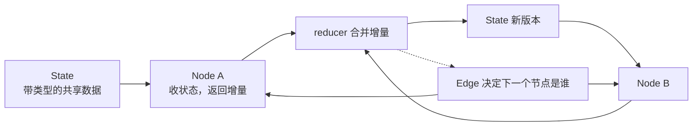
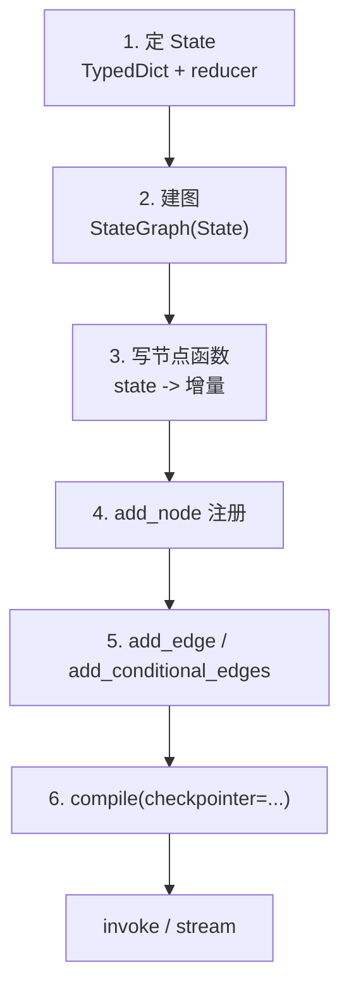
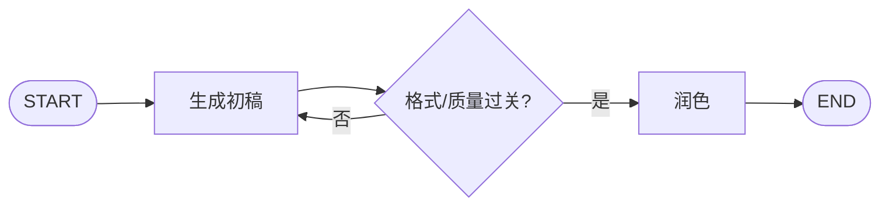
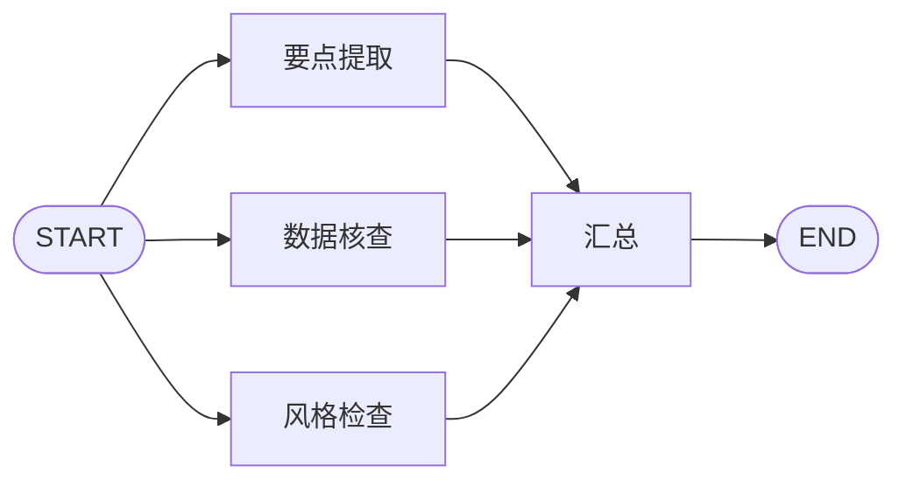
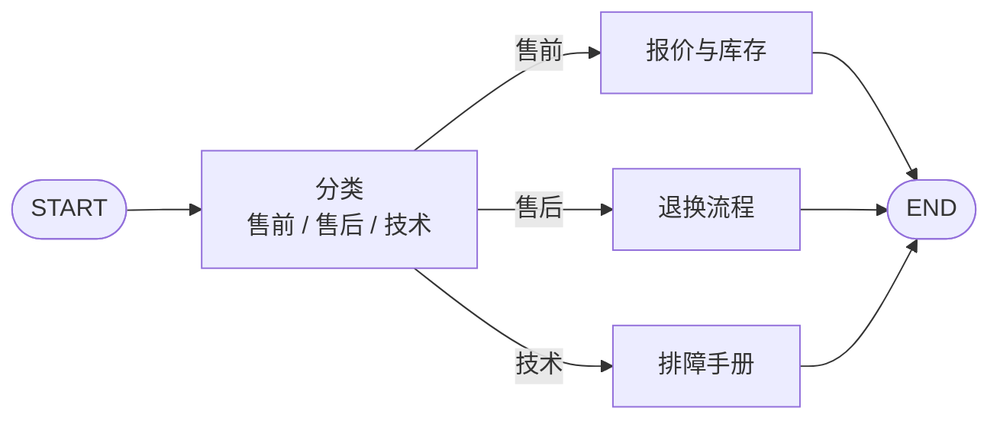
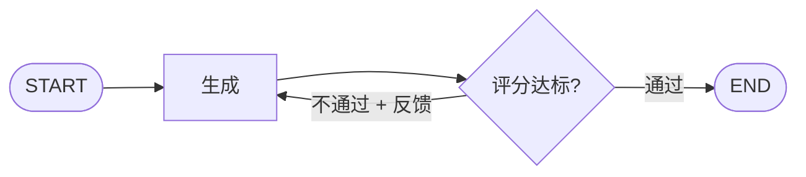
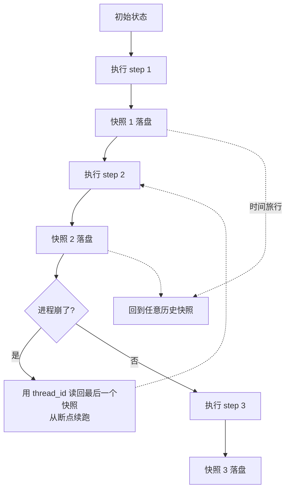
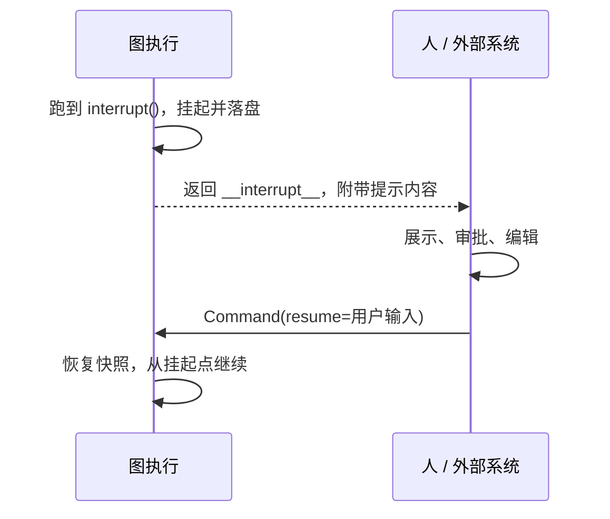
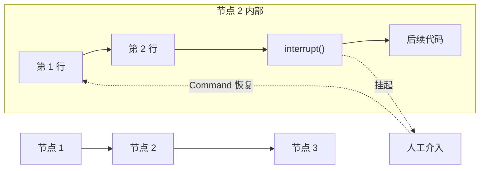
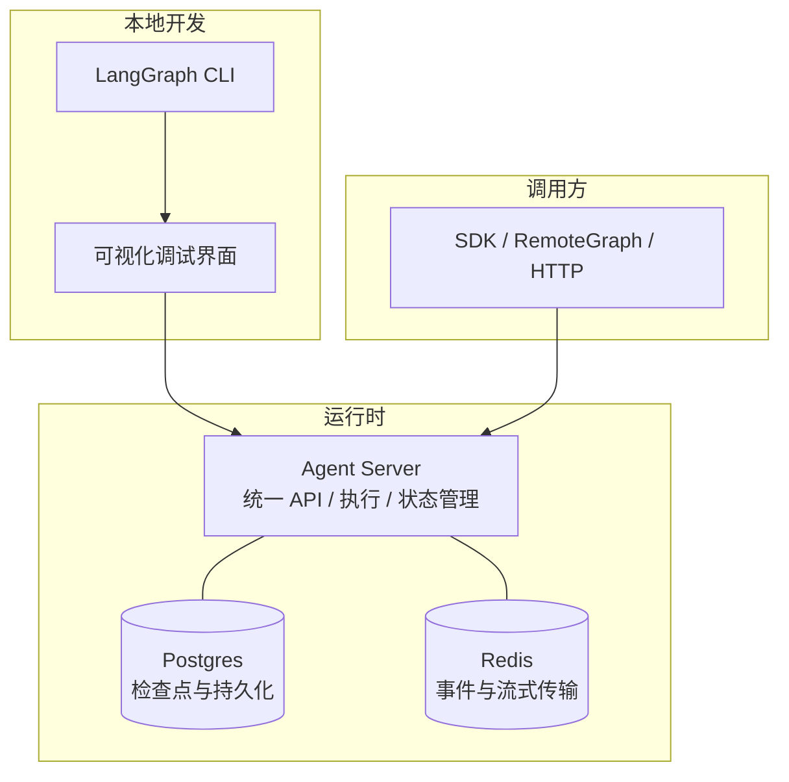

## 先记住三句话

我把这一整套东西压缩成三句，后面全是它们的展开：

1. **State 是唯一被共享的东西**。节点之间不互相调用，只读写同一份带类型的状态。
2. **图 = 状态 + 节点 + 边**。边分两种：固定的和条件判断的；条件边可以返回 `Send`，于是边的数量在运行时才定下来。
3. **持久化不是附加功能，而是记忆、断点恢复、人工中断、时间旅行共同的地基**。没有 checkpointer，后面一半能力都用不了。

再补一句我自己的定位理解：LangGraph 不管我用哪个模型、system prompt 长什么样，它管的是"多个步骤怎么串起来、状态存在哪、人怎么插手"。把它想成给 Agent 用的流程内核，比把它想成"另一个 LLM 框架"准确得多。

## 为什么需要图，而不是链

链式写法（LCEL）是一条直线：输入 → 检索 → 拼提示词 → 生成 → 输出。它的问题不是不好用，而是**形状被写死了**：你在写代码的时候就得知道有几步、每步是什么。

一旦需求变成下面这类，直线的形状就不够了：

- 要不要调工具，得等模型看完了才知道 —— 分支在运行时才产生
- 工具调用和模型之间要来回好几轮 —— 需要回环
- 三个维度的分析可以同时跑 —— 需要扇出再汇合
- 跑到一半要停下来等人审批 —— 需要能挂起再续上

| 问题 | 链式写法的表现 | 图式写法的对应能力 |
| --- | --- | --- |
| 中途忘了前面做过什么 | 上下文靠手工一路传参 | 共享 State 全程在位 |
| 为什么做了这个决定，查不出来 | 埋在调用栈里，看不到中间态 | 每个节点进出都留状态快照 |
| 想插人工确认 | 只能把流程拆碎 | `interrupt()` + 恢复 |
| 进程重启 | 从头再来 | checkpointer 续跑 |
| 上生产 | 自己搭服务器 | 统一的 Server 运行时 |

这里我想强调一下「编排」和「自主」的分界，这个区分决定了你该不该上图：

| | 工作流式编排 | 自主智能体 |
| --- | --- | --- |
| 谁决定下一步 | 我写的代码 / 条件边 | 模型自己决定 |
| 可预测性 | 高，路径基本能穷举 | 低，但能处理没见过的输入 |
| 适合 | 流程明确的业务，比如工单分类、审批 | 开放式问题，比如"帮我调研一下这个方向" |
| 调试难度 | 低 | 高 |

我现在的习惯是：**能写死就写死，写不死的部分才交给模型**。把模型限制在一两个真正需要判断力的节点里（分类、打分、决定要不要检索），其余路径用固定边连起来，整张图会好调很多。

## 三要素：State / Node / Edge

我用了很久才把这三者的边界想清楚。它们的信息流向是这样的：



### State

State 是整张图共享的数据结构，通常写成一个 `TypedDict`（也支持 Pydantic 模型）。它的三个性质：

- **共享**：所有节点都能读到
- **结构化**：字段和类型是显式声明的，不是随手塞的字典
- **不可变式更新**：节点不直接改它，而是返回一份"要改哪些字段"的增量

### Node

节点就是个函数，签名是 `state -> dict`。两个要点：

- 参数拿到的是当前完整状态
- 返回值**不必**是完整状态，只写你要改的字段就行

我认为"单一职责"这条在节点粒度上比在函数粒度上更重要 —— 一个节点只干一件事，图的可读性和可调试性会好一个数量级。

### Edge

边决定谁接在谁后面，三种：

| 类型 | 写法 | 语义 |
| --- | --- | --- |
| 固定边 | `add_edge("a", "b")` | 总是从 a 到 b |
| 条件边 | `add_conditional_edges("a", fn, [...])` | 退出 a 时调 fn 决定去哪 |
| 入口/出口 | `START` / `END` | 图的起点和终点标记 |

`add_conditional_edges` 的 `path_map` 我建议永远显式写出来。不写的时候路由函数返回的字符串就直接当节点名用，写错一个字母不报错，只是走到一个奇怪的死路；写成字典映射之后，路由函数可以返回业务语义的词（`"needs_search"`），映射关系集中在一处，改起来也方便。

## 上手：StateGraph 的六步

我把它总结成一个固定套路，写新图基本就是填空：



一个能跑的最小例子，我故意选了不需要任何 LLM 的场景，方便先看清机制：

```python
from typing import Annotated, TypedDict
from operator import add
from langgraph.graph import StateGraph, START, END


class DocState(TypedDict):
    topic: str                              # 直接覆盖
    outline: list[str]                      # 覆盖
    log: Annotated[list[str], add]          # 追加
    llm_calls: Annotated[int, add]          # 累加


def plan(state: DocState):
    return {
        "outline": ["背景", "现状", "结论"],
        "log": ["plan done"],
        "llm_calls": 1,
    }


def review(state: DocState):
    return {"log": ["review done"], "llm_calls": 1}


def need_more(state: DocState) -> str:
    return "plan" if len(state["outline"]) < 2 else "review"


builder = StateGraph(DocState)
builder.add_node("plan", plan)
builder.add_node("review", review)
builder.add_edge(START, "plan")
builder.add_conditional_edges("plan", need_more, {"plan": "plan", "review": "review"})
builder.add_edge("review", END)

graph = builder.compile()
print(graph.invoke({"topic": "LangGraph", "outline": [], "log": [], "llm_calls": 0}))
```

跑一遍我注意到几件事：

- `log` 和 `llm_calls` 都是 `Annotated[..., add]`，但行为不同：列表是拼接，整数是求和。同一个函数 `add` 对不同类型的语义不一样，这点第一次看到会愣一下。
- 没写 reducer 的字段（`topic`、`outline`）是**整体替换**。多个并行分支同时写同一个无 reducer 的字段会直接报错 —— 这是 LangGraph 在拦你，不是 bug。
- `compile()` 会做结构检查：是否有从 `START` 走不到的节点、是否有走不到 `END` 的节点。

### reducer 这块的坑

| 字段类型 | 写法 | 节点返回值 | 结果 |
| --- | --- | --- | --- |
| 普通字段 | `x: str` | `{"x": "b"}` | 覆盖成 `"b"` |
| 列表追加 | `x: Annotated[list, add]` | `{"x": ["b"]}` | 追加，`[... , "b"]` |
| 计数累加 | `x: Annotated[int, add]` | `{"x": 1}` | 累加 |
| 消息列表 | `messages: Annotated[list, add_messages]` | `{"messages": [msg]}` | 按 id 去重合并 |

**最容易踩的一脚**：给列表字段加了 `add` 之后，节点里返回 `{"x": ["b"]}` 会追加；如果手滑返回 `{"x": "b"}`（字符串而不是列表），`list + str` 直接抛 `TypeError`。报错信息不会告诉你"这是 reducer 的问题"，第一次碰上会找很久。

### 想强行覆盖 reducer 怎么办

有些场景就是要清空重来，比如用户点了"新对话"，你要把整个消息列表抹掉，而不是再追加一条。这时候用 `Overwrite` 包一层：

```python
from langgraph.types import Overwrite

def reset(state: DocState):
    # 绕过 reducer，直接替换整个列表
    return {"log": Overwrite(["会话已重置"])}
```

`Overwrite` 的导入路径是 `langgraph.types`，记一下，不在 `graph` 里。适合它的场景基本就三类：重置对话、错误恢复后回滚状态、替换掉已经写坏的数据。

### 输入输出和内部状态分开

默认输入输出是同一个 schema，内部中间结果会原样吐给调用方。要么是嫌脏，要么是不能泄露，总之经常需要收窄：

```python
class InState(TypedDict):
    question: str

class OutState(TypedDict):
    answer: str

class InnerState(InState, OutState):
    scratch: str        # 只在节点之间流转

builder = StateGraph(InnerState, input_schema=InState, output_schema=OutState)
```

`input_schema` 管校验，`output_schema` 管过滤，`state_schema` 是节点真正看到的完整状态。我一开始觉得这是可选项，后来发现做 API 的时候它是必需的 —— 不然接口返回里会冒出一堆内部字段。

如果想更细粒度地控制"某个字段只给某几个节点看"，可以在节点函数签名上标注入参和返回类型：入参类型决定它能读到什么，返回类型决定它写出的东西进不进公共状态。没标注的字段就留在内部，下游节点读不到。不过这里有个取舍 —— 类型标注是给人和类型检查器看的约定，**运行时并不会真的把这个字段藏起来**，所以真正的敏感数据还是别往图里放。

## 五种常见编排模式

这一节是我觉得最值钱的部分：大部分生产里的图，拆开看都是这五种形状的组合。

### 提示链（Prompt Chaining）

把一个大任务切成若干步，前一步的输出是后一步的输入，中间可以插校验闸门。



典型的例子是"先列提纲再逐节展开"、"先翻译再校对"。加一个校验节点，不通过就打回上一步重做，这是它和单纯流水线的区别。

### 并行化（Parallelization）

同一份输入同时喂给多条互不依赖的分支，最后汇合。对应到代码上就是**从 `START` 连出多条边**，各分支再连到同一个聚合节点：



```python
builder.add_edge(START, "extract")
builder.add_edge(START, "verify")
builder.add_edge(START, "style")
for n in ("extract", "verify", "style"):
    builder.add_edge(n, "merge")
builder.add_edge("merge", END)
```

关键细节：三个分支的返回值会在**同一个 super-step 内合并**。所以它们写的字段名必须互不冲突，或者都带 reducer。写同一字段又没 reducer = 报错。

### 路由（Routing）

先分类，再走分支。这是我最常用的模式：用一个便宜的模型（或者干脆正则）做一次分类，把请求丢给对应的处理链。



```python
def route(state: dict) -> str:
    label = classify(state["question"])       # 返回 "sales" / "support" / "tech"
    return label

builder.add_conditional_edges(
    "classify", route,
    {"sales": "sales_node", "support": "support_node", "tech": "tech_node"},
)
```

这里的经验是：**分类节点一定要给兜底分支**。模型偶尔会返回你枚举之外的东西，映射表里加一个 `"other"` 通道，比让整张图崩掉好。

### 协调者-工作者（Orchestrator-Workers）

和并行化长得很像，区别只有一句话：**分支数量是不是运行时才知道的**。

| | 并行化 | 协调者-工作者 |
| --- | --- | --- |
| 分支数 | 写代码时确定 | 运行时由协调者决定 |
| 边 | `add_edge` 手写几条就是几条 | 条件边返回 `Send` 列表 |
| 例子 | 同时算均值/最值/方差 | 先读文档结构，发现要拆 7 节就派 7 个 |

实现靠 `Send`：条件边的路由函数不返回节点名，而是返回一个 `Send` 列表，每个 `Send` 是一个"独立任务包"。

```python
from langgraph.types import Send
from typing import Annotated, TypedDict
import operator

class State(TypedDict):
    topic: str
    sections: list[str]
    drafts: Annotated[list[str], operator.add]

def fan_out(state: State):
    # 运行时才知道有几个 section，就生成几个 Send
    return [Send("write_section", {"section": s}) for s in state["sections"]]

def write_section(state: dict):
    return {"drafts": [draft(state["section"])]}

builder.add_conditional_edges("plan", fan_out, ["write_section"])
```

我的理解是：`Send` 相当于给每个 worker 单独塞了一份**局部状态**。worker 之间彼此看不见对方的输入，只能通过带 reducer 的公共字段把结果交回来。

### 评估器-优化器（Evaluator-Optimizer）

生成 → 打分 → 不过关就带着反馈重新生成，闭环。



**这里必须设上限**。评估不通过就回头重生成，是个天然的无限循环结构，模型很可能一直在"再改改"。要么在状态里放一个 `attempts` 计数，要么在条件边里判断 `attempts >= 3` 就强制走 `END`。我吃过这个亏：一次本地调试忘了加上限，进程卡在循环里跑了十几分钟。

另外评估器不一定是 LLM，规则校验、单元测试、schema 校验都可以当评估器，而且比 LLM 便宜得多、稳定得多。

## 持久化：记忆、中断、时间旅行共同的地基

### 线程级持久化

机制很朴素：**每执行完一步，就把当前状态快照写一份到后端**。所以图不是"从头跑到尾"的一个函数调用，而是"一串可寻址的状态"。



两个核心概念：

| 概念 | 是什么 | 关键点 |
| --- | --- | --- |
| Thread | 一次完整的会话 / 一次任务执行 | 靠 `thread_id` 标识，彼此隔离 |
| Checkpoint | 某个时刻的状态快照 | 记了 `values`、`next`（下一步去哪些节点）、`metadata`，并用 `parent_config` 串成链条 |

`next` 这个字段我觉得很妙：它让"暂停"变成了一件自然的事 —— 快照已经记下了"接下来该跑谁"，恢复不恢复只是要不要继续调用的区别。

用法分两步：

```python
# 1) 编译时挂上 checkpointer
from langgraph.checkpoint.memory import InMemorySaver
graph = builder.compile(checkpointer=InMemorySaver())

# 2) 调用时带 thread_id
config = {"configurable": {"thread_id": "user-42"}}
graph.invoke({"messages": [("user", "我叫小明")]}, config)
graph.invoke({"messages": [("user", "我叫什么")]}, config)   # 它能答出来
```

同一个 `thread_id` 传进来：如果不存在就新建线程从初始状态跑；如果存在就加载最后一次快照继续。这就是"短期记忆"的全部秘密 —— 没有魔法，就是 `messages` 被一起存下来了。

存储后端的选择：

| 后端 | 类 | 适用 |
| --- | --- | --- |
| 内存 | `InMemorySaver` | 开发、单测。进程一停就没了 |
| SQLite | `SqliteSaver` | 本地实验、单机小工具 |
| Postgres | `PostgresSaver` | 生产 |

Postgres 我第一次用的时候忘了初始化表结构，报了一堆看不懂的错。记住：**第一次跑要先 `checkpointer.setup()`**。

### 跨会话持久化：Store

checkpointer 解决的是"同一次会话里别忘事"，但它管不了"这个用户上次来是什么时候、当时偏好什么"。Thread 之间是隔离的，这是它的设计目标，不是缺陷。

需要跨线程的信息，用 `Store`：

| | Checkpointer | Store |
| --- | --- | --- |
| 存什么 | 状态随时间的变化 | 结构化的知识 |
| 范围 | 单个 thread | 跨 thread，所有线程可读 |
| 组织方式 | `thread_id` → 检查点链 | `namespace` → key/value |
| 生命周期 | 一次会话 | 长期 |
| 典型用途 | 会话记忆、回放、调试 | 用户画像、偏好、历史沉淀 |

```python
from langgraph.store.memory import InMemoryStore

store = InMemoryStore()
graph = builder.compile(checkpointer=InMemorySaver(), store=store)
```

`store.put(("user-42", "prefs"), "food", {"like": "面食"})` 这样的三元组读起来很清楚：命名空间按业务维度分层，最后一个 key 定位到具体条目。我倾向于把 namespace 设计成 `(用户, 类别, 子类别)`，比一个大 namespace 里塞各种前缀键好维护得多。

场景对照：

| 阶段 | 你得到什么 |
| --- | --- |
| 只有状态，无持久化 | 每次对话都是陌生人 |
| 加 checkpointer | 单次会话内有记忆，换个会话就重来 |
| 再加 store | 它能说"你上次提到在学 Rust，进展如何" |

### 记忆的日常维护

`messages` 无限增长是要出事的：token 越烧越多，最后撞上上下文窗口。三种处理方式：

```python
# 1) 裁剪：只留最近的若干 token
from langchain_core.messages.utils import trim_messages
kept = trim_messages(state["messages"], strategy="last",
                     token_counter=model, max_tokens=2000,
                     start_on="human")

# 2) 删除：按 id 移除特定消息
from langchain_core.messages import RemoveMessage
return {"messages": [RemoveMessage(id=m.id) for m in state["messages"][:4]]}

# 3) 总结：把旧对话压成摘要，比直接丢更保信息
return {"summary": summarize(state["messages"][:-4]),
        "messages": [RemoveMessage(id=m.id) for m in state["messages"][:-4]]}
```

我的选择顺序是：**能总结就别删，能删就别硬塞**。裁剪最省事但会丢信息，总结贵一点但保住了脉络。

### 人机介入：中断

`interrupt()` 是"暂停键"。它把当前状态存下来，把一个可序列化的提示信息抛给调用方，然后整个调用就返回了。



```python
from langgraph.types import interrupt, Command

def confirm_node(state: dict):
    answer = interrupt({"question": "批准这笔操作吗?", "detail": state["action"]})
    return {"approved": bool(answer)}

graph = builder.compile(checkpointer=InMemorySaver())   # 没有 checkpointer，中断无从谈起
config = {"configurable": {"thread_id": "t1"}}

graph.invoke({"action": "转账 30000"}, config)      # 挂起，返回里带 __interrupt__
graph.invoke(Command(resume=True), config)          # 恢复，True 成为 interrupt() 的返回值
```

#### 中断的三条硬规则

这三条我是真的踩过，值得单独列：

**1. 只能传能序列化的数据。** 字符串、数字、布尔、列表、字典可以；函数、类实例、数据库连接不行 —— 因为它们要落盘存进检查点，存不下就报错。

**2. 绝对不要把 `interrupt()` 包在 `try/except Exception` 里。** 这条最反直觉。它的暂停机制是靠内部抛一个特殊异常实现的，如果你用宽泛的 `except Exception` 接住了，暂停信号就丢了，图会继续往下跑，行为完全不可预测。真需要异常处理，就只捕获你明确知道的那种具体异常类型（比如网络超时），或者把 `interrupt()` 和可能出错的代码拆开写。

**3. 中断之前的代码必须幂等。** 恢复执行时，**整个节点是从头再跑一遍的**，不是从 `interrupt()` 那一行接着跑。所以中断前如果有一句"创建订单"、"发送通知"、"扣款"，恢复一次就重复执行一次。正确做法是把副作用挪到中断之后，或者放进一个单独的节点，或者用 upsert 这类天然幂等的操作。



注意那条回到"第 1 行"的箭头 —— 这就是重复执行的来源。

#### 中断的四种用法

| 模式 | 做什么 | 我的场景 |
| --- | --- | --- |
| 审批 / 拒绝 | 敏感操作前停一下，人工点同意或不同意 | 转账、发邮件、改数据库 |
| 审查 / 编辑 | 把模型生成的文本交给人改，改完写回状态 | 对外文案、合同条款 |
| 工具内中断 | 中断写在工具函数里，调用参数先给人看 | 高风险 API 的参数确认 |
| 校验人工输入 | 循环中断直到输入合法 | 收集手机号、身份证号 |

第一种最常用，配合 `Command(goto=...)` 还能在恢复时直接改变后续走向 —— 恢复不只是"给个值"，也可以是"换个方向走"。

### 时间旅行

因为每一步都有快照，历史就是可寻址的。这套操作我总结成四步：

```python
# 1) 正常跑一遍
states = list(graph.get_state_history(config))     # 倒序，最近的在前

# 2) 找到想回退的那个快照
target = states[2]
print(target.values, target.next)

# 3) （可选）改一改状态，会分叉出新分支，原快照不动
new_config = graph.update_state(target.config, {"topic": "换个方向"})

# 4) 从那里重放：输入传 None，因为状态已经在快照里了
graph.invoke(None, new_config)
```

`update_state` 不是原地修改，而是**从那个点分叉出一条新分支**，原来的历史完整保留。这个设计我很喜欢 —— 调试的时候可以放心大胆地"假设当时换个输入会怎样"，不会污染原始轨迹。

它解决的实际问题：模型跑出来的结果不理想，你不想重跑整条链（贵且随机），只想回到某个中间节点改一个词看看。这在没有检查点的系统里是没法做的。

## 流式输出

流式在 LangGraph 里有两层含义，别混：

- **图的流式**：按节点输出，看到执行推进到哪了
- **token 流式**：模型一个字一个字往外吐

`stream_mode` 决定你看哪一层：

| 模式 | 输出什么 | 用途 |
| --- | --- | --- |
| `values` | 每步之后的完整状态 | 想看全局状态的演变 |
| `updates` | 每个节点这次的增量 | 只关心谁改了什么（默认） |
| `messages` | LLM 的 token 流 | 打字机效果 |
| `custom` | 节点/工具里主动推的数据 | 进度条、自定义事件 |
| `debug` | 各种内部细节 | 排查问题 |

```python
for chunk in graph.stream({"topic": "缓存"}, stream_mode="updates"):
    print(chunk)          # {'plan': {'log': ['plan done'], 'llm_calls': 1}}

# 也可以同时订阅多种模式，返回 (mode, chunk) 二元组
for mode, chunk in graph.stream(payload, stream_mode=["updates", "messages"]):
    ...
```

`custom` 模式要配合 `get_stream_writer()`，适合在工具执行过程中往外推阶段状态：

```python
from langgraph.config import get_stream_writer

def search_tool(query: str) -> str:
    writer = get_stream_writer()
    writer({"stage": "searching", "query": query})
    result = do_search(query)
    writer({"stage": "done", "hits": len(result)})
    return result
```

我感觉这个能力被低估了。前端要显示"正在检索资料…"、"已找到 5 条"这类信息，靠 `messages` 模式是拿不到的，必须自己推。

## 子图：把图当积木

子图就是"作为节点的另一张图"。用法有两种，区别在于状态是否共享：

| | 方式一：节点内部调用 | 方式二：子图直接当节点 |
| --- | --- | --- |
| 挂载 | `add_node("x", 普通函数)`，函数里 `sub.invoke(...)` | `add_node("x", 编译好的子图)` |
| 状态 | 父子状态可以完全不同，手工转换 | 同名字段自动共享 |
| 私有字段 | 由你决定映射规则 | 留在子图内，不外泄 |
| 流式 | 父图 `stream(..., subgraphs=True)` | 直接 stream 即可 |

我倾向方式二：少写转换代码，字段共享是"约定同名"这么简单。只有当子图的状态结构跟父图差异很大、或者要做多主图复用的时候，方式一的显式转换反而更清楚。

两个实用细节：

- **checkpointer 只需挂在父图上**，会向下传播到子图，不用每个子图都配一遍。
- **中断也支持子图**，但恢复的时候要加 `checkpoint_ns` 参数指定是哪个子图的命名空间 —— 否则运行时不知道你要恢复谁。这点我第一次用的时候卡了一会儿。

## 运行时上下文：别把什么都往 State 里塞

有个我早期常犯的错：把数据库连接、用户 ID、API key 统统塞进 State。问题是这些东西会跟着检查点一起被序列化，既浪费空间又可能泄露。

LangGraph 的做法是分三类：

| 类别 | 放哪 | 例子 |
| --- | --- | --- |
| 静态运行时上下文 | 调用时的 `context` 参数 | 用户 ID、语言偏好、数据库连接 |
| 动态运行时上下文 | 图的状态 | 对话历史、中间结果 |
| 跨会话上下文 | Store | 用户画像、长期偏好 |

判断标准很简单：**这次运行里从头到尾不变的东西，就不该进 State**。

```python
from dataclasses import dataclass
from langgraph.runtime import Runtime

@dataclass
class Ctx:
    user_id: str
    language: str = "zh"

def my_node(state: dict, runtime: Runtime[Ctx]):
    return {"answer": f"[{runtime.context.language}] ..."}

graph.invoke({"q": "..."}, context={"user_id": "u1", "language": "en"})
```

工具函数里也能拿到上下文，靠 `ToolRuntime` 注入，这样工具能知道自己是被哪个用户调用的，不用把这个信息塞进工具参数里让模型去编。

## 打包成服务：项目结构长什么样

单个 `.py` 文件跑得通，不代表能上线。要对外提供服务，需要一个描述文件告诉运行时"我的图在哪"：

```json
{
  "$schema": "https://langgra.ph/schema.json",
  "dependencies": ["."],
  "graphs": {
    "chat_agent": "./src/agent/graph.py:graph",
    "search_agent": "./src/agent/search.py:search_graph"
  },
  "env": ".env"
}
```

然后 `langgraph dev` 起本地开发服务器（内存模式，适合调试），它会带一个可视化界面，能看节点执行、改输入重跑、查看中断点。

我理解的部署形态大致是三层：



要自己落地就绕不开两件事：**Postgres**（存检查点、助手等持久化数据）和 **Redis**（做事件发布订阅，支撑实时流）。托管方案会把这些包掉，自托管就得自己管。

## 踩坑清单

把上面零碎提到的坑集中一下，这是我认为最值得先看的部分：

| 坑 | 现象 | 处理 |
| --- | --- | --- |
| reducer 类型不匹配 | `TypeError`，看不出跟 reducer 有关 | 加 reducer 的字段一律返回列表/数值，不要返回裸值 |
| 并行分支写同一字段 | 报错说字段冲突 | 要么给 reducer，要么各写各的字段 |
| 忘了 checkpointer | `interrupt()` 直接失效或报错 | 用中断/恢复/记忆就必配 checkpointer |
| 恢复时忘带 thread_id | 找不到会话，从头开始 | config 里始终带 `{"configurable": {"thread_id": ...}}` |
| `interrupt()` 被 try 包住 | 暂停信号丢失，流程乱跑 | 只用具体异常类型捕获，或拆开写 |
| 中断前有副作用 | 恢复后重复扣款/重复发消息 | 副作用挪到中断之后，或用 upsert |
| 评估循环没有上限 | 无限重试，token 烧光 | 状态里放 `attempts`，条件边强制退出 |
| 上下文全塞 State | 检查点膨胀、敏感信息落盘 | 用 `context` 参数和 Store 分类存放 |
| Postgres 没初始化 | 一堆 table not exist | 首次运行调 `checkpointer.setup()` |
| `path_map` 不写 | 路由写错不报错，走到奇怪的地方 | 显式写映射字典，加兜底分支 |

## 我现在的写法

如果让我从头设计一个 LangGraph 应用，顺序大概是这样：

1. **先画图再写代码**。把节点画出来，边标清楚是固定还是条件。画不出来说明流程还没想清楚，这时候写代码只会更乱。
2. **定状态字段**。只放"跨步骤要留下来的原始数据"，不放格式化文本、不放提示词模板、不放能从别处推出来的东西。
3. **每个节点一个职责**，函数签名标注入参和返回类型，靠类型标注表达"这个字段只在这两个节点之间流转"。
4. **条件边全部显式映射**，每个路由函数都带兜底分支。
5. **从第一天就挂 checkpointer**，哪怕开发阶段用内存版。后期想加记忆和中断，改动成本比一开始就配高得多。
6. **能确定的事情用固定边写死**，把模型限制在真正需要判断力的少数节点上。

最后一句感受：LangGraph 本身不难学，API 面很窄 —— 状态、节点、边、checkpointer，四个概念就够了。难的是把业务流程拆成合适的节点粒度，以及想清楚哪些信息该活在状态里、哪些不该。这部分框架帮不上忙，只能靠多画几张图慢慢练。
