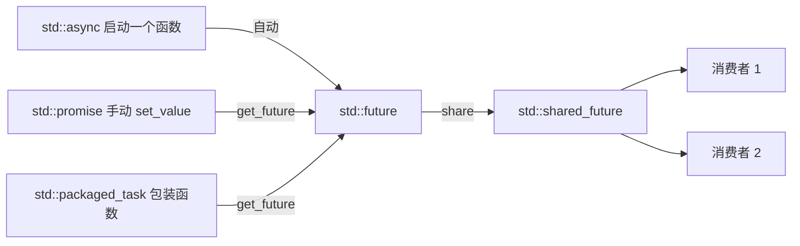

# C++11 并发编程入门：future / shared_future / async / launch / promise / packaged_task / future_status

> **适合读者**：会写基本多线程（至少用过 `std::thread` 和 `std::mutex`），但还没接触过 C++11 `<future>` 库的同学。
>
> **环境**：所有代码都是标准 C++11。Linux/macOS 下用 `g++ -std=c++11 -pthread 文件名.cpp -o 程序名` 编译；Windows 的 MSVC 直接编译即可（`future` 库不需要额外链接，但请确保使用 C++11 以上标准）。

---

## 目录

1. 先看问题：`std::thread` 传回结果有多麻烦
2. `std::future`：一个"承诺未来会有结果"的盒子
3. `std::async` 与 `std::launch`：一键开启异步计算
4. `std::promise`：手动"兑现承诺"
5. `std::packaged_task`：把函数"打包"成可异步执行的任务
6. `std::shared_future`：一份结果，多人共享
7. `std::future_status`：任务进行到哪一步了？
8. 综合实战：并行求和 & 简易任务队列
9. 接口速查表
10. 常见坑与最佳实践
11. 课后练习

---

## 1. 先看问题：`std::thread` 传回结果有多麻烦

假设我们要在另一个线程里计算 `1 + 2 = 3`，并把结果带回主线程。用最原始的 `std::thread` 怎么写？

```cpp
// 老办法：通过指针把结果"塞"回主线程
#include <thread>
#include <iostream>
void compute(int* result) {   // 让线程把结果写到这块内存里
    *result = 1 + 2;
}
int main() {
    int x = 0;                        // 主线程的普通变量
    std::thread t(compute, &x);       // 把 x 的地址交给新线程
    t.join();                         // 必须 join，否则 x 可能还没被写入
    std::cout << x << std::endl;      // 3
}
```

这个写法至少有三个痛点：

1. **必须 `join`**：主线程只能"死等"线程结束，无法中途查看"算完了没有"。
2. **生命周期危险**：如果忘记 `join` 或在线程还没结束时 `main` 返回，`x` 的内存就悬空了，程序直接崩溃。
3. **异常丢失**：线程里抛出异常会直接终止程序，主线程根本"接不住"——异常无法跨线程传播。

`<future>` 库就是为解决这三点而生的。它的核心思想是：

> **生产者**（可能在任何线程里）负责产出结果；**消费者**持有一个 `std::future`，它就像一个"自动取货的盒子"——现在取不到就等，取到了就立刻拿到，异常也能原样传回来。

`<future>` 里一共就这几个主要工具，先混个脸熟：

| 工具 | 一句话 |
| --- | --- |
| `std::future<T>` | 消费者端的"未来结果"，只能被取走一次 |
| `std::shared_future<T>` | `future` 的"多份拷贝"版，每个拷贝都能取一次结果 |
| `std::async` | 最省事的入口：直接"启动一个异步任务"并返回 `future` |
| `std::launch` | `async` 的策略开关：立即执行 / 懒执行 |
| `std::promise<T>` | 生产者端的手动"承诺"：由你亲自 `set_value` |
| `std::packaged_task` | 把任意函数包装成"任务"，结果自动送入 `future` |
| `std::future_status` | 查询任务状态用的枚举：`ready` / `timeout` / `deferred` |

它们之间的关系可以用一张图概括：



（Mermaid 只是示意图，看不懂没关系，下面逐个讲。）

---

## 2. `std::future`：一个"承诺未来会有结果"的盒子

### 2.1 概念

`std::future<T>` 表示：**"未来一定会有一个 `T` 类型的值（或异常）到达我这里"**。它本身不生产数据，只是"接收端"。生产端可以是 `std::async`、`std::promise` 或 `std::packaged_task`（后面两节讲）。

`future` 和它对应的生产者之间通过一块**共享状态（shared state）**通信，可以理解为一块共用的内存：

```
生产者计算/设置结果 ──写入──> [共享状态] <──读取── 消费者 future.get()
                               （线程安全）
```

### 2.2 常用接口

| 接口 | 作用 |
| --- | --- |
| `get()` | **阻塞等待**结果并取走它。只能调用**一次**！第二次行为未定义 |
| `wait()` | 只等待任务完成，**不取结果**，返回 `void` |
| `wait_for(时间)` | 最多等一段时间，返回 `std::future_status`（不管结果，可反复调用） |
| `wait_until(时刻)` | 等到某个**绝对时刻**，返回 `std::future_status` |
| `valid()` | 该 `future` 是否关联了共享状态（是否还能用） |
| `share()` | 把这个 `future` 转成 `std::shared_future`（第 6 节讲） |

注意：`std::future` **不可拷贝**（拷贝构造/赋值被删除），只能**移动**。这非常合理——"这份结果只能被一个人取走"，移动就是把资格转给别人。

### 2.3 示例 1：最最最简单的用法

```cpp
#include <future>        // future / async 都在这个头文件里
#include <iostream>
int main() {
    // std::async 直接启动一个异步任务（详情见第 3 节），返回 std::future<int>
    std::future<int> fut = std::async(std::launch::async,
                                      [] { return 100 + 23; });
    // get() 会阻塞，直到任务完成并把结果取走
    int result = fut.get();
    std::cout << "结果 = " << result << std::endl;   // 123
}
```

这段代码背后的时间线：

```
主线程:  [发起任务] ......... fut.get() 阻塞 ......... [拿到 123]
新线程:  ........... 计算 100+23，写入共享状态 ...........
```

### 2.4 示例 2：`valid()` 与"只能 get 一次"

```cpp
#include <future>
#include <iostream>
int main() {
    std::future<int> fut = std::async(std::launch::async, [] { return 7; });
    std::cout << "valid = " << fut.valid() << std::endl;  // 1：关联了共享状态
    int v = fut.get();                                    // 第一次 get，OK
    std::cout << "v = " << v << std::endl;
    std::cout << "valid = " << fut.valid() << std::endl;  // 0：结果已被取走，状态"空了"
    // fut.get();   // ⚠️ 第二次调用 get() 是未定义行为（UB）！
    //              // 在 gcc/libstdc++ 上通常会直接抛 std::future_error，
    //              // 但标准不保证任何行为，绝不要这么写。
    return 0;
}
```

### 2.5 示例 3：`wait()` —— 只等不取

```cpp
#include <future>
#include <thread>
#include <chrono>
#include <iostream>
int main() {
    auto fut = std::async(std::launch::async, [] {
        std::this_thread::sleep_for(std::chrono::milliseconds(300));  // 模拟耗时
        return 99;
    });
    fut.wait();    // 阻塞直到任务完成；注意：它不取走结果
    std::cout << "任务已完成" << std::endl;
    std::cout << fut.get() << std::endl;   // 99：结果还在，可以正常 get()
}
```

`wait()` 适合"我只关心任务做完了没有，结果可能在别的地方用"的场景。它和 `get()` 的一个关键区别：**`wait()` 可以反复调用，`get()` 不行。**

`wait_for` / `wait_until` 是"限时等待"，返回值是个三值枚举，我们留到第 7 节专门讲。

---

## 3. `std::async` 与 `std::launch`：一键开启异步计算

### 3.1 接口

```cpp
// 形式 1：不指定策略
template <class F, class... Args>
std::future<std::result_of_t<F(Args...)>> std::async(F&& f, Args&&... args);
// 形式 2：显式指定策略
template <class F, class... Args>
std::future<std::result_of_t<F(Args...)>> std::async(std::launch policy, F&& f, Args&&... args);
```

只要把**函数 + 参数**丢进去，`async` 就帮你：开线程 / 安排执行 → 把结果链接到返回的 `future` 上。这是 `<future>` 里最省事的入口，90% 的入门场景用它就够了。

### 3.2 `std::launch` 策略（就是一个位标志枚举）

| 策略 | 含义 |
| --- | --- |
| `std::launch::async` | **一定会新建一个线程**立刻执行任务 |
| `std::launch::deferred` | **懒执行**：任务不会自己跑，直到有人调用 `get()` 或 `wait()`，而且是在**调用它的那个线程**里执行（不会新建线程） |
| `std::launch::async \| std::launch::deferred` | **默认策略**：由编译器/库实现自由选择。典型实现会选择异步开线程，但标准不保证 |

### 3.3 示例 1：三种策略的行为对比

通过打印**线程 id** 就能看清每种策略到底"在哪里跑"。

```cpp
#include <future>
#include <thread>
#include <iostream>
int main() {
    std::cout << "主线程 id = " << std::this_thread::get_id() << std::endl;
    // 策略一：launch::async —— 一定在新线程里立刻执行
    auto f1 = std::async(std::launch::async, [] {
        std::cout << "async  任务跑在     " << std::this_thread::get_id() << std::endl;
        return 1;
    });
    std::cout << "async  结果 = " << f1.get() << std::endl;
    // 策略二：launch::deferred —— 不启动！等 get() 时才在当前线程（主线程）里执行
    auto f2 = std::async(std::launch::deferred, [] {
        std::cout << "deferred 任务跑在     " << std::this_thread::get_id() << std::endl;
        return 2;
    });
    std::cout << "deferred 结果 = " << f2.get() << std::endl;   // 这一行执行时才真正运行上面的 lambda
    // 策略三：默认策略（等同于 async | deferred）—— 由实现决定，通常也是新线程
    auto f3 = std::async([] {
        std::cout << "默认  任务跑在     " << std::this_thread::get_id() << std::endl;
        return 3;
    });
    std::cout << "默认  结果 = " << f3.get() << std::endl;
}
```

某个运行结果可能是：

```
主线程 id = 140737353846016
async  任务跑在     140737353846016    ← 注意：这是子线程，数字和主线程不同才正常
async  结果 = 1
deferred 任务跑在     140737353846016  ← 和主线程 id 相同 = 在主线程里执行的
deferred 结果 = 2
默认  任务跑在     123456789012345    ← 另一个子线程
默认  结果 = 3
```

### 3.4 示例 2：`deferred` 的"惰性"到底有多懒

```cpp
#include <future>
#include <iostream>
int main() {
    bool ran = false;
    auto fut = std::async(std::launch::deferred, [&ran] {
        ran = true;                  // 只有真正执行时才会置位
        return 42;
    });
    std::cout << "调用 get 之前，任务执行了吗？" << ran << std::endl;   // 0（没执行！）
    int v = fut.get();                                                   // 现在才执行 lambda
    std::cout << "调用 get 之后 ran = " << ran << ", 结果 v = " << v << std::endl;
}
```

输出：

```
调用 get 之前，任务执行了吗？0
调用 get 之后 ran = 1, 结果 v = 42
```

> ⚠️ **新手最容易踩的坑**：如果你**从不**调用 `get()` / `wait()`，`deferred` 任务**永远不会执行**，代码悄悄"少了件事"也不会报错。而 `async` 策略的任务则一定会执行完（详见第 10 节坑 3）。

### 3.5 常用场景：给 async 传参数

```cpp
#include <future>
#include <string>
#include <iostream>
// 普通函数也可以
int add(int a, int b) { return a + b; }
int main() {
    // 传函数指针 + 参数
    std::future<int> f1 = std::async(std::launch::async, add, 3, 4);
    std::cout << f1.get() << std::endl;   // 7
    // 传 lambda + 参数；std::cref 表示按"引用"传，避免拷贝大对象
    std::string big("hello");
    auto f2 = std::async(std::launch::async,
                         [](const std::string& s) { return s.size(); },
                         std::cref(big));
    std::cout << f2.get() << std::endl;   // 5
    // 不指定策略（默认策略）
    auto f3 = std::async([] { return 3.14; });
    std::cout << f3.get() << std::endl;   // 3.14
}
```

> **注意**：`async` 拷贝参数的原则和 `std::thread` 一样——默认**按值拷贝**（调用时发生，而不是移动）。想传引用就用 `std::cref`/`std::ref`。而且注意：**`std::cref` 临时对象在 `get()` 完成前必须还活着**（上面例子里 `big` 直到 `f2.get()` 之后才销毁，没问题）。

---

## 4. `std::promise`：手动"兑现承诺"

`std::async` 是"库帮你自动生产结果"，那如果你想**自己控制什么时候给结果**（比如结果来自用户输入、网络回调、另一个线程的中间计算），就用 `std::promise`。

`promise` 与 `future` 是一对：`promise` 是**生产者端**（承诺未来会给一个值），`future` 是**消费者端**。

### 4.1 常用接口

| 接口 | 作用 |
| --- | --- |
| `get_future()` | 取出与之配对的 `std::future`（只能调用一次） |
| `set_value(v)` | 设置结果，唤醒所有等待的消费者；`promise<void>` 用 `set_value()` |
| `set_exception(eptr)` | 不设置值，而是设置一个异常（消费者 `get()` 时会抛出它） |
| `set_value_at_thread_exit(v)` | 设置结果，但**等当前线程真正结束时**才生效（唤醒等待者） |
| `set_exception_at_thread_exit(eptr)` | 同上，但设置的是异常 |
| （析构） | 如果析构时**一直没兑现**，消费者 `get()` 会收到 `std::future_error`（broken promise） |

`set_value` 只能调用一次，第二次会抛 `std::future_error`（错误码 `promise_already_satisfied`）。

### 4.2 示例 1：最基本的生产者-消费者

```cpp
#include <future>
#include <thread>
#include <chrono>
#include <iostream>
int main() {
    // 1. 创建一个"承诺"
    std::promise<int> pr;
    // 2. 拿到它配套的"未来结果"
    auto fut = pr.get_future();
    // 3. 把 promise 交给工作线程
    //    ⚠️ promise 不可拷贝！只能传引用（或者用 std::move 转移所有权）
    std::thread worker([&pr] {
        std::this_thread::sleep_for(std::chrono::milliseconds(200));  // 模拟耗时计算
        pr.set_value(12345);        // 4. 兑现承诺：把结果写进共享状态
        // 注意：set_value 之后，工作线程还能继续干别的活！
        std::cout << "[worker] 已兑现承诺" << std::endl;
    });
    // 5. 主线程阻塞在这里，直到 set_value 被调用（或 promise 析构）
    std::cout << "拿到结果：" << fut.get() << std::endl;
    worker.join();
}
```

输出顺序可能是（不保证先后，因为 `[worker]` 打印和主线程的 `get()` 返回是并发的）：

```
拿到结果：12345
[worker] 已兑现承诺
```

关键点：**`get()` 之前 worker 可以干很久**，主线程只是"等着"，不会一起卡住。

### 4.3 示例 2：跨线程传递异常（这是 `std::thread` 做不到的）

```cpp
#include <future>
#include <thread>
#include <iostream>
#include <stdexcept>
int main() {
    std::promise<int> pr;
    auto fut = pr.get_future();
    std::thread worker([&pr] {
        try {
            throw std::runtime_error("计算失败：数据非法");   // 线程里出了异常
        } catch (...) {
            // 把"当前异常"打包塞进共享状态，而不是让程序崩掉
            pr.set_exception(std::current_exception());
        }
    });
    try {
        fut.get();      // 会重新抛出 worker 里设置的那个异常
    } catch (const std::exception& e) {
        std::cout << "主线程捕获到子线程的异常：" << e.what() << std::endl;
    }
    worker.join();
}
```

输出：

```
主线程捕获到子线程的异常：计算失败：数据非法
```

### 4.4 示例 3：`broken_promise` —— 承诺没兑现就"跑路"

如果 promise 在 `set_value` 之前就析构了（比如所在的线程提前崩溃、忘记调用），消费者 `get()` 会得到一个 `std::future_error`，错误码是 `std::future_errc::broken_promise`。这是**一个特性，不是 bug**：它保证了"永远会有一个结果（值或异常）送达消费者"，消费者不会被永久挂起。

```cpp
#include <future>
#include <iostream>
int main() {
    std::future<int> fut;              // 先声明一个空的 future
    {
        std::promise<int> pr;          // promise 在花括号作用域内
        fut = pr.get_future();         // 把 future 拿出来
        // 忘记调用 pr.set_value(...) 就离开了作用域
    }                                  // pr 析构 → 共享状态被标记为 broken promise
    try {
        fut.get();
    } catch (const std::future_error& e) {
        std::cout << "错误码: " << static_cast<int>(e.code().value()) << std::endl;
        std::cout << "错误信息: " << e.what() << std::endl;   // 通常含 "broken promise"
    }
}
```

### 4.5 一句话补充 `set_value_at_thread_exit`

普通 `set_value` 会**立即**唤醒等待者；而 `set_value_at_thread_exit` 会把值先存起来，**等线程函数返回、线程真正结束前**才唤醒等待者。适合"线程里引用的资源（如局部对象）必须在线程结束前保持有效"的场合：

```cpp
std::promise<int> pr;
auto fut = pr.get_future();
std::thread t([&pr] {
    int local = 100;                                  // 线程局部资源
    pr.set_value_at_thread_exit(local);               // 先存，不马上唤醒
    // 线程函数还可以继续用 local，此时等待者还没醒
});                                                   // 线程结束时，等 fut.get() 的人被唤醒
```

日常代码很少用这个，知道存在即可。

---

## 5. `std::packaged_task`：把函数"打包"成可异步执行的任务

如果想"把某个函数包装成一个**可以丢到任意线程里执行、结果自动进入 future** 的任务对象"，就用 `packaged_task`。它比 `promise` 省事：你**不需要手动 `set_value`**，任务函数执行完毕后结果自动写入共享状态。

### 5.1 接口

| 接口 | 作用 |
| --- | --- |
| `packaged_task<签名>(可调用对象)` | 构造。`签名` 形如 `int(int, int)`，表示"入参两个 int、返回 int" |
| `get_future()` | 取出结果对应的 `future`（只能调用一次，最好在执行任务**之前**调用） |
| `operator()(实参...)` | 执行任务；结果/异常自动写入共享状态。可重复调用（只要 `reset` 过） |
| `valid()` | 是否还有效（是否还有可用的共享状态） |
| `reset()` | 丢弃旧状态、绑定一块**新的**共享状态，让任务可以**再次**执行 |

### 5.2 示例 1：包装函数，丢掉线程里执行

```cpp
#include <future>
#include <thread>
#include <iostream>
int add(int a, int b) { return a + b; }
int main() {
    // 1. 把函数 add 打包成"任务"，签名是 int(int, int)
    std::packaged_task<int(int, int)> task(add);
    // 2. 提前拿好它的 future
    auto fut = task.get_future();
    // 3. 任务不可拷贝，用 std::move 移进线程执行；参数 3 和 4 会传给 add
    std::thread t(std::move(task), 3, 4);
    // 4. 主线程等结果——包装好的任务执行完会自动存入，无需手动 set_value
    std::cout << fut.get() << std::endl;   // 7
    t.join();
}
```

对比：`std::thread` 版需要手写指针传结果 + `join`；`packaged_task` 版只需要 `get_future()` 然后 `get()`，还顺带解决了异常传播。

### 5.3 示例 2：手动执行（不一定非要开新线程）

```cpp
#include <future>
#include <iostream>
int main() {
    std::packaged_task<int(int)> task([](int n) { return n * n; });
    auto fut = task.get_future();
    task(5);                      // 直接在当前线程（主线程）执行任务
    std::cout << fut.get() << std::endl;   // 25
}
```

### 5.4 示例 3：`reset()` 复用同一个任务——跑完一次还能再跑

```cpp
#include <future>
#include <iostream>
int main() {
    std::packaged_task<int(int)> task([](int n) { return n * n; });
    // 第一次执行
    auto fut1 = task.get_future();
    task(4);
    std::cout << "第一轮: " << fut1.get() << std::endl;   // 16
    // ⚠️ 不 reset 直接再执行会怎样？—— get_future() 只能调一次，且共享状态已"用完"，
    // 再调用 task(5) 时行为未定义/报错。正确的复用方式是 reset()：
    task.reset();                 // 绑定一块全新的共享状态，任务又能执行了
    auto fut2 = task.get_future();
    task(6);
    std::cout << "第二轮: " << fut2.get() << std::endl;   // 36
}
```

### 5.5 `promise` vs `packaged_task` 怎么选？

| | `std::promise` | `std::packaged_task` |
| --- | --- | --- |
| 结果来源 | **你手动** `set_value(结果)` | 被包装的**函数自动**产生结果 |
| 灵活性 | 可以延迟到任意时刻兑现，甚至跨"多个函数"攒成结果 | 结果就是函数返回值 |
| 典型场景 | 回调式、事件式（例如 GUI 事件、网络响应到达时才给结果） | 函数式、任务队列（把任务打包丢给线程池） |

---

## 6. `std::shared_future`：一份结果，多人共享

### 6.1 问题所在

`std::future` 的结果**只能被一个人取走**。但如果有多于一个消费者需要同一次计算结果呢？

```cpp
// ❌ 这份代码是错的！future 只能 get 一次
std::future<int> fut = std::async(std::launch::async, [] { return 100; });
// int a = fut.get();   // 先取走
// int b = fut.get();   // ❌ 第二次 get 是未定义行为！
```

### 6.2 解决方案：`shared_future`

`std::shared_future<T>` 和 `std::future<T>` 一样是一坨"结果盒子"，但**拷贝任意多份，每份都能 `get()` 一次**，而且所有拷贝共享同一份底层结果（只计算一次）。

得到 `shared_future` 的方式：用 `std::future::share()` 把已有 `future` 转过来。无论这个 `future` 来自 `std::async` 还是 `std::promise::get_future()`，都可以 `.share()`：

```cpp
std::shared_future<int> sf1 = std::async(std::launch::async, [] { return 42; }).share();  // 来自 async
std::shared_future<int> sf2 = pr.get_future().share();   // 来自 promise（pr 是 std::promise<int>）
```

注意不要直接写 `std::shared_future<int> sf = pr.get_future();`——`get_future()` 返回的是 `std::future`，类型不匹配。

`shared_future` 的接口与 `future` 基本相同：`get()`（可反复调用）、`valid()`、`wait()`、`wait_for()`、`wait_until()`。区别是：

- **可拷贝**（也天然可移动）；
- `get()` 是 `const` 的，**多个线程可以同时调用**（结果只算一次，大家各自拿到自己的副本）。

### 6.3 示例 1：一个结果，3 个消费者

```cpp
#include <future>
#include <thread>
#include <iostream>
#include <vector>
int main() {
    // 生成器：一个"广播"的 promise（这里刻意不用 async，演示手动控制"广播时机"）
    std::promise<int> pr;
    std::shared_future<int> sf = pr.get_future().share();   // future → shared_future
    // 3 个消费者线程，每个都"拷贝一份" shared_future（拷贝很廉价，只是引用计数+1）
    std::vector<std::thread> consumers;
    for (int i = 1; i <= 3; ++i) {
        consumers.emplace_back([sf, i] {        // sf 按值捕获：共享同一份结果
            std::cout << "消费者 " << i << " 拿到 " << sf.get() << std::endl;
        });
    }
    // 等所有消费者进入等待状态（演示用，实际可省略：等待本身是幂等的）
    std::this_thread::sleep_for(std::chrono::milliseconds(100));
    pr.set_value(888);                         // 生产者发放结果：一处 set，全部唤醒
    std::cout << "生产者已发放 888" << std::endl;
    for (auto& t : consumers) t.join();
}
```

输出（行序可能不同，但 3 个消费者都会拿到 888）：

```
生产者已发放 888
消费者 1 拿到 888
消费者 2 拿到 888
消费者 3 拿到 888
```

### 6.4 示例 2：`share()` —— 从 `async` 的结果直接派生

```cpp
#include <future>
#include <iostream>
int main() {
    // async 返回的 future 先 share()，得到一个"人手一份"的 shared_future
    std::shared_future<int> sf =
        std::async(std::launch::async, [] { return 42; }).share();
    // 同一个进程内，普通拷贝也可以多次 get —— 每次 get 都会取到同一个值
    std::shared_future<int> sf2 = sf;          // 拷贝一份
    std::cout << sf.get() << std::endl;        // 42
    std::cout << sf2.get() << std::endl;       // 42（结果只计算了一次）
}
```

> **一句话总结**：`future` = 单发子弹，`shared_future` = 一挺可以人多一起打的机枪（但子弹只造一颗）。

---

## 7. `std::future_status`：任务进行到哪一步了？

`wait_for` / `wait_until` 不会抛出异常、也不会直接返回结果，而是返回 `std::future_status`，告诉你"这次等待的结果是什么"。

### 7.1 三个枚举值

| 枚举值 | 含义 |
| --- | --- |
| `std::future_status::ready` | 共享状态已就绪（任务完成，结果可取） |
| `std::future_status::timeout` | 超时了，任务还没完成（自动重试即可） |
| `std::future_status::deferred` | 任务用了 `deferred` 策略，**且还没开始执行**（等 `get()`/`wait()` 才跑） |

> 注意：`deferred` **不是**错误，它只是表示"还没轮到它干活"。此时求 `get()` 会立刻在当前线程执行任务。

### 7.2 示例 1：`wait_for` 轮询 —— 别让主线程干等

```cpp
#include <future>
#include <thread>
#include <chrono>
#include <iostream>
int main() {
    auto fut = std::async(std::launch::async, [] {
        std::this_thread::sleep_for(std::chrono::seconds(1));   // 模拟耗时 1 秒
        return 100;
    });
    // 每 200ms 查看一次，最多查 10 次（即最多等 2 秒）
    for (int i = 1; i <= 10; ++i) {
        auto status = fut.wait_for(std::chrono::milliseconds(200));
        if (status == std::future_status::ready) {
            std::cout << "任务完成！结果 = " << fut.get() << std::endl;
            return 0;
        }
        std::cout << "第 " << i << " 次检查：还没好，主线程继续干别的…" << std::endl;
    }
    std::cout << "等了 2 秒还没完，放弃" << std::endl;
}
```

输出：

```
第 1 次检查：还没好，主线程继续干别的…
第 2 次检查：还没好，主线程继续干别的…
第 3 次检查：还没好，主线程继续干别的…
第 4 次检查：还没好，主线程继续干别的…
第 5 次检查：还没好，主线程继续干别的…
任务完成！结果 = 100
```

这就是 `wait_for` 的价值：**等待的同时主线程还能喘口气**（做 UI 刷新、检查其它状态等）。

### 7.3 示例 2：`deferred` 状态的识别与处理

```cpp
#include <future>
#include <chrono>
#include <iostream>
int main() {
    // 注意：deferred 任务在 get() 之前根本不会启动
    auto fut = std::async(std::launch::deferred, [] { return 5; });
    auto status = fut.wait_for(std::chrono::seconds(0));   // 0 秒 = 立刻检查
    if (status == std::future_status::deferred) {
        std::cout << "任务还没启动（deferred），get() 现在会立刻执行它" << std::endl;
    }
    std::cout << "结果 = " << fut.get() << std::endl;      // 5：这里触发真正的执行
}
```

输出：

```
任务还没启动（deferred），get() 现在会立刻执行它
结果 = 5
```

### 7.4 示例 3：`wait_until` —— 绝对时间点

```cpp
#include <future>
#include <chrono>
#include <iostream>
int main() {
    auto fut = std::async(std::launch::async, [] {
        std::this_thread::sleep_for(std::chrono::milliseconds(100));
        return 1;
    });
    // 等到"现在 + 2 秒"这个绝对时刻；如果是 ready（提前完成）就直接判定成功
    auto status = fut.wait_until(std::chrono::steady_clock::now()
                                 + std::chrono::seconds(2));
    if (status == std::future_status::ready) {
        std::cout << "2 秒内完成了，结果 = " << fut.get() << std::endl;
    } else {
        std::cout << "到 2 秒还没完成" << std::endl;
    }
}
```

> 实用技巧：`wait_until` 比 `wait_for` 更适合**循环延迟**场景——用固定绝对截止时间多次等待，不会因为每轮都"加上一个相对时间"导致越等越久。

---

## 8. 综合实战

### 8.1 并行求和：一个任务拆成多份，四处并发算

```cpp
#include <future>
#include <vector>
#include <numeric>      // std::iota
#include <algorithm>    // std::min
#include <iostream>
// 把 [begin, end) 范围内的元素加起来（每份任务单独执行）
long long sum_range(const std::vector<int>& data, size_t begin, size_t end) {
    long long total = 0;
    for (size_t i = begin; i < end; ++i) {
        total += data[i];
    }
    return total;
}
int main() {
    const size_t N = 1000000;              // 100 万个整数：1..1000000
    std::vector<int> data(N);
    std::iota(data.begin(), data.end(), 1);   // 填入 1, 2, 3, ..., 1000000
    const size_t chunk = 100000;           // 每份 10 万个数
    std::vector<std::future<long long>> futures;
    // 把大任务切成 10 份，每份用 launch::async 明确要求"开新线程"并行计算
    for (size_t i = 0; i < N; i += chunk) {
        futures.push_back(
            std::async(std::launch::async,
                       sum_range,                       // 函数
                       std::cref(data),                 // 参数1：按引用传（避免拷贝）
                       i,                               // 参数2：开始下标
                       std::min(i + chunk, N)));        // 参数3：结束下标
    }
    // 汇总：每个 future 依次 get()，得到一个总结果
    long long total = 0;
    for (auto& f : futures) {
        total += f.get();
    }
    std::cout << "1+2+...+1000000 = " << total << std::endl;   // 500000500000
}
```

要点：

- 把 `future` 放进 `std::vector` 是"批量异步任务"的标准姿势；
- `std::cref(data)` 保证 10 个线程**共享读**同一份数据，不需要拷贝 10 次；
- 由于只读共享，这里**不需要锁**——并发读写同一块内存才需要锁。

### 8.2 简易任务队列：`packaged_task` + 条件变量（进阶）

把"任务"打包丢进队列，由一个工作线程不断取任务执行——这是**线程池**的雏形。

```cpp
#include <future>
#include <thread>
#include <deque>
#include <mutex>
#include <condition_variable>
#include <iostream>
#include <vector>
// 任务类型：返回 int 的可执行单元，被打包后可以排队执行
using Task = std::packaged_task<int()>;
int main() {
    std::deque<Task> tasks;        // 任务队列
    std::mutex m;                  // 保护队列的锁
    std::condition_variable cv;    // 通知"有新任务"的条件变量
    bool done = false;             // 是否还要继续干活
    // 工作线程：循环取任务执行，队列空且被通知结束时退出
    std::thread worker([&] {
        while (true) {
            Task task;
            {
                // 1. 加锁；2. 等待直到"结束 或 有任务"；3. 拿任务（移走，不拷贝）
                std::unique_lock<std::mutex> lock(m);
                cv.wait(lock, [&] { return done || !tasks.empty(); });
                if (done && tasks.empty()) {
                    return;                    // 收工：没有任务也没人说继续
                }
                task = std::move(tasks.front());
                tasks.pop_front();
            }
            task();                            // 4. 在锁外执行任务（重要！）
        }
    });
    // 主线程：投递 5 个任务
    std::vector<std::future<int>> results;
    for (int i = 1; i <= 5; ++i) {
        Task task([i] { return i * i; });      // 打包
        results.push_back(task.get_future());  // 记录结果入口
        {
            std::lock_guard<std::mutex> lock(m);
            tasks.push_back(std::move(task));  // 入队（只移动，不拷贝）
        }
        cv.notify_one();                       // 喊工作线程起来干活
    }
    // 通知收工
    {
        std::lock_guard<std::mutex> lock(m);
        done = true;
    }
    cv.notify_one();
    worker.join();
    // 汇总所有结果（顺序与投递顺序一致）
    for (auto& f : results) {
        std::cout << f.get() << ' ';
    }
    std::cout << std::endl;
}
```

输出：

```
1 4 9 16 25
```

这个例子串起了大半知识点：`packaged_task` 打包任务、`get_future` 收集结果、`std::move` 转移任务、条件变量唤醒、`future::get()` 等待结果。**建议逐行读一遍**——它也是面试常客。

---

## 9. 接口速查表

| 工具 | 常用接口 | 拷贝性 | 一句话 |
| --- | --- | --- | --- |
| `std::future<T>` | `get()` `wait()` `wait_for()` `wait_until()` `valid()` `share()` | 只可移动 | "未来结果"的接收端，只能取一次 |
| `std::shared_future<T>` | `get()` `wait()` `wait_for()` `wait_until()` `valid()` | 可拷贝 | 结果"广播"给多个消费者，各取各的 |
| `std::async` | `async(f, args...)` `async(launch, f, args...)` | 函数 | 一键启动异步任务并返回 future |
| `std::launch` | `async` `deferred` `async \| deferred` | 枚举 | `async` 的策略位标志 |
| `std::promise<T>` | `get_future()` `set_value()` `set_exception()` `set_value_at_thread_exit()` | 只可移动 | 手动设置结果的"生产者" |
| `std::packaged_task<R(Args...)>` | `get_future()` `operator()` `valid()` `reset()` | 只可移动 | 把函数打包成"任务"，结果自动入库 |
| `std::future_status` | `ready` `timeout` `deferred` | — | `wait_for` / `wait_until` 的返回值 |

---

## 10. 常见坑与最佳实践

### 坑 1：`future::get()` 只能调用一次

第二次调用是**未定义行为**（libstdc++ 会抛 `std::future_error`，有的编译器直接崩溃）。多消费者请换成 `shared_future`。

### 坑 2：默认的 `std::async` 不保证开新线程

`std::async(f, ...)` 等价于 `async(std::launch::async | std::launch::deferred, ...)`，库实现可能选 `deferred`（不执行、不阻塞，直到 `get()`）。**想要"一定有个线程在并行跑"就必须显式写 `std::launch::async`。**

### 坑 3：忘调 `get()`，`async` 任务的 future 析构会"隐形 join"

如果任务以 `launch::async` 启动，最后一个引用其共享状态的 `future` 析构时，析构函数会**阻塞等待任务完成**——等价于一个隐式的 `join()`。后果：如果你以为"任务反正不用了，不管它"，程序可能会在函数返回处**莫名其妙地卡住**。

- `async` 策略：析构阻塞（隐式 join）。
- `deferred` 策略：析构什么都不做，任务**直接被丢弃**。

### 坑 4：promise 忘兑现 → `broken_promise`

promise 析构时没 `set_value`，消费者 `get()` 抛 `std::future_error`（`broken_promise`）。这不算灾难，但说明你的业务逻辑漏了分支；务必确保"要么 set_value，要么 set_exception"。

### 坑 5：`wait_for` 返回 `deferred` ≠ 超时

很多新手把 `future_status::deferred` 当成 `timeout` 处理，导致"任务永远不执行"的错觉。正确处理：先判 `deferred`，直接 `get()`（它会立刻启动并执行）。

### 坑 6：延迟任务里捕获了悬垂引用

```cpp
// ❌ 危险：deferred 的 lambda 可能比一个局部变量活得久
std::shared_future<int> f;
{
    int local = 1;
    f = std::async(std::launch::deferred, [&local] { return local; }).share();
}   // local 在这里就死了！
// ... 很久以后 ...
f.get();   // 用了已销毁的 local！悬垂引用，未定义行为
```

`deferred` 的 lambda 可以**延迟到任意时间**执行，所以不要捕获引用或指针；需要时按值捕获或把数据放进 `shared_ptr`。

### 坑 7：`packaged_task::get_future()` 只能调一次，且趁早调

- 再次调用抛 `std::future_error`（`future_already_retrieved`）；
- 建议在**执行任务前**就调用（惯例：`std::thread(std::move(task), ...)` 移动之后原对象状态失效，更没法拿了）。

### 坑 8：`future` 只解决"结果传递"，不解决"数据竞争"

多个线程**只读** `shared_future` 没问题；但如果你在任务里共享其他变量（比如同一个 `std::cout`、同一块非 const 数据），该加锁还是要加锁。

---

## 11. 课后练习

1. 用 `std::async` 写一个函数：给定字符串，返回它的大写形式（提示：按值传参即可）。
2. 把第 4.2 节的 promise 例子改成：`std::thread` 里发生异常时用 `set_exception` 传递，主线程捕获并打印。
3. 把第 8.1 节的并行求和改成：不切分，用 `std::async` 启动一个任务直接求 1..N 的和；再比较两者输出。
4. 写一个 `shared_future` 例子：1 个 `promise`，5 个消费者线程，验证每个都能 `get()` 到同一个值。
5. 把第 7.2 节的轮询代码改成：`wait_until` + 固定截止时间版（注意 `std::chrono::steady_clock`）。

---

## 结语

`<future>` 库把"线程间传结果 + 传异常"这两个最麻烦的问题，标准化成了一组简单对象：

- **要省事** → 用 `std::async`（配 `std::launch` 控制策略）；
- **要自己控制兑现时机** → 用 `std::promise`；
- **要把函数变成可排队任务** → 用 `std::packaged_task`；
- **一份结果多人用** → 用 `std::shared_future` / `share()`；
- **要轮询、不想死等** → 用 `wait_for` / `wait_until` + `std::future_status`。

入门路线建议：先把 `async` 玩熟，再学 `promise`，最后用 `packaged_task` 组合出你自己的任务队列。祝你早日写出健壮又优雅的并发代码！
